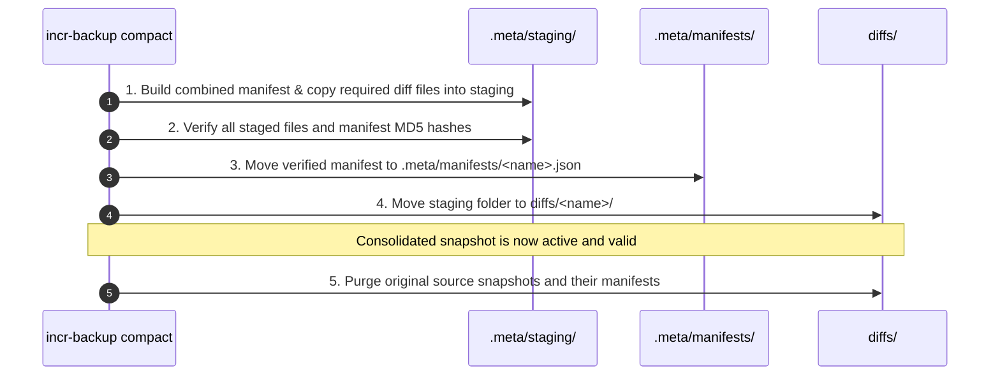

# Design Specification: Dynamic Snapshot Consolidation

## 1. Goal & Overview

The goal is **true, mathematically verifiable point-in-time recovery** with zero data loss, while allowing arbitrary snapshot frequencies and custom retention grouping.

### Core Principles
1. **Append-Only Syncs:** Every `sync` execution creates a discrete, immutable snapshot with its own timestamp. There are no in-place updates or overwrites.
2. **Explicit Consolidation via Cron/CLI:** A dedicated command combines multiple snapshots within a user-specified date range into a single named snapshot.
3. **Identical Snapshot Format:** A consolidated snapshot has the exact same directory and manifest format as a normal snapshot. This allows consolidated snapshots to be compacted again over wider date ranges (e.g., several hourly snapshots $\rightarrow$ a day snapshot; several day snapshots $\rightarrow$ a month snapshot).
4. **Zero-Data-Loss Safety:** Source snapshots are purged **only after** the consolidated snapshot has been fully created, verified, and committed.
5. **Individual Manifests:** Each snapshot maintains its own manifest file in `.meta/manifests/<name>.json` for scalability with 150k+ files (200GB+).

---

## 2. Reverse-Incremental Diff Mechanics: Concrete Walkthrough

To understand which files are kept, merged, or discarded during compaction, consider this real-world scenario spanning 3 days and 3 files:

### The Scenario: 3 Files Across 3 Days
* **`report.docx`**: Edited multiple times each day.
* **`budget.xlsx`**: Edited once on Day 2 morning, then never again.
* **`logo.png`**: Never modified throughout history.

```text
Day 1 (Oct 27): Baseline snapshot taken at 23:00 -> day-2026-10-27
Day 2 (Oct 28): Three runs taken:
                - 10:00 -> snap-10:00
                - 14:00 -> snap-14:00
                - 20:00 -> snap-20:00
Day 3 (Oct 29): One run taken at 12:00 -> snap-12:00
Now (Oct 29, 15:00): current/ mirror
```

### File Mutation History Table

| Timestamp | `report.docx` | `budget.xlsx` | `logo.png` | What rclone sync puts into `--backup-dir` |
| :--- | :--- | :--- | :--- | :--- |
| **Day 1, 23:00** (`day-2026-10-27`) | $V_A$ | $V_1$ | $V_L$ | Initial baseline |
| **Day 2, 10:00** (`snap-10:00`) | $V_A$ *(no change)* | Modified to $V_2$ | $V_L$ *(no change)* | `diffs/snap-10:00/` receives **`budget.xlsx` ($V_1$)** |
| **Day 2, 14:00** (`snap-14:00`) | Modified to $V_B$ | $V_2$ *(no change)* | $V_L$ *(no change)* | `diffs/snap-14:00/` receives **`report.docx` ($V_A$)** |
| **Day 2, 20:00** (`snap-20:00`) | Modified to $V_C$ | $V_2$ *(no change)* | $V_L$ *(no change)* | `diffs/snap-20:00/` receives **`report.docx` ($V_B$)** |
| **Day 3, 12:00** (`snap-12:00`) | Modified to $V_D$ | $V_2$ *(no change)* | $V_L$ *(no change)* | `diffs/snap-12:00/` receives **`report.docx` ($V_C$)** |
| **Now (Oct 29, 15:00)** | In `current/`: **$V_D$** | In `current/`: **$V_2$** | In `current/`: **$V_L$** | — |

---

## 3. What Happens During Compaction?

We run:
```bash
incr-backup compact \
    --from 2026-10-28T00:00:00+05:30 \
    --to 2026-10-28T23:59:59+05:30 \
    --name daily-2026-10-28
```

The snapshots in this range are: `snap-10:00`, `snap-14:00`, and `snap-20:00`.
The **newest snapshot in the range** is `snap-20:00`.

### Step 1: Manifest Selection
The consolidated snapshot `daily-2026-10-28` adopts the **manifest of `snap-20:00`**.
That manifest records the exact state at 20:00:
* `report.docx` = $V_C$ (MD5 of $V_C$)
* `budget.xlsx` = $V_2$ (MD5 of $V_2$)
* `logo.png` = $V_L$ (MD5 of $V_L$)

### Step 2: Evaluating Diff Files to Keep vs. Discard

Let's inspect every file currently sitting inside the 3 diff directories being combined:

1. **`diffs/snap-10:00/budget.xlsx` (contains $V_1$):**
   * *Who needs $V_1$?*
   * The Day 1 snapshot (`day-2026-10-27`) needs $V_1$! At Day 1, `budget.xlsx` was $V_1$.
   * If we delete $V_1$, Day 1 can never be restored!
   * **Verdict: KEEP.** Move $V_1$ into `diffs/daily-2026-10-28/budget.xlsx`.

2. **`diffs/snap-14:00/report.docx` (contains $V_A$):**
   * *Who needs $V_A$?*
   * The Day 1 snapshot (`day-2026-10-27`) needs $V_A$! At Day 1, `report.docx` was $V_A$.
   * **Verdict: KEEP.** Move $V_A$ into `diffs/daily-2026-10-28/report.docx`.

3. **`diffs/snap-20:00/report.docx` (contains $V_B$):**
   * *Who needs $V_B$?*
   * Does `snap-20:00` need $V_B$? No! At 20:00, `report.docx` is $V_C$.
   * Does `day-2026-10-27` need $V_B$? No! Day 1 needs $V_A$.
   * Does any surviving snapshot need $V_B$? No! $V_B$ was just an intermediate scratch edit between 14:00 and 20:00 on Day 2.
   * **Verdict: DISCARD.** Delete $V_B$ (space reclaimed).

### Summary of Compaction Action:
* **Created:** `diffs/daily-2026-10-28/` containing `report.docx` ($V_A$) and `budget.xlsx` ($V_1$).
* **Created:** `.meta/manifests/daily-2026-10-28.json` (cloned from `snap-20:00.json`).
* **Purged:** `diffs/snap-10:00`, `diffs/snap-14:00`, `diffs/snap-20:00`.

---

## 4. Point-in-Time Restore Demonstration

Let's demonstrate how `incr-backup restore` reconstructs the exact point-in-time state for each scenario after compaction.

### Remote Directory Layout After Compaction:
```text
current/
├── report.docx   (V_D)
├── budget.xlsx   (V_2)
└── logo.png      (V_L)

diffs/
├── snap-12:00/            (Day 3 snapshot)
│   └── report.docx        (V_C)
├── daily-2026-10-28/      (Compacted Day 2 snapshot, anchored at 20:00)
│   ├── report.docx        (V_A)
│   └── budget.xlsx        (V_1)
└── day-2026-10-27/        (Day 1 snapshot)
    └── (diffs from before Day 1)
```

---

### Scenario A: Restore `daily-2026-10-28` (Point in Time: Day 2, 20:00)

**Command:**
```bash
incr-backup restore daily-2026-10-28 --to /tmp/restore_day2 --verify
```

**Target Manifest (`daily-2026-10-28.json`):**
* `report.docx`: expects $V_C$
* `budget.xlsx`: expects $V_2$
* `logo.png`: expects $V_L$

**Location Resolution Algorithm:**
For each file in the target manifest, search diffs created **after** the target point in time up to `current/`:

1. **`report.docx` (expects $V_C$):**
   * Inspect diffs created after Day 2 20:00: `diffs/snap-12:00/`.
   * Found `diffs/snap-12:00/report.docx`!
   * Download from: **`diffs/snap-12:00/report.docx`** $\rightarrow$ yields **$V_C$** (MD5 matches!).
2. **`budget.xlsx` (expects $V_2$):**
   * Inspect diffs created after Day 2 20:00: `diffs/snap-12:00/`. Not present.
   * Fall back to `current/`.
   * Download from: **`current/budget.xlsx`** $\rightarrow$ yields **$V_2$** (MD5 matches!).
3. **`logo.png` (expects $V_L$):**
   * Inspect diffs created after Day 2 20:00: `diffs/snap-12:00/`. Not present.
   * Fall back to `current/`.
   * Download from: **`current/logo.png`** $\rightarrow$ yields **$V_L$** (MD5 matches!).

**Result:** Every file restored exactly matches the state at **Day 2, 20:00**.

---

### Scenario B: Restore `day-2026-10-27` (Point in Time: Day 1, 23:00)

**Command:**
```bash
incr-backup restore day-2026-10-27 --to /tmp/restore_day1 --verify
```

**Target Manifest (`day-2026-10-27.json`):**
* `report.docx`: expects $V_A$
* `budget.xlsx`: expects $V_1$
* `logo.png`: expects $V_L$

**Location Resolution Algorithm:**
Inspect all diffs created after Day 1: `diffs/snap-12:00/` and `diffs/daily-2026-10-28/`:

1. **`report.docx` (expects $V_A$):**
   * Search in `diffs/daily-2026-10-28/`: **Found!**
   * Download from: **`diffs/daily-2026-10-28/report.docx`** $\rightarrow$ yields **$V_A$** (MD5 matches!).
2. **`budget.xlsx` (expects $V_1$):**
   * Search in `diffs/daily-2026-10-28/`: **Found!**
   * Download from: **`diffs/daily-2026-10-28/budget.xlsx`** $\rightarrow$ yields **$V_1$** (MD5 matches!).
3. **`logo.png` (expects $V_L$):**
   * Not in `snap-12:00/` or `daily-2026-10-28/`.
   * Fall back to `current/`.
   * Download from: **`current/logo.png`** $\rightarrow$ yields **$V_L$** (MD5 matches!).

**Result:** Every file restored exactly matches the state at **Day 1, 23:00**.

---

## 5. Two-Phase Safe Compaction Protocol

To guarantee that a crash or network interruption never loses data, purging happens **strictly after** the new snapshot is fully committed:



If the process fails at any point before Step 5, the original snapshots remain 100% intact and untouched.

---

## 6. CLI Interface & Timestamp Format

### 6.1 Compaction Command & Timestamp Format
Timestamps for `--from` and `--to` require ISO-8601 strings with an explicit timezone offset matching the configured timezone (e.g., `+05:30` or `+0530`):

```bash
incr-backup compact \
    --from 2026-10-28T00:00:00+05:30 \
    --to 2026-10-28T23:59:59+05:30 \
    --name daily-2026-10-28
```

* **Validation Rule:** The CLI parses the offset from `--from` and `--to` and validates that it matches the `timezone` setting in `incr-backup.toml`. If there is a mismatch (e.g. UTC passed when config is `local` / `+05:30`), it aborts with:
  `Error: Timezone offset in --from (+00:00) does not match configured backup timezone (+05:30).`

### 6.2 Dry-Run Visibility
Both summary and detailed modes are supported:

```bash
# High-level summary of changes:
incr-backup compact --from <START> --to <END> --name <NAME> --dry-run --summary

# Detailed file-by-file plan:
incr-backup compact --from <START> --to <END> --name <NAME> --dry-run --full-list
```

---

## 7. Uniform Format (Recursive Compaction)

A consolidated snapshot is identical in structure to an original snapshot:

```text
remote:backups/myhost/
├── current/                                 <- Latest mirror
├── diffs/
│   ├── 2026-10-29T10-00-00+0530/            <- Regular snapshot
│   ├── daily-2026-10-28/                    <- Compacted from Day 2 runs
│   ├── weekly-2026-W43/                     <- Compacted from 7 dailies
│   └── monthly-2026-10/                     <- Compacted from 4 weeklies
└── .meta/
    └── manifests/
        ├── 2026-10-29T10-00-00+0530.json
        ├── daily-2026-10-28.json
        ├── weekly-2026-W43.json
        └── monthly-2026-10.json
```

Because the format is uniform:
1. `incr-backup restore <snapshot-name>` uses the exact same location resolution algorithm regardless of whether a snapshot is raw or compacted.
2. A user can run cron scripts to compact hourlies into a daily, and later compact those dailies into a monthly.

---

## 8. Specific Architectural Clarifications & Invariants

### 8.1 Does Compaction Need the Preceding Snapshot ($S_{\text{prev}}$)?
* **When older snapshots exist:** **Yes.** To know which files in the diffs are needed by pre-range history vs. intra-range churn, the compactor reads the manifest of the single snapshot immediately preceding the range ($S_{\text{prev}}$).
* **When compacting from the beginning of history (the very first snapshot):** **No.** If there are no snapshots prior to the range, **compaction CAN be done**. In fact, it is simpler: because no older snapshots exist, zero diffs are needed by older history. All intra-range diffs are safe to discard!
* **Does compaction need any snapshot AFTER the range end date?** **No, never.** Snapshots created after the range end date represent future states and have no bearing on intra-range history.

### 8.2 Does Restore Need Snapshots Before or After the Target Timestamp?
* **Snapshots after the target:** **Yes.** In reverse-incremental architecture, restore starts at `current/` and searches backward through all diffs created **after** the target point in time.
* **Snapshots before the target:** **No, never.** Snapshots created before the target timestamp represent the past relative to the target and are completely unneeded for reconstructing the target state.

### 8.3 Does Global File/Directory Deletion (`incr-backup remove`) Still Work?
* **Yes, 100% seamlessly.**
* **Advisory Cloud Locking:** Before scanning or modifying any files, `incr-backup remove` acquires an exclusive advisory lock via `LockManager` (`lock.rs`). It holds this lock throughout manifest rewriting and physical file deletion, releasing it upon completion or failure. This guarantees that `remove`, `compact`, and `sync` are strictly mutually exclusive and can never race or corrupt metadata.
* `incr-backup remove` (used for GDPR/compliance or sensitive data eradication) works by:
  1. Acquiring the remote cloud advisory lock (`lock.rs`).
  2. Inspecting every manifest in `.meta/manifests/*.json` and rewriting them to drop the target paths.
  3. Executing `rclone delete` across `current/` and all `diffs/*/` directories.
  4. Releasing the remote lock.
* Because compacted snapshots use the exact same directory layout and individual JSON manifests, `remove` treats them identically. Furthermore, compaction makes `remove` faster because there are fewer total diff directories and manifest files to traverse.

### 8.4 Snapshot Naming and Timestamp Resolution
* **Supported Naming Schemes:** Both automatic timestamp-based names (UTC `...Z` or local offset `...+0530`, filesystem-safe without colons `:`) and custom names via `--name <NAME>` (e.g. `pre-deploy`, `release-1.0`) are supported.
* **Manifest Metadata as Source of Truth:** The backup engine never relies on parsing snapshot directory names to infer time. Every snapshot's manifest (`.meta/manifests/<name>.json`) explicitly stores the creation time in UTC under `created_at`.
* **Consolidated Snapshot Timestamp:** The consolidated snapshot's manifest inherits the exact `created_at` timestamp of the anchor snapshot (the newest snapshot within the compacted range).
* **Chronological Invariant:** Range filtering (`compact --from ... --to ...`), restore location resolution (scanning snapshots after target), and list sorting strictly sort by `manifest.created_at`.

---

## 9. Corner Cases, Failure Modes & Mitigations

### 9.1 File Lifecycle Corner Cases

| Corner Case | Description & Risk | Architectural Mitigation |
| :--- | :--- | :--- |
| **File Created and Deleted Intra-Range** | A file is created at 10:30, captured in an 11:00 sync (`current/`), then deleted at 13:00, causing the 14:00 sync to move it to `diffs/snap-14:00`. If kept, it leaks storage; Day 1 never had it, and Day 2 anchor (20:00) doesn't have it. | Compare against $S_{\text{prev}}$. If a file was not in $S_{\text{prev}}$ AND is not in the anchor ($S_{\text{newest}}$), it was created and deleted inside this window $\rightarrow$ **purge it completely**. |
| **Circular / Reverted Edits ($A \rightarrow B \rightarrow A$)** | File modified to $B$ at 11:00, then reverted back to $A$ at 17:00. Diffs contain both $A$ and $B$. Restoring Day 1 must get $A$, not $B$. | Strict "Earliest-Diff" rule: for any file modified in the range, only the earliest diff version is kept (which captures the state prior to that day's edits). Later intra-day revisions are dropped. |
| **File Renamed / Path Changed** | File renamed from `old.txt` to `new.txt`. Rclone sees delete + add, moving `old.txt` into diffs. | Handled naturally. Manifests store exact relative paths and hashes. `old.txt` stays in the diff for pre-rename snapshots; `new.txt` is tracked in subsequent manifests and `current/`. |
| **Empty Diff Directories** | A backup runs when no files were changed (0 bytes diff). | Both compactor and restore engine treat missing or empty diff directories as valid zero-diff states without errors. |

### 9.2 Compaction Range & Boundary Corner Cases

| Corner Case | Description & Risk | Architectural Mitigation |
| :--- | :--- | :--- |
| **Partial / Overlapping Ranges** | User runs `compact` on [10:00–16:00], then attempts [14:00–20:00]. The raw snapshots at 14:00 were already consumed. | **Atomic Interval Rule:** Compacted snapshots are atomic units. The compactor verifies that all snapshots matching the range are wholly contained. Partial overlaps error out with a clear boundary message. |
| **Zero Snapshots in Range** | User specifies a time window where no backups ran. | Gracefully exits with error: `No snapshots found in range [from, to]`. Exit code 1. Zero changes made. |
| **Single Snapshot in Range** | User specifies a range containing only 1 snapshot. | Treated as a simple rename/alias to `--name`. No file consolidation needed. |
| **Timezone & Offset Mismatch** | `--from` supplied in UTC (`Z`), while backup config is set to `local` (`+05:30`). | Explicit validation: `--from` and `--to` must supply an explicit timezone offset matching the configured timezone. |

### 9.3 Cloud Remote & Concurrency Failures

| Failure Mode | Description & Risk | Architectural Mitigation |
| :--- | :--- | :--- |
| **API Rate Limits (403 RateLimitExceeded)** | Moving thousands of files server-side on Google Drive triggers per-second request limits. | 1. Limit concurrency during compaction (`--tpslimit 8`, `--transfers 4`).<br>2. Compaction runs as an asynchronous cron maintenance job, never blocking the fast sync path. |
| **Network Interruption / Process Kill** | Compactor killed midway through moving diff files. | **Two-Phase Staging Protocol:** Files are copied into `.meta/staging/<name>/`. Only after verification are they committed to `diffs/<name>/` and source snapshots purged. |
| **Concurrent `sync` and `compact`** | A scheduled `sync` writes to `current/` and `diffs/` while `compact` is analyzing dependencies. | **Mandatory Remote Advisory Lock:** `compact` acquires the cloud lock via `LockManager` (`lock.rs`). Any concurrent `sync` will respect the lock and wait or defer. |
| **Concurrent `restore` and `compact`** | A user restores a snapshot while its underlying diff is being compacted. | `restore` checks for active compaction locks and pauses or alerts the user before reading diff directories. |
