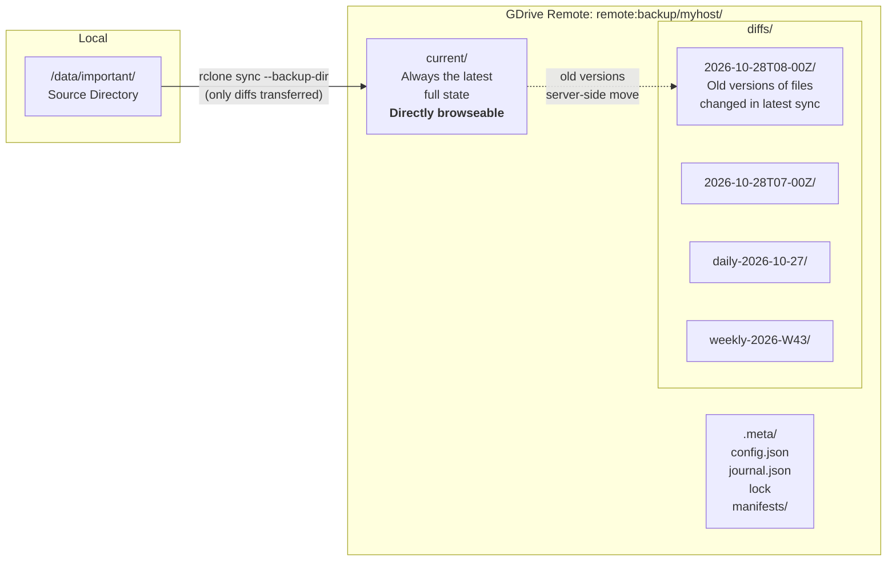
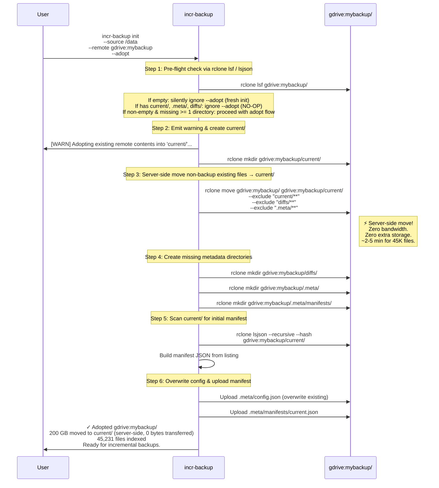
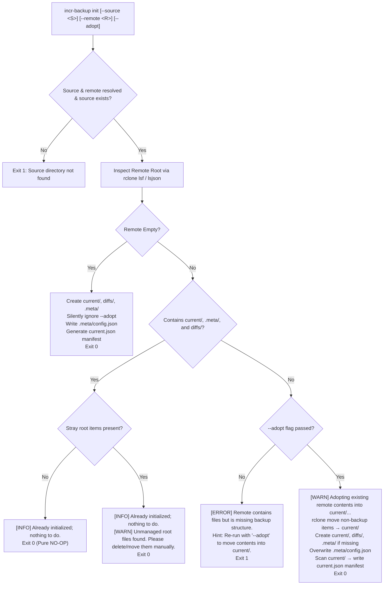

# incr-backup — Implementation Plan (Dynamic Snapshot Consolidation)

> Reverse-incremental snapshot backup for rclone cloud remotes (Google Drive, S3, etc.)
> 
> *Architecture updated: All tier rotations, slot limits, and in-place updates have been replaced by append-only discrete snapshots and dynamic snapshot consolidation (`compact`). See [DESIGN_SNAPSHOT_CONSOLIDATION.md](DESIGN_SNAPSHOT_CONSOLIDATION.md).*

---

## Table of Contents

1. [Architecture Overview](#architecture-overview)
2. [Space Calculation — Worked Example](#space-calculation--worked-example)
3. [Adopt Existing Remote (`init --adopt`)](#adopt-existing-remote-init---adopt)
4. [Deduplication Guarantee](#deduplication-guarantee)
5. [Snapshot Semantics — Discrete Append-Only Snapshots (`sync`)](#snapshot-semantics--discrete-append-only-snapshots-sync)
6. [Dynamic Snapshot Consolidation (`compact`)](#dynamic-snapshot-consolidation-compact)
7. [Resumability — Surviving Interruptions](#resumability--surviving-interruptions)
8. [Restore Algorithm](#restore-algorithm)
9. [Diff Between Snapshots](#diff-between-snapshots)
10. [Verify Command — What Gets Checked](#verify-command--what-gets-checked)
11. [CLI Reference](#cli-reference)
    - [Rclone Flags Integration & Safety Analysis for sync](#rclone-flags-integration--safety-analysis-for-sync)
12. [Remote Directory Layout](#remote-directory-layout)
13. [Rust vs Python — Revised Analysis](#rust-vs-python--revised-analysis)
14. [Rust Code Documentation Guidelines](#rust-code-documentation-guidelines)
15. [Rust Module Design](#rust-module-design)
16. [Multiple Sources on Same Remote](#multiple-sources-on-same-remote)
17. [Implementation Phases — AI Coding Agent Timeline](#implementation-phases--ai-coding-agent-timeline)
18. [Cron Setup](#cron-setup)
19. [Test Cases (112 Cases)](#test-cases-112-cases)
20. [Comment Audit — All Items Addressed](#comment-audit--all-items-addressed)

---

## Architecture Overview



**How it works:**

1. `current/` on the remote is always an exact mirror of the source — directly browseable on Google Drive.
2. When a sync runs, `rclone sync --backup-dir` uploads only changed files to `current/` and **server-side moves** (zero bandwidth) old versions from `current/` to a timestamped `diffs/` subdirectory.
3. Files deleted from source are also moved to `diffs/` (preserved, not lost).
4. A JSON manifest records the complete file listing at each snapshot point.
5. Every `sync` is append-only, creating an independent, immutable snapshot. Dynamic snapshot consolidation (`compact`) periodically consolidates intermediate snapshots without data loss.

---

## Space Calculation — Worked Example

> [!IMPORTANT]
> Each diff directory contains the old versions of files changed/deleted in **one sync operation** (typically one hour of changes). It does NOT contain cumulative changes over a day/week/month. When a daily snapshot is "created," it's just an hourly diff directory that was **renamed** (promoted) — its size doesn't change.

### Assumptions

| Parameter | Value |
|---|---|
| Source size | 200 GB |
| Total files | ~45,000 |
| Daily churn rate | ~2% of total size = ~4 GB/day |
| Working hours (when changes happen) | 8 hours/day |
| Hourly churn during work | 4 GB ÷ 8 hours = **~0.5 GB/hour** |

### Step-by-step Breakdown

**Q: How many diff directories exist after taking hourly syncs?**

Each sync creates an append-only snapshot with its own diff directory. If you run 24 hourly syncs in a day, 24 diff directories are created in `diffs/`.

**Q: How is space reclaimed without slot limits or rotation?**

Via **Dynamic Snapshot Consolidation (`compact`)**:
Running `compact --from yesterday_start --to yesterday_end --name daily-YYYY-MM-DD` consolidates intermediate hourly snapshots into a single daily snapshot. Intermediate scratch versions of files that were overwritten multiple times throughout the day are discarded, while files needed to reconstruct any point in time are safely preserved according to the earliest diff rule.

### Space Usage Example (200 GB Source)

| Component | Description | Size |
|---|---|---|
| `current/` | Full mirror of source | 200.0 GB |
| 7 consolidated daily diffs | 7 days × ~4 GB/day net churn | ~28.0 GB |
| Today's hourly diffs (uncompacted) | 8 working hours × 0.5 GB | ~4.0 GB |
| `.meta/` manifests | JSON manifests (~1 MB each) | ~30 MB |
| **Total** | | **~232.0 GB** |

### Formula

$$
\text{Total} = S_{\text{source}} + \sum \text{Size}(D_{\text{snapshots}})
$$

Where:
- $S_{\text{source}}$ = current source size (200 GB)
- $D_{\text{snapshots}}$ = individual diff directories created by `sync` and consolidated by `compact`

### Comparison

| Approach | Space Used | Ratio |
|---|---|---|
| **incr-backup (this tool)** | ~211 GB | **1.06×** source |
| rsnapshot with hard links (local) | ~211 GB | 1.06× (same efficiency) |
| Naive full copies (23 snapshots) | 4,600 GB | 23× source |

---

## Adopt Existing Remote (`init --adopt`)

> **User's situation:** 200 GB of files are already `rclone sync`'ed to a GDrive directory at root level (e.g., `gdrive:mybackup/file1.txt`).

### Can we `rclone move` to `current/`? → **Yes**

`rclone move` on Google Drive is a **server-side metadata operation** — it changes each file's parent folder ID without re-uploading any data. For 200 GB / 45,000 files:

| Metric | Value |
|---|---|
| Bandwidth used | **0 bytes** (server-side) |
| Extra storage used | **0 bytes** (moved, not copied) |
| Time | **~2-5 minutes** (only API calls) |

### `init --adopt` Flow



### Why move to `current/` instead of treating root as current/?

| Approach | Browse on GDrive | Clean? | Problem |
|---|---|---|---|
| Root as current/ | `.meta/` and `diffs/` mixed in with user files | ✗ | Confusing; risk of user accidentally deleting `.meta/` |
| **Move to `current/`** | **Only user files visible in `current/`** | **✓** | **Clean separation** |

### What if adopt is interrupted?

The journal tracks this step. Re-running `incr-backup init --adopt` detects that required directories or metadata are incomplete (missing full triad), emits the adopt warning, re-runs the idempotent `rclone move` (skipping already-moved files), creates any missing directories, overwrites `.meta/config.json`, and finishes initial manifest indexing.

---

### Remote State Scenarios & Init/Adopt Decision Matrix

Behavior of `incr-backup init [--source <path>] [--remote <remote>] [--adopt]` (source and remote may be specified via CLI flags, environment variables, or `incr-backup.toml` configuration):

| Scenario | Remote Contents / State | Flag Passed | Expected Action | Exit Code | Message / Output |
|---|---|:---:|---|:---:|---|
| **1. Empty Remote** | Remote directory does not exist or has 0 entries | *any* (silently ignore `--adopt`) | Fresh setup: create `current/`, `diffs/`, `.meta/`, `.meta/manifests/`, upload `config.json` & initial `current.json`. | **0** | `✓ Initialized empty backup at <remote>` (silently ignore `--adopt`, no adopt message printed). |
| **2a. Clean Initialized Remote** | Contains `current/`, `.meta/`, and `diffs/` directories; **no stray entries** at root | *any* (ignore `--adopt`) | **Pure NO-OP**: zero writes to remote, metadata is untouched. | **0** | `[INFO] Remote already initialized at <remote>; nothing to do.` |
| **2b. Initialized Remote with Stray Files** | Contains `current/`, `.meta/`, `diffs/` directories **AND unmanaged files/dirs** at root | *any* (ignore `--adopt`) | **NO-OP with Warning**: zero writes to remote. Warn user to clean up root. | **0** | `[INFO] Remote already initialized at <remote>; nothing to do.`<br>`[WARN] Unmanaged root files/directories detected in '<remote>' (<stray-items>). Please manually delete or move them out.` |
| **3. Non-Empty, Missing Structure (No Adopt)** | Remote contains files/dirs but lacks at least one of `current/`, `.meta/`, `diffs/` | **Without `--adopt`** | **Reject & Halt**: prevent accidental corruption or stranded files at root. Prompt user to adopt. | **Non-zero (1)** | `[ERROR] Remote '<remote>' contains existing files but is not an initialized backup namespace (missing required directories).`<br>`Hint: To adopt existing files into 'current/', re-run with '--adopt'.` |
| **4. Non-Empty, Adopt Requested** | Remote contains files/dirs but lacks at least one of `current/`, `.meta/`, `diffs/` | **With `--adopt`** | **Adopt**: show warning notice, server-side move all non-backup root contents into `current/` (excluding `current/**`, `diffs/**`, `.meta/**`), create missing directories, **overwrite `.meta/config.json`**, scan `current/`, and upload initial manifest. | **0** | `[WARN] Adopting existing remote contents into 'current/'...`<br>`✓ Adopted N files into current/`<br>`✓ Initialized <remote>` |

#### Detailed Step-by-Step Logic for `incr-backup init`



#### Comparison vs Current Implementation (`src/main.rs`)
- **Empty Remote**: Currently does not check remote emptiness; if `--adopt` is passed on empty remote, it runs `rclone move_dir` and prints adopt messages instead of silently ignoring `--adopt`.
- **Initialized Remote**: Currently returns `Err(IncrError::AlreadyInitialized)` (exit code 1) instead of a successful NO-OP (exit code 0). Currently checks only `cat .meta/config.json` rather than the `current/`, `.meta/`, `diffs/` directory triad. Does not detect or warn about stray root entries.
- **Missing Structure Without `--adopt`**: Currently does not check if remote is empty; silently proceeds, creating `current/` and `.meta/` while leaving existing files stranded at remote root without suggesting `--adopt`.
- **Adopt Requested**: Currently performs `rclone move_dir` excluding `current/**`, `diffs/**`, `.meta/**`, but lacks pre-flight structure inspection, warning messaging, and explicit overwrite semantics.

---

## Deduplication Guarantee

**Yes, deduplication is guaranteed.** Every file version exists in exactly **one** location on the remote.

### Proof

`rclone sync --backup-dir` maintains this invariant:

1. For any file path `P`, it exists in exactly **one** of:
   - `current/P` (the latest version), OR
   - `diffs/<some-snapshot>/P` (an older version)

2. `--backup-dir` performs a **server-side MOVE**, not a copy. The old file is removed from `current/` and placed in `diffs/`. Zero duplication.

3. Files that never change remain in `current/` indefinitely — only one copy ever.

### Edge Case: Content Returns (A → B → A)

If `report.pdf` changes from content A → B → A:

```
After t0: current/report.pdf = A
After t1: current/report.pdf = B,  diffs/hourly.0/report.pdf = A  
After t2: current/report.pdf = A,  diffs/hourly.0/report.pdf = B,  diffs/hourly.1/report.pdf = A
```

Content A exists in two places — but they represent different timeline points (t0 and t2). This is **correct behavior**, not duplication. True content-addressable dedup would require a `.store/` architecture that breaks the simple `rclone sync --backup-dir` model.

---

## Snapshot Semantics — Discrete Append-Only Snapshots (`sync`)

> [!IMPORTANT]
> Every `sync` execution is **append-only**. It creates an independent, immutable snapshot directory (`diffs/<snapshot_name>`) and manifests without slot limits, rotation cascades, or in-place overwrites. Compaction and pruning are decoupled and handled cleanly by `compact`.

### How Discrete Snapshots Work

1. **Independent Timestamped Snapshots**:
   - By default, each sync formats a snapshot name using filesystem-safe ISO-8601 timestamps:
     - UTC: `2026-10-28T08-00Z`
     - Local: `2026-10-28T13-30+0530`
   - Alternatively, a custom name can be provided via `--name <custom-name>`.
2. **Reverse-Incremental Diff Capture**:
   - `rclone sync source current/ --backup-dir diffs/<snapshot_name>` uploads new/modified files to `current/` and moves pre-modification versions to `diffs/<snapshot_name>/`.
   - Files deleted from the source are preserved in `diffs/<snapshot_name>/`.
3. **Dedicated Manifest**:
   - A complete manifest is uploaded to `.meta/manifests/<snapshot_name>.json` and `.meta/manifests/current.json`.

---

## Dynamic Snapshot Consolidation (`compact`)

Rather than relying on rigid hourly/daily/weekly slots that cause rotation overflow or premature data loss, `incr-backup` uses **Dynamic Snapshot Consolidation**:

1. **Arbitrary Frequency Backups**: Run `sync` as often as desired (every 10 minutes, hourly, or before risky operations).
2. **Periodic Consolidation**: Run `compact --from <start> --to <end> --name <consolidated_name>` (e.g. nightly via cron).
3. **Reverse-Incremental Dependency Resolution**:
   - When consolidating snapshots in a range, intermediate scratch revisions within the range are safely reclaimed.
   - Files that must be retained for older snapshots outside the range are preserved in accordance with the earliest diff rule.
4. **Two-Phase Safe Commit**:
   - Phase 1: Consolidated diffs staged to `.meta/staging/<name>/` and manifest uploaded.
   - Phase 2: Verified, moved to `diffs/<name>/`, and source snapshots safely purged. Zero data loss.

---

## Resumability — Surviving Interruptions

> [!IMPORTANT]
> **Every sync operation is designed to survive crashes and network failures.** A write-ahead journal tracks progress; re-running the tool resumes from the last completed step.

### Journal File (`.meta/journal.json`)

```json
{
  "operation": "sync",
  "level": "hourly",
  "started_at": "2026-10-28T08:00:00+05:30",
  "backup_dir": "diffs/hourly.0__2026-10-28T08-00",
  "steps": [
    { "name": "acquire_lock",      "status": "done" },
    { "name": "rclone_sync",       "status": "running" },
    { "name": "generate_manifest", "status": "pending" },
    { "name": "upload_manifest",   "status": "pending" },
    { "name": "cleanup_journal",   "status": "pending" },
    { "name": "release_lock",      "status": "pending" }
  ]
}
```

### Interruption → Recovery Matrix

| Interrupted During | What's Broken | Recovery on Re-run |
|---|---|---|
| **Lock acquisition** | Nothing changed | Retry from start |
| **`rclone sync`** | Partial upload to current/, partial moves to backup-dir | **Re-run same `rclone sync --backup-dir` command** — rclone is idempotent (see below) |
| **Manifest generation** | Sync done, no manifest | Re-scan remote with `rclone lsjson --recursive --hash` |
| **Manifest upload** | Manifest generated locally, not on remote | Re-upload |
| **Journal cleanup** | Everything done, journal still exists | Detect all steps = done → delete journal |

### Why `rclone sync` is Safe to Re-run

`rclone sync source dest --backup-dir bak/` is idempotent after interruption:

| File State After Crash | On Re-run |
|---|---|
| Already uploaded correctly | Skipped (hash matches) |
| Partially uploaded | Re-uploaded (hash mismatch detected) |
| Old version already moved to backup-dir | New version uploaded to current/ (old not re-moved) |
| Old version NOT yet moved | Moved to backup-dir, new version uploaded |

### Lock Management

```json
{
  "holder": "laptop.local",
  "pid": 12345,
  "started_at": "2026-10-28T08:00:00+05:30",
  "timeout_minutes": 60
}
```

| Scenario | Behavior |
|---|---|
| Lock exists, age < timeout | **Refuse.** "Another backup running. Use --force to override." |
| Lock exists, age > timeout | **Warn and break.** "Stale lock (2h old). Breaking and resuming." |
| `--force` flag | Break lock unconditionally |

---

## Restore Algorithm

### Location Resolution

To restore snapshot `snap_A` (state from an earlier point in time):

```
Timeline:  snap_A  ←  snap_B  ←  snap_C  ←  current
           (target)                         (newest)
```

For each file in `snap_A`'s manifest, find where that version lives now:

```
Search order (first match wins):
  1. diffs/snap_C/F    ← check diffs created chronologically after target
  2. diffs/snap_B/F
  3. current/F         ← file unchanged since snap_A
```

**Why this order?** When file X changed at `snap_C` sync, the pre-`snap_C` version was moved from `current/` to `diffs/snap_C/`. If X was also changed at `snap_B` sync, the pre-`snap_B` version (= the `snap_A`-era version) is in `diffs/snap_B/`. So we search diff directories created chronologically after the target snapshot until we find X.

### Execution

```rust
/// Resolve where each file lives on the remote for a given snapshot.
///
/// Similar to Java's Stream.filter().findFirst() pattern:
/// walk through diff directories from newest-to-oldest after the
/// target snapshot, find the first one containing the file.
fn resolve_locations(
    target_manifest: &Manifest,
    snapshots_after_target: &[SnapshotInfo],  // ordered: closest-first
) -> Vec<ResolveEntry> {
    target_manifest.files.iter().map(|file| {
        // Check each diff directory after the target
        for snap in snapshots_after_target {
            if snap.diff_manifest.has_file(&file.path) {
                return ResolveEntry {
                    file: file.clone(),
                    remote_path: format!("diffs/{}/{}", snap.dir_name, file.path),
                };
            }
        }
        // Not in any diff → unchanged, still in current/
        ResolveEntry {
            file: file.clone(),
            remote_path: format!("current/{}", file.path),
        }
    }).collect()
}
```

The tool then groups files by source directory and runs targeted `rclone copy --files-from` commands.

### Restoring `current` (Latest)

No tool needed — direct rclone works:

```bash
rclone sync remote:backup/myhost/current/ /local/restore/
```

---

## Diff Between Snapshots

```bash
$ incr-backup diff hourly.0 daily.0

Comparing: hourly.0 (2026-10-27T22:00) ↔ daily.0 (2026-10-27T02:00)

Added (in hourly.0, not in daily.0):
  + documents/quarterly-report.pdf           2.4 MB
  + code/new-feature.rs                     12.3 KB

Deleted (in daily.0, not in hourly.0):
  - photos/temp-screenshot.png             840.0 KB

Modified (same path, different content):
  ~ documents/report.pdf        1.0 MB → 1.3 MB   md5: a1b2c3 → d4e5f6
  ~ code/main.rs                4.2 KB → 4.8 KB   md5: 789abc → def012

Summary: 2 added, 1 deleted, 2 modified
         New data: 2.41 MB | Removed: 840 KB | Changed: 2.1 MB
```

### Implementation

Pure manifest comparison — **no network I/O** after manifests are cached:

```rust
/// Compare two manifests, like a "git diff --stat" between snapshots.
///
/// Algorithm (similar to Python dict comparison):
///   map_a = {path: entry for entry in manifest_a}
///   map_b = {path: entry for entry in manifest_b}
///   added    = keys in map_a but not map_b
///   deleted  = keys in map_b but not map_a
///   modified = keys in both where md5 differs
fn diff_manifests(a: &Manifest, b: &Manifest) -> DiffResult {
    let map_a: HashMap<&str, &FileEntry> = a.files.iter()
        .map(|f| (f.path.as_str(), f)).collect();
    let map_b: HashMap<&str, &FileEntry> = b.files.iter()
        .map(|f| (f.path.as_str(), f)).collect();

    let mut result = DiffResult::default();
    for (path, entry_a) in &map_a {
        match map_b.get(path) {
            None => result.added.push((*entry_a).clone()),
            Some(entry_b) if entry_a.md5 != entry_b.md5 =>
                result.modified.push(((*entry_a).clone(), (*entry_b).clone())),
            _ => result.unchanged += 1,
        }
    }
    for (path, entry_b) in &map_b {
        if !map_a.contains_key(path) {
            result.deleted.push((*entry_b).clone());
        }
    }
    result
}
```

### Flags

| Flag | Effect |
|---|---|
| `--json` | Machine-readable JSON output |
| `--only-added` | Show only files added |
| `--only-deleted` | Show only files deleted |
| `--only-modified` | Show only files with content changes |
| `--stat` | Summary counts/sizes only |

---

## Verify Command — What Gets Checked

`incr-backup verify [SNAPSHOT]` validates backup integrity at three levels:

### All Checks

| # | Check | What It Verifies | Method | Speed |
|---|---|---|---|---|
| 1 | **Config exists** | `.meta/config.json` present and valid JSON | `rclone cat` + parse | Quick |
| 2 | **Manifest exists** | Every retained snapshot has a manifest in `.meta/manifests/` | `rclone lsf .meta/manifests/` | Quick |
| 3 | **Manifest parseable** | Every manifest is valid JSON with required fields (`path`, `size`, `md5`, `mtime`) | Download + deserialize | Quick |
| 4 | **File count match** | Number of files in `current/` matches manifest entry count | `rclone size current/` vs manifest | Quick |
| 5 | **Total size match** | Total size of `current/` matches manifest total | `rclone size` vs manifest | Quick |
| 6 | **Snapshot ordering** | Timestamps are monotonically decreasing (hourly.0 is newest) | Compare manifest timestamps | Quick |
| 7 | **Retention compliance** | Snapshot count doesn't exceed configured retention per tier | Count vs config | Quick |
| 8 | **Lock state** | No stale locks present | Check `.meta/lock` existence and age | Quick |
| 9 | **Diff directory existence** | Every manifest references a diff dir that actually exists | `rclone lsd diffs/` vs manifest list | Quick |
| 10 | **Remote hash check** | MD5 of each file on remote matches manifest | `rclone lsjson --hash` vs manifest | Medium |
| 11 | **Cross-snapshot consistency** | Files referenced by older manifests still exist (in diffs or current) | Location resolution check | Medium |
| 12 | **Deep verify** | Download files, re-hash locally, compare against manifest | `rclone copy` + local `md5sum` | Slow |

### Usage

```bash
incr-backup verify              # Quick checks only (1-9)
incr-backup verify --check-hashes   # + remote hash verification (10-11)
incr-backup verify --deep          # + download and re-hash (12)
incr-backup verify hourly.2       # Verify specific snapshot only
incr-backup verify --space         # Include space usage report
```

### Output Example

```
$ incr-backup verify --check-hashes

Verifying backup at gdrive:backup/myhost/

  ✓ Config valid                           (.meta/config.json)
  ✓ No stale lock
  ✓ Manifest: current                      (45,231 files, 200.0 GB)
  ✓ Manifest: hourly.0                     (12 changed files, 3.2 MB)
  ✓ Manifest: hourly.1                     (5 changed files, 800 KB)
  ✓ Manifest: daily.0                      (142 changed files, 45.6 MB)
  ✓ Remote hashes match manifest           (45,231 files verified)
  ✓ Snapshot ordering valid
  ✓ Retention within limits

Space usage:
  current/     200.0 GB    (45,231 files)
  diffs/        18.4 GB    (5,260 files across 6 snapshots)
  .meta/        12.8 MB    (7 manifests)
  ─────────────────────────
  Total:       218.4 GB

All checks passed. ✓
```

---

## CLI Reference

### Global Options

```
GLOBAL OPTIONS (apply to all commands):
    -c, --config <PATH>       Config file path
                              [default: ./incr-backup.toml]
                              [env: INCR_BACKUP_CONFIG]

    -s, --source <PATH>       Override source directory
                              [env: INCR_BACKUP_SOURCE]

    -r, --remote <REMOTE>     Override rclone remote path
                              [env: INCR_BACKUP_REMOTE]

    -v, --verbose             Increase verbosity (-v, -vv, -vvv)
                              [env: INCR_BACKUP_LOG_LEVEL]

    -n, --dry-run             Show what would happen without making changes

        --rclone-path <PATH>  Path to rclone binary
                              [default: rclone]
                              [env: INCR_BACKUP_RCLONE_PATH]

        --rclone-flags <FLAGS>  Extra flags passed to every rclone call
                                [env: INCR_BACKUP_RCLONE_FLAGS]
```

### Commands

```
incr-backup init
    --source <PATH>           Local source directory (optional if provided in config)
    --remote <REMOTE>         rclone remote path (optional if provided in config)
    --adopt                   Adopt existing rclone-synced directory
                              (moves files server-side into current/, zero bandwidth)
    --exclude <PATTERN>       Exclude pattern (repeatable)

incr-backup sync
    --name <NAME>             Custom snapshot name (optional; defaults to ISO timestamp)
    --force                   Break stale lock and run
    --dry-run                 Preview what will be synced

incr-backup compact
    --from <ISO-8601>         Start of date range (inclusive, required)
    --to <ISO-8601>           End of date range (inclusive, required)
    --name <NAME>             Name of the consolidated snapshot (required)
    --dry-run                 Preview what will be compacted without modifying remote
    --summary                 Summary-only output in dry-run mode
    --full-list               Full file listing output in dry-run mode
    --force                   Break stale lock if present

incr-backup list
    --json                    JSON output

incr-backup status

incr-backup restore <SNAPSHOT>
    --to <PATH>               Local destination (required)
    --path <SUBPATH>          Restore only a file or subdirectory
    --verify                  Checksum-verify after restore
    --overwrite               Allow restoring to non-empty directory

incr-backup diff <SNAPSHOT_A> <SNAPSHOT_B>
    --json / --only-added / --only-deleted / --only-modified / --stat

incr-backup verify [SNAPSHOT]
    --check-hashes            Verify remote file hashes (medium)
    --deep                    Download and re-hash (slow)
    --space                   Include space usage report

incr-backup remove <PATH>...  (alias: rm)
    --path <PATH>             Specific path to remove (repeatable)
    --force                   Break stale lock and run
    --json                    Output result as JSON

incr-backup config <push|pull|diff>
    push [--force]            Push local configuration to remote metadata (.meta/config.json)
    pull [--to <PATH>] [--overwrite]
                              Pull remote metadata into local configuration file
    diff                      Compare local configuration vs remote metadata
```

### Configuration Synchronization & Safety

1. Edit local `incr-backup.toml` (template at `config/incr-backup-example.toml`).
2. Run `incr-backup config diff` to review differences.
3. Run `incr-backup config push` to update `.meta/config.json` on the remote under lock.
4. Run `incr-backup config pull --to <PATH>` to pull remote metadata into a local TOML file.

### Rclone Flags Integration & Safety Analysis for `sync`

#### Invocation Mechanism: Direct Flags vs. `extra_flags`
Command-line arguments for `incr-backup` are parsed via `clap`. Raw rclone flags cannot be supplied directly as positional or direct options to `incr-backup sync` (e.g., executing `incr-backup sync --delete-excluded` is rejected by the CLI parser).

Instead, custom rclone flags are forwarded to all underlying `rclone` subprocess calls via any of three mechanisms:
1. **Global CLI Option (`--rclone-flags`)**:
   ```bash
   incr-backup --rclone-flags "--delete-excluded --delete-before --exclude-from /path/to/EXCLUDE_FILE.txt --transfers 16 --checkers 32 --no-update-dir-modtime --drive-chunk-size 64M --fast-list --links" sync
   ```
2. **Configuration File (`incr-backup.toml`)**:
   ```toml
   [rclone]
   path = "rclone"
   extra_flags = "--delete-excluded --delete-before --exclude-from /path/to/EXCLUDE_FILE.txt --transfers 16 --checkers 32 --no-update-dir-modtime --drive-chunk-size 64M --fast-list --links"
   ```
3. **Environment Variable (`INCR_BACKUP_RCLONE_FLAGS`)**:
   ```bash
   export INCR_BACKUP_RCLONE_FLAGS="--delete-excluded --delete-before --exclude-from /path/to/EXCLUDE_FILE.txt --transfers 16 --checkers 32 --no-update-dir-modtime --drive-chunk-size 64M --fast-list --links"
   incr-backup sync
   ```

#### Directory Isolation: Why `.meta/` and `diffs/` Are NOT Deleted
A primary concern when using destructive flags like `--delete-excluded` or `--delete-before` is whether internal metadata (`.meta/`) or snapshot history (`diffs/`) could be wiped out.

- **Sync Target Scoping**: During `incr-backup sync`, the destination target of `rclone sync` is explicitly `<remote_path>/current/`:
  ```bash
  rclone sync <source_path> <remote_path>/current/ --backup-dir <remote_path>/diffs/<snapshot_name> <extra_flags...>
  ```
- **Sibling Directory Isolation**: Both `<remote_path>/.meta/` and `<remote_path>/diffs/` are sibling directories at the remote root, strictly outside `<remote_path>/current/`. `rclone sync` only analyzes and modifies files within the subtree of its target destination; it never scans or touches sibling directories.
- **Backup-Dir Redirection**: Even inside `current/`, deleted or replaced files are not immediately destroyed; rclone server-side moves them into `--backup-dir` (`diffs/<snapshot_name>/`).

#### Tabular Analysis of Flags

| Flag | Supported via `extra_flags`? | Will it delete `.meta` or `diffs`? | Operational Behavior in `incr-backup sync` | Notes & Recommendations |
| :--- | :---: | :---: | :--- | :--- |
| **`--delete-excluded`** | **Yes** | **No** (Safe) | Deletes destination files inside `current/` that match exclusion rules. Because `--backup-dir` is active, rclone server-side moves excluded files out of `current/` into the active snapshot's `diffs/` folder instead of permanently deleting them. | Safe for `.meta/` and `diffs/`. Only affects files located inside `current/`. |
| **`--delete-before`** | **Yes** | **No** (Safe) | Moves superseded files from `current/` into `--backup-dir` *before* initiating new file uploads, rather than during or after file transfers. | Useful when remote cloud storage quotas are tight to free up capacity early. Operates strictly within `current/`. |
| **`--exclude-from EXCLUDE_FILE.txt`** | **Yes** | **No** (Safe) | Excludes source paths matching the rules in the specified text file. Combines additively with patterns configured in `[exclude]` within `incr-backup.toml`. | **Important:** Pass an absolute file path (e.g. `/etc/incr-backup/excludes.txt`). Avoid spaces in the file path because `split_whitespace()` breaks arguments on spaces. |
| **`--transfers 16`** | **Yes** | **No** (Safe) | Sets parallel file transfers to 16 (default is 4). | Dramatically accelerates sync speeds when processing many small or medium files. |
| **`--checkers 32`** | **Yes** | **No** (Safe) | Sets parallel hash / modification check threads to 32 (default is 8). | Significantly shortens the preliminary directory traversal and comparison phase. |
| **`--no-update-dir-modtime`** | **Yes** | **No** (Safe) | Prevents updating directory modification times on the remote. | Minimizes unnecessary API calls on object storage and Google Drive where directory timestamp modifications incur extra requests. |
| **`--drive-chunk-size 64M`** | **Yes** | **No** (Safe) | Sets Google Drive multipart upload buffer size to 64MB (default is 8MB). | Speeds up large file uploads on Google Drive. Note memory footprint: 16 transfers × 64MB = ~1.0 GB RAM. |
| **`--fast-list`** | **Yes** | **No** (Safe) | Enables recursive listing (`ListR`) for providers that support it (Google Drive, S3, B2). | Reduces API calls and accelerates manifest generation, using slightly more local RAM to cache directory trees. |
| **`--links`** | **Yes** | **No** (Safe) | Preserves symlinks by writing `.rclonelink` metadata files on cloud storage backends that do not natively support unix symlinks. | Essential if source tree contains symbolic links that need to be backed up and restored properly. |

#### Key Technical Considerations
1. **Whitespace Tokenization**: `Rclone::new` tokenizes `extra_flags` via `.split_whitespace()`. File paths (such as the argument to `--exclude-from`) must not contain unescaped spaces; use absolute paths without spaces.
2. **Buffer Memory Scaling**: When combining `--transfers 16` with `--drive-chunk-size 64M`, memory allocation can reach 16 × 64 MB = 1,024 MB (~1 GB) of RAM during concurrent uploads.
3. **Symlink Translation**: With `--links`, rclone represents symlinks on Google Drive as `.rclonelink` files. `incr-backup restore` translates them back to local symlinks.

---

## Remote Directory Layout

```
gdrive:backup/myhost/                    ← remote base path (configurable)
│
├── current/                             ← 👈 BROWSE ON GDRIVE (always complete mirror)
│   ├── documents/
│   │   ├── report.pdf
│   │   └── notes.txt
│   ├── photos/
│   │   └── vacation.jpg
│   └── code/
│       └── main.rs
│
├── diffs/                               ← Old versions of changed/deleted files
│   ├── hourly.0__2026-10-27T22-00Z/     ← Timestamp in name (: → -, with timezone: Z or +0530)
│   │   └── documents/
│   │       └── report.pdf               ← Previous version
│   ├── hourly.1__2026-10-27T21-00Z/
│   ├── daily.0__2026-10-27T00-00Z/
│   │   └── photos/
│   │       └── deleted-photo.jpg        ← Deleted from source; preserved
│   ├── weekly.0__2026-10-25T00-00Z/
│   └── monthly.0__2026-09-01T00-00Z/
│
└── .meta/
    ├── config.json                      ← Backup configuration
    ├── journal.json                     ← In-progress operation (if any)
    ├── lock                             ← Lock file (only during runs)
    └── manifests/
        ├── current.json                 ← All files in current/
        ├── hourly.0.json                ← State at this snapshot point
        ├── daily.0.json
        └── ...
```

---

## Rust vs Python — Revised Analysis

> **User comment:** "Why does it take 3-4 weeks? We should use existing rclone and not re-write it."
>
> **Correction:** Previous timelines assumed a **human developer**. Since an **AI coding agent** will implement this, the timeline is dramatically shorter. The tool is purely an orchestration layer calling `rclone` as a subprocess — we never reimplement file transfer, hashing, or cloud APIs.

### What the Tool Actually Does (None of This is rclone)

| # | Task | Complexity | rclone Involved? |
|---|---|---|---|
| 1 | Parse CLI args + config | Low | No |
| 2 | Compute local file MD5 hashes | Medium | No (local `walkdir` + `md5`) |
| 3 | Read/write JSON manifests | Low | No |
| 4 | Call rclone commands as subprocesses | Low | Yes (subprocess) |
| 5 | Snapshot consolidation & naming | Medium | Yes (rclone moveto/purge) |
| 6 | Resolve file locations for restore | Medium | No (manifest lookups) |
| 7 | Diff two manifests | Low | No |
| 8 | Journal read/write | Low | No |
| 9 | Lock management | Low | Yes (rclone cat/rcat/delete) |

### Revised Timeline: AI Coding Agent

| Phase | What | Estimated Time |
|---|---|---|
| 1. Foundation | Cargo scaffold, CLI, config, rclone wrapper, manifest, scanner, lock | 2-3 hours |
| 2. Core backup | Journal, sync pipeline, init (with --adopt), list, status | 3-4 hours |
| 3. Restore & diff | Location resolution, restore command, diff command | 2-3 hours |
| 4. Hardening | Verify, dry-run, edge cases, error messages | 2-3 hours |
| 5. Testing | Unit tests, integration tests with `:local:` backend | 3-4 hours |
| 6. Consolidation | Dynamic snapshot consolidation (`compact`), two-phase commit | 2-3 hours |
| **Total** | | **~14-20 hours of agent time** |

> [!NOTE]
> With an AI coding agent working in focused sessions, this is achievable in **2-3 days of wall-clock time**. The previous "3-4 weeks" estimate was for a human developer writing Rust from scratch.

### Why Rust is Still the Right Choice (Even for Agent)

1. **`Result<T, E>` everywhere** — the agent's generated code has compile-time guarantees that errors are handled. Backup tools cannot afford silent failures.
2. **Single binary** — deploy by copying one file. No runtime dependencies.
3. **`rayon` parallel hashing** — hashing 200 GB of files in ~5 min vs ~12 min (Python).
4. **Type safety** — manifest structures, snapshot metadata, config are all statically typed. Catches bugs at compile time.

---

## Rust Code Documentation Guidelines

> [!IMPORTANT]
> All Rust code will be documented for developers familiar with Java/Python but not Rust.

### Rules

**1. Every public item gets a `///` doc comment** with:
- One-line summary
- Why/when you'd use it
- Algorithm overview (for complex logic)
- Java/Python analogy where helpful

**2. Rust-specific idioms get inline comments:**

```rust
// `?` is like Python's "raise" or Java's checked exception — if this fails,
// the error propagates to the caller immediately.
let manifest = load_manifest(path)?;

// `iter().map().collect()` is like Python's list comprehension:
//   Python: [f.path for f in files]
//   Java:   files.stream().map(f -> f.path).collect(toList())
let paths: Vec<String> = files.iter().map(|f| f.path.clone()).collect();

// `unwrap_or_else` = Python's `dict.get(key, default)` / Java's `Optional.orElse()`
let timeout = config.timeout.unwrap_or_else(|| Duration::from_secs(3600));

// `match` is like Java's switch expression or Python's match/case (3.10+),
// but the compiler FORCES you to handle every variant — no forgotten cases.
match result {
    Ok(manifest) => process(manifest),
    Err(SyncError::Locked { holder, .. }) => eprintln!("Locked by {holder}"),
    Err(e) => return Err(e),  // propagate other errors
}
```

**3. Ownership/borrowing explained when non-obvious:**

```rust
/// Takes references (`&`) to both manifests — like Java/Python passing objects
/// by reference. Rust's default is pass-by-move (ownership transfer), so `&`
/// explicitly says "borrow, don't consume."
fn diff_manifests(a: &Manifest, b: &Manifest) -> DiffResult { ... }
```

**4. Error types documented as Java exception analogy:**

```rust
/// Errors during sync operations.
/// 
/// Rust equivalent of a Java exception hierarchy. Unlike Java, these are
/// returned as values (Result<T, SyncError>) not thrown — you MUST handle them.
#[derive(Debug, thiserror::Error)]
enum SyncError {
    #[error("backup locked by {holder} since {since}")]
    Locked { holder: String, since: String },
    
    #[error("rclone failed: {cmd} (exit {code}): {stderr}")]
    RcloneFailed { cmd: String, code: i32, stderr: String },
}
```

**5. Module-level docs explain context:**

```rust
//! # Manifest Module
//!
//! Handles reading, writing, and comparing snapshot manifests.
//! Think of a manifest as a "table of contents" for a snapshot — it lists
//! every file with its path, size, MD5 hash, and modification time.
//!
//! ## Analogy
//! Like a Python dict mapping file paths to their metadata, serialized as JSON.
```

---

## Rust Module Design

### Crate Structure

```
incr-backup/
├── Cargo.toml
├── README.md
├── docs/
│   ├── IMPLEMENTATION_PLAN.md
│   └── TEST_CASES.md
├── src/
│   ├── main.rs              # CLI entry point (clap derive)
│   ├── lib.rs               # Library root, re-exports
│   ├── config.rs            # Config: TOML + env vars + CLI overrides
│   ├── manifest.rs          # Manifest CRUD + diffing
│   ├── scanner.rs           # Local scan + parallel MD5 (rayon + walkdir)
│   ├── rclone.rs            # rclone subprocess wrapper
│   ├── snapshot.rs          # Snapshot naming & timezone formatting
│   ├── compact.rs           # Dynamic snapshot consolidation
│   ├── sync.rs              # Full sync pipeline orchestration
│   ├── restore.rs           # Restore with location resolution
│   ├── diff.rs              # Diff command (delegates to manifest)
│   ├── verify.rs            # All verification checks
│   ├── journal.rs           # Write-ahead journal
│   ├── lock.rs              # Remote lock management
│   └── error.rs             # Error types (thiserror)
└── tests/
    ├── common/mod.rs         # Test helpers
    ├── test_config.rs
    ├── test_compact.rs
    ├── test_manifest.rs
    ├── test_scanner.rs
    ├── test_sync.rs
    ├── test_restore.rs
    ├── test_diff.rs
    ├── test_verify.rs
    ├── test_journal.rs
    └── test_lock.rs
```

### Cargo.toml

```toml
[package]
name = "incr-backup"
version = "0.1.0"
edition = "2024"
description = "rsnapshot-like incremental backups for rclone remotes"

[dependencies]
clap = { version = "4", features = ["derive", "env"] }
serde = { version = "1", features = ["derive"] }
serde_json = "1"
toml = "0.8"
chrono = { version = "0.4", features = ["serde"] }
md-5 = "0.10"
rayon = "1"
walkdir = "2"
thiserror = "2"
log = "0.4"
env_logger = "0.11"

[dev-dependencies]
tempfile = "3"
assert_cmd = "2"
predicates = "3"
```

---

## Multiple Sources on Same Remote

Each source → its own independent namespace:

```
gdrive:backups/
├── laptop-documents/         ← --remote gdrive:backups/laptop-documents
│   ├── current/
│   ├── diffs/
│   └── .meta/
├── server-database/          ← --remote gdrive:backups/server-database
│   ├── current/
│   ├── diffs/
│   └── .meta/
└── photos-archive/           ← --remote gdrive:backups/photos-archive
    ├── current/
    ├── diffs/
    └── .meta/
```

Each namespace is fully independent — own config, manifests, lock, journal. No shared state.

```bash
# Different sources via different configs
incr-backup sync -c ~/configs/documents.toml
incr-backup sync -c ~/configs/photos.toml

# Or via env vars / CLI args
incr-backup sync -s ~/Documents -r gdrive:backups/documents
incr-backup sync -s ~/Photos    -r gdrive:backups/photos
```

---

## Implementation Phases — AI Coding Agent Timeline

> [!NOTE]
> All phases are complete, including Phase 6 which implemented Dynamic Snapshot Consolidation (`compact`) and decoupled compaction from sync.

### Phase 1: Foundation (✅ Done)
- `error.rs` — `SyncError`, `ConfigError`, etc. with `thiserror`
- `config.rs` — TOML parsing, env var overrides, CLI override merge, validation
- `rclone.rs` — wrapper: `sync`, `lsjson`, `move`, `purge`, `mkdir`, `delete`, `moveto`, `size`, `cat`, `rcat`
- `scanner.rs` — parallel local scan with `walkdir` + `rayon` + `md5`
- `manifest.rs` — `Manifest`, `FileEntry`, `DiffResult` structs, JSON serde, `from_rclone_lsjson()`
- `lock.rs` — create/check/release/break lock
- Unit tests for each module

### Phase 2: Core Backup (✅ Done)
- `journal.rs` — WAL journal: create, update step, load on restart
- `snapshot.rs` — timezone-aware snapshot naming without tiers or slots
- `sync.rs` — append-only pipeline: lock → journal → rclone sync → manifest → upload → journal cleanup → unlock
- `main.rs` — `init` command (with `--adopt`), `sync` command, `list` command, `status` command
- Integration tests with rclone `:local:` backend

### Phase 3: Restore & Diff (✅ Done)
- `restore.rs` — location resolution, `--files-from` generation, multi-source copy, `--path` filter
- `diff.rs` — manifest comparison, formatted output, `--json`/`--stat`/`--only-*` flags
- `remove.rs` — purge files/directories across manifests, current/, and diffs/
- Commands: `restore`, `diff`, `remove` (alias `rm`)
- Integration tests

### Phase 4: Hardening (✅ Done)
- `verify.rs` — 12 checks, quick/medium/deep modes
- `--dry-run` for all mutating commands
- Edge cases: empty source warning, special chars, symlinks
- Comprehensive error messages with recovery suggestions
- README with usage examples

### Phase 5: Testing (✅ Done)
- Unit tests for all modules
- Integration tests covering TC-SYNC-*, TC-SNAP-*, TC-PIR-*, TC-REST-*, TC-DIFF-*, TC-REM-*, TC-LOCK-*, TC-JOUR-*

### Phase 6: Dynamic Snapshot Consolidation (`compact`) (✅ Done)
- `compact.rs` — Dynamic snapshot consolidation algorithm (two-phase commit with staging, earliest diff rule, point-in-time mathematical consistency)
- Removal of retention, tier cascade, and slot rotation overflow

---

## Cron Setup

```cron
# Hourly append-only sync: create a snapshot every hour
0 * * * *   /usr/local/bin/incr-backup sync -c /etc/incr-backup/myhost.toml >> /var/log/incr-backup.log 2>&1

# Daily Compaction: Every night at 2:30 AM, consolidate yesterday's hourly snapshots
30 2 * * *  /usr/local/bin/incr-backup compact --from "$(date -v-1d +\%Y-\%m-\%dT00:00:00\%z)" --to "$(date -v-1d +\%Y-\%m-\%dT23:59:59\%z)" --name "daily-$(date -v-1d +\%Y-\%m-\%d)" -c /etc/incr-backup/myhost.toml >> /var/log/incr-backup.log 2>&1
```

> [!IMPORTANT]
> **Overlap handling:** If the 2:30 AM compaction run is still operating when the 3:00 AM hourly sync fires, the 3:00 AM sync detects the active advisory lock (`.meta/lock`), skips gracefully, and the 4:00 AM sync proceeds normally.

---

## Test Cases (112 Cases)

Full test case documentation: [TEST_CASES.md](docs/TEST_CASES.md)

### Summary

| Section | IDs | Count |
|---|---|---|
| 1. `init` Command | TC-INIT-001 – 010 | 10 |
| 2. `sync` — Core Operation | TC-SYNC-001 – 010 | 10 |
| 3. `sync` — Discrete Snapshots | TC-SNAP-001 – 006 | 6 |
| 4. `sync` — Point-in-Time Integrity | TC-PIR-001 – 006 | 6 |
| 5. `list` Command | TC-LIST-001 – 003 | 3 |
| 6. `status` Command | TC-STAT-001 – 003 | 3 |
| 7. `restore` Command | TC-REST-001 – 008 | 8 |
| 8. `diff` Command | TC-DIFF-001 – 006 | 6 |
| 9. `verify` Command | TC-VERI-001 – 005 | 5 |
| 10. Locking & Concurrency | TC-LOCK-001 – 005 | 5 |
| 11. Journal & Resumability | TC-JOUR-001 – 004 | 4 |
| 12. Error Handling & Edge Cases | TC-ERR-001 – 008 | 8 |
| 13. Configuration & Environment | TC-CONF-001 – 008 | 8 |
| 14. Filesystem Edge Cases | TC-FS-001 – 011 | 11 |
| 15. Network & Remote Failures | TC-NET-001 – 005 | 5 |
| 16. Multi-Source & Namespace | TC-NS-001 – 004 | 4 |
| 17. `remove` Command | TC-REM-001 – 006 | 6 |
| 18. `config` Command | TC-CFG-001 – 004 | 4 |
| 19. `compact` Command | TC-COMP-001 – 009 | 9 |
| **Total** | | **121** |

### Key Test Categories

- **Happy path:** TC-INIT-001, TC-SYNC-001–005, TC-REST-001, TC-DIFF-001
- **Discrete snapshots:** TC-SNAP-001–006 (append-only, custom name, timezone, rapid syncs, diff preservation)
- **Point-in-time integrity:** TC-PIR-001–006 (manifests, journal resume, idempotency, exclude filters)
- **Resumability:** TC-JOUR-001–004 (crash during each phase, journal replay)
- **Edge cases:** TC-FS-001–011 (spaces, unicode, symlinks, 0-byte files, 50K files, 6GB files)
- **Network failures:** TC-NET-001–005 (drop during sync/manifest, rate limits)
- **Concurrent access:** TC-LOCK-001–005 (lock contention, stale lock, force-break)
- **Consolidation:** TC-COMP-001–009 (dynamic snapshot consolidation, two-phase staging, earliest diff rule)

---

## Comment Audit — All Items Addressed

### Round 1 Comments (on v2 artifact)

| # | Comment | Where Addressed |
|---|---|---|
| 1 | "Explain how space calculation works" | [Space Calculation](#space-calculation--worked-example) — full worked example with Q&A format |
| 2 | "Can we rclone move to current/? Use this for clean browsing" | [Adopt Existing Remote](#adopt-existing-remote-init---adopt) — yes, server-side move, 0 bandwidth |
| 3 | "Why 3-4 weeks? Don't re-write rclone" | [Revised Analysis](#rust-vs-python--revised-analysis) — corrected: 2-3 days for AI agent |
| 4 | "What is --retention used for?" | [CLI Reference → Configuration Synchronization](#cli-reference) — local/remote metadata sync |
| 5 | "What will be verified? Document all" | [Verify Command](#verify-command--what-gets-checked) — 12 checks in table with speed levels |

### Round 2 Comments (on v3 request)

| # | Comment | Where Addressed |
|---|---|---|
| 6 | "Document complex Rust code for Java/Python developers" | [Rust Code Documentation Guidelines](#rust-code-documentation-guidelines) — 5 rules with examples |
| 7 | "How are intermediate snapshots consolidated?" | [Dynamic Snapshot Consolidation](#dynamic-snapshot-consolidation-compact) — compact command with two-phase safe commit |
| 8 | "Are syncs append-only?" | [Snapshot Semantics](#snapshot-semantics--discrete-append-only-snapshots-sync) — YES, every sync creates an immutable snapshot |
| 9 | "How is resumability handled?" | [Resumability](#resumability--surviving-interruptions) — journal-based WAL with interruption matrix |
| 10 | "Add test cases" | [Test Cases](#test-cases-112-cases) — comprehensive test suite |
| 11 | "Avoid re-uploading 200GB" | [Adopt Existing Remote](#adopt-existing-remote-init---adopt) — `rclone move` (server-side) |
| 12 | "Is deduplication guaranteed?" | [Deduplication Guarantee](#deduplication-guarantee) — proof by invariant |
| 13 | "Diff between any two snapshots" | [Diff Between Snapshots](#diff-between-snapshots) — manifest comparison with code |

### Round 3 Comments

| # | Comment | Where Addressed |
|---|---|---|
| 15 | "Check all comments addressed" | This audit table |
| 16 | "Timeline for coding agent, not developer" | [Implementation Phases](#implementation-phases--ai-coding-agent-timeline) — 2-3 days |
| 17 | "Make plan commentable" | This is now an artifact (commentable) |

### Round 4 Comments

| # | Comment | Where Addressed |
|---|---|---|
| 18 | "Does incr-backup sync support rclone flags (--delete-excluded, etc.) without deleting .meta and diffs?" | [Rclone Flags Integration & Safety Analysis for sync](#rclone-flags-integration--safety-analysis-for-sync) — tabular breakdown & safety proof |

### Round 5 Comments

| # | Comment | Where Addressed |
|---|---|---|
| 19 | "How to change retention presets of a backup?" | [`--retention` Presets & Lifecycle](#--retention-presets--lifecycle) |
| 20 | "When does cleanup happen when moving from aggressive to minimal?" | [When Does Cleanup Happen](#when-does-cleanup-happen-eg-aggressive--minimal) |
| 21 | "Can we auto-update remote metadata (.meta/config.json) based on current retention in config file? What could be cons?" | [Why No Silent Auto-Update on sync](#why-no-silent-auto-update-on-sync) — transient safety & conflict analysis |
| 22 | "Implement config push, pull, diff with no auto-update & mismatch warnings" | [CLI Reference](#cli-reference) & [TEST_CASES.md Section 18](docs/TEST_CASES.md#18-config-command--local--remote-metadata-sync) |
| 23 | "Generate config/incr-backup-example.toml with rich documentation" | [Configuration File (`incr-backup-example.toml`)](config/incr-backup-example.toml) |

### Round 6 Comments (current)

| # | Comment | Where Addressed |
|---|---|---|
| 24 | "Clarify init and adopt behavior: empty remote (silently ignore --adopt), initialized remote as no-op (warn on stray files), non-empty suggestion & adopt warning (overwrite config)" | [Remote State Scenarios & Init/Adopt Decision Matrix](#remote-state-scenarios--initadopt-decision-matrix) — decision table, flowchart, and gap analysis |

