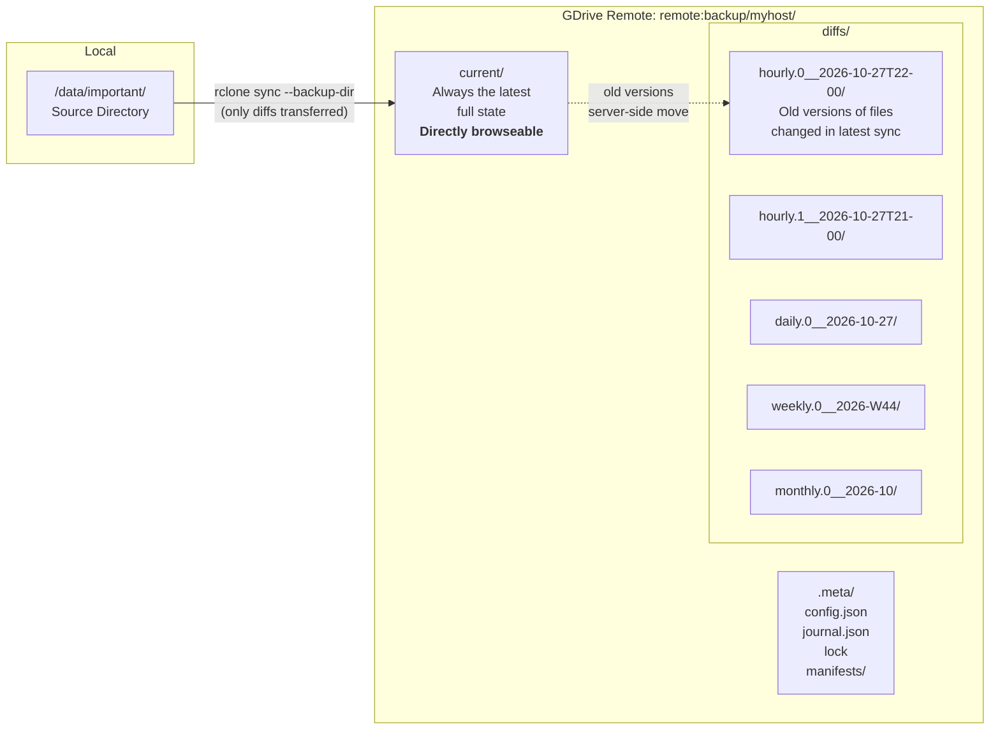
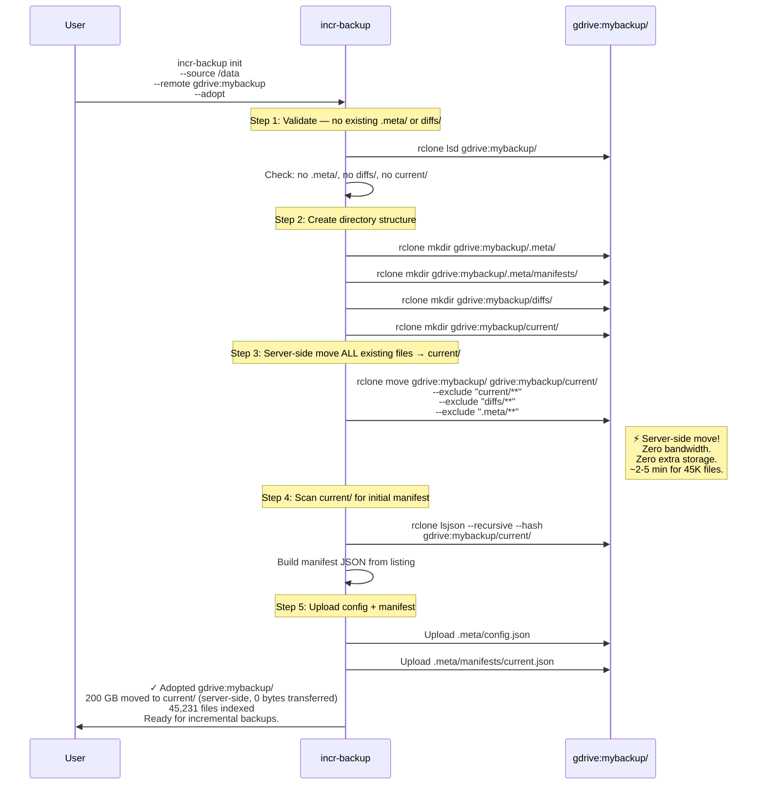

# incr-backup — Implementation Plan v3 (Final)

> Reverse-incremental snapshot backup for rclone GDrive remotes
> 
> Workspace: `~/git/shabeer_incr_backup`

---

## Table of Contents

1. [Architecture Overview](#architecture-overview)
2. [Space Calculation — Worked Example](#space-calculation--worked-example)
3. [Adopt Existing Remote (`init --adopt`)](#adopt-existing-remote-init---adopt)
4. [Deduplication Guarantee](#deduplication-guarantee)
5. [Rotation Semantics — When Does What Rotate?](#rotation-semantics--when-does-what-rotate)
6. [Multiple Runs Per Hour — What Happens?](#multiple-runs-per-hour--what-happens)
7. [Resumability — Surviving Interruptions](#resumability--surviving-interruptions)
8. [Restore Algorithm](#restore-algorithm)
9. [Diff Between Snapshots](#diff-between-snapshots)
10. [Verify Command — What Gets Checked](#verify-command--what-gets-checked)
11. [CLI Reference](#cli-reference)
12. [Remote Directory Layout](#remote-directory-layout)
13. [Rust vs Python — Revised Analysis](#rust-vs-python--revised-analysis)
14. [Rust Code Documentation Guidelines](#rust-code-documentation-guidelines)
15. [Rust Module Design](#rust-module-design)
16. [Multiple Sources on Same Remote](#multiple-sources-on-same-remote)
17. [Implementation Phases — AI Coding Agent Timeline](#implementation-phases--ai-coding-agent-timeline)
18. [Cron Setup](#cron-setup)
19. [Test Cases (107 Cases)](#test-cases-107-cases)
20. [Comment Audit — All Items Addressed](#comment-audit--all-items-addressed)

---

## Architecture Overview



**How it works:**

1. `current/` on the remote is always an exact mirror of the source — directly browseable on Google Drive.
2. When a sync runs, `rclone sync --backup-dir` uploads only changed files to `current/` and **server-side moves** (zero bandwidth) old versions from `current/` to a timestamped `diffs/` subdirectory.
3. Files deleted from source are also moved to `diffs/` (preserved, not lost).
4. A JSON manifest records the complete file listing at each snapshot point.
5. rsnapshot-style rotation (hourly → daily → weekly → monthly) manages retention.

---

## Space Calculation — Worked Example

> [!IMPORTANT]
> Each diff directory contains the old versions of files changed/deleted in **one sync operation** (typically one hour of changes). It does NOT contain cumulative changes over a day/week/month. When a daily snapshot is "created," it's just an hourly diff directory that was **renamed** (promoted) — its size doesn't change.

### Assumptions

| Parameter | Value |
|---|---|
| Source size | 200 GB |
| Total files | ~45,000 |
| Daily churn rate | ~2% of total size = ~4 GB/day |
| Working hours (when changes happen) | 8 hours/day |
| Hourly churn during work | 4 GB ÷ 8 hours = **~0.5 GB/hour** |
| Retention | 6 hourly, 7 daily, 4 weekly, 6 monthly |

### Step-by-step Breakdown

**Q: How many diff directories exist at any point?**

Each retained snapshot has exactly one diff directory. Total slots:

```
hourly:  6 slots
daily:   7 slots
weekly:  4 slots
monthly: 6 slots
─────────────────
Total:  23 slots
```

**Q: What's in each diff directory?**

Each was created by a **single** `rclone sync --backup-dir` call. It contains the old versions of files that changed during that one sync interval. Average size per diff ≈ **0.5 GB**.

**Q: But isn't a daily diff a whole day's worth of changes?**

**No.** `daily.0` was originally an `hourly.N` that got **renamed** (promoted) during daily rotation. It still contains exactly the same data — one hour's worth of changes. The "daily" label only means "this snapshot is retained at the daily level." It doesn't change the directory's content or size.

The same applies to weekly and monthly — they are all promoted hourlies, each containing ~0.5 GB.

**Q: Then how are old daily changes preserved?**

They're spread across multiple diff directories. Over a day with hourly syncs, 24 diffs are created. Only 6 fit in hourly slots; the rest are either promoted to daily or deleted when they fall off the end. The point-in-time state is reconstructed from `current/` + relevant diffs during restore.

### Final Calculation

| Component | Calculation | Size |
|---|---|---|
| `current/` | Full mirror of source | 200.0 GB |
| 6 hourly diffs | 6 × 0.5 GB | 3.0 GB |
| 7 daily diffs | 7 × 0.5 GB (each is a promoted hourly) | 3.5 GB |
| 4 weekly diffs | 4 × 0.5 GB (each is a promoted daily) | 2.0 GB |
| 6 monthly diffs | 6 × 0.5 GB (each is a promoted weekly) | 3.0 GB |
| `.meta/` manifests | 23 JSON files, ~1 MB each | ~23 MB |
| **Total** | | **~211.5 GB** |

### Formula

$$\text{Total} = S_{\text{source}} + N_{\text{slots}} \times \overline{\Delta}_{\text{per\_sync}}$$

Where:
- $S_{\text{source}}$ = current source size (200 GB)
- $N_{\text{slots}}$ = total retention slots across all tiers (6+7+4+6 = 23)
- $\overline{\Delta}_{\text{per\_sync}}$ = average size of changed/deleted files per sync (0.5 GB)

### Comparison

| Approach | Space Used | Ratio |
|---|---|---|
| **incr-backup (this tool)** | ~211 GB | **1.06×** source |
| rsnapshot with hard links (local) | ~211 GB | 1.06× (same efficiency) |
| Naive full copies (23 snapshots) | 4,600 GB | 23× source |

---

## Adopt Existing Remote (`init --adopt`)

> **User's situation:** 200 GB of files are already `rclone sync`'ed to a GDrive directory at root level (e.g., `gdrive:mybackup/file1.txt`).

### Can we `rclone move` to `current/`? → **Yes**

`rclone move` on Google Drive is a **server-side metadata operation** — it changes each file's parent folder ID without re-uploading any data. For 200 GB / 45,000 files:

| Metric | Value |
|---|---|
| Bandwidth used | **0 bytes** (server-side) |
| Extra storage used | **0 bytes** (moved, not copied) |
| Time | **~2-5 minutes** (only API calls) |

### `init --adopt` Flow



### Why move to `current/` instead of treating root as current/?

| Approach | Browse on GDrive | Clean? | Problem |
|---|---|---|---|
| Root as current/ | `.meta/` and `diffs/` mixed in with user files | ✗ | Confusing; risk of user accidentally deleting `.meta/` |
| **Move to `current/`** | **Only user files visible in `current/`** | **✓** | **Clean separation** |

### What if adopt is interrupted?

The journal tracks this step. Re-running `init --adopt` detects partial state (journal exists) and re-runs the `rclone move`, which is idempotent — already-moved files are skipped.

---

## Deduplication Guarantee

**Yes, deduplication is guaranteed.** Every file version exists in exactly **one** location on the remote.

### Proof

`rclone sync --backup-dir` maintains this invariant:

1. For any file path `P`, it exists in exactly **one** of:
   - `current/P` (the latest version), OR
   - `diffs/<some-snapshot>/P` (an older version)

2. `--backup-dir` performs a **server-side MOVE**, not a copy. The old file is removed from `current/` and placed in `diffs/`. Zero duplication.

3. Files that never change remain in `current/` indefinitely — only one copy ever.

### Edge Case: Content Returns (A → B → A)

If `report.pdf` changes from content A → B → A:

```
After t0: current/report.pdf = A
After t1: current/report.pdf = B,  diffs/hourly.0/report.pdf = A  
After t2: current/report.pdf = A,  diffs/hourly.0/report.pdf = B,  diffs/hourly.1/report.pdf = A
```

Content A exists in two places — but they represent different timeline points (t0 and t2). This is **correct behavior**, not duplication. True content-addressable dedup would require a `.store/` architecture that breaks the simple `rclone sync --backup-dir` model.

---

## Rotation Semantics — When Does What Rotate?

> [!IMPORTANT]
> **Each `--level` only rotates ITS OWN tier (and promotes from one tier below).** Running `sync --level hourly` does NOT touch dailies, weeklies, or monthlies. The **cron schedule** controls when each level runs, not the tool.

### What Each Level Does — Precisely

```mermaid
flowchart TD
    subgraph "sync --level hourly"
        H1["1. Rotate hourlies ONLY<br/>Delete hourly.5 if full<br/>hourly.4→5, 3→4, 2→3, 1→2, 0→1"]
        H2["2. rclone sync source → current/<br/>--backup-dir diffs/hourly.0__timestamp"]
        H3["3. Generate & upload manifest"]
        H1 --> H2 --> H3
    end

    subgraph "sync --level daily"
        D1["1. Rotate dailies ONLY<br/>Delete daily.6 if full<br/>daily.5→6, ..., 0→1"]
        D2["2. Promote: rename<br/>hourly.(max) → daily.0"]
        D3["3. Then do hourly rotation + sync<br/>(exactly as above)"]
        D1 --> D2 --> D3
    end

    subgraph "sync --level weekly"
        W1["1. Rotate weeklies ONLY"]
        W2["2. Promote: oldest daily → weekly.0"]
        W3["3. Then do daily-level ops<br/>(daily rotation + hourly sync)"]
        W1 --> W2 --> W3
    end

    subgraph "sync --level monthly"
        M1["1. Rotate monthlies ONLY"]
        M2["2. Promote: oldest weekly → monthly.0"]
        M3["3. Then do weekly-level ops<br/>(cascades down to hourly sync)"]
        M1 --> M2 --> M3
    end
```



### Concrete Walkthrough: First 48 Hours

```
HOUR 1  — cron: sync --level hourly
  Nothing to rotate (first run)
  Sync runs → creates diffs/hourly.0__08:00
  State: current, hourly.0
  Dailies: (none)  Weeklies: (none)  Monthlies: (none)

HOUR 2  — cron: sync --level hourly
  Rotate: hourly.0 → hourly.1
  Sync → new hourly.0__09:00
  State: current, hourly.0, hourly.1
  Dailies: UNTOUCHED  Weeklies: UNTOUCHED  Monthlies: UNTOUCHED

HOUR 6  — cron: sync --level hourly
  State: current, hourly.0 through hourly.5 (6 slots = FULL)

HOUR 7  — cron: sync --level hourly
  Rotate: DELETE hourly.5 (oldest), shift all down
  Sync → new hourly.0
  State: current, hourly.0–5 (still 6, oldest was purged)
  Dailies: STILL UNTOUCHED (hourly cron never touches dailies!)

2:30 AM — cron: sync --level daily ← ONLY FIRES ONCE PER DAY
  1. Rotate dailies: nothing to rotate (first daily)
  2. Promote: hourly.5 renamed → daily.0
  3. Hourly rotation + sync: shift hourlies, create new hourly.0
  State: current, hourly.0–4 (lost one to promotion), daily.0
  Weeklies: UNTOUCHED  Monthlies: UNTOUCHED

NEXT DAY 2:30 AM — cron: sync --level daily
  1. Rotate dailies: daily.0 → daily.1
  2. Promote: hourly.5 → daily.0
  3. Hourly rotation + sync
  State: current, hourly.0–4, daily.0–1

SUNDAY 3:30 AM — cron: sync --level weekly ← ONLY FIRES ONCE PER WEEK
  1. Rotate weeklies: nothing (first weekly)
  2. Promote: daily.6 → weekly.0
  3. Daily cascade → hourly sync
  State: current, hourly.0–N, daily.0–5, weekly.0
  Monthlies: UNTOUCHED
```

### Key Takeaway

**Cron determines when each level fires, not the tool.** The tool never "auto-detects" that it's midnight or Sunday. If you don't set up the daily cron, dailies never happen — you'll only have hourly snapshots that get deleted when they fall off the end.

---

## Multiple Runs Per Hour — What Happens?

### Default: Update In Place (No Rotation)

If `hourly.0` was created less than `min_interval_minutes` (default: 30) ago, the tool **skips rotation** and updates in place:

```
10:00 → sync --level hourly → NEW snapshot: rotates, creates hourly.0__10:00
10:15 → sync --level hourly → UPDATE in place: re-syncs to same hourly.0__10:00
10:45 → sync --level hourly → UPDATE in place: re-syncs to same hourly.0__10:00
11:00 → sync --level hourly → NEW snapshot: rotates (>30 min), creates hourly.0__11:00
```

**Why?** Prevents rapid runs from filling up all 6 hourly slots with sub-hour snapshots and losing older history.

**Update in place means:**
1. `rclone sync source current/ --backup-dir diffs/hourly.0__10:00` re-runs with the SAME backup-dir
2. The manifest for `hourly.0` is regenerated
3. Older snapshots (hourly.1, hourly.2, ...) are untouched

### `--force-rotate`: Always Rotate

```bash
incr-backup sync --level hourly --force-rotate
```

Forces rotation regardless of timing. Use when you know a significant change happened and want a distinct snapshot point.

### Configuration

```toml
[rotation]
# Minimum minutes between rotations at the same level.
# 0 = always rotate (rsnapshot behavior)
# 30 = default (update in place if recent)
min_interval_minutes = 30
```

---

## Resumability — Surviving Interruptions

> [!IMPORTANT]
> **Every sync operation is designed to survive crashes and network failures.** A write-ahead journal tracks progress; re-running the tool resumes from the last completed step.

### Journal File (`.meta/journal.json`)

```json
{
  "operation": "sync",
  "level": "hourly",
  "started_at": "2026-10-28T08:00:00+05:30",
  "backup_dir": "diffs/hourly.0__2026-10-28T08-00",
  "steps": [
    { "name": "acquire_lock",      "status": "done" },
    { "name": "rotate_snapshots",  "status": "done",    "renames": ["hourly.0→1", "hourly.1→2"] },
    { "name": "delete_oldest",     "status": "done",    "deleted": "hourly.5__old_ts" },
    { "name": "rclone_sync",       "status": "running" },
    { "name": "generate_manifest", "status": "pending" },
    { "name": "upload_manifest",   "status": "pending" },
    { "name": "cleanup_journal",   "status": "pending" },
    { "name": "release_lock",      "status": "pending" }
  ]
}
```

### Interruption → Recovery Matrix

| Interrupted During | What's Broken | Recovery on Re-run |
|---|---|---|
| **Lock acquisition** | Nothing changed | Retry from start |
| **Rotation (renames)** | Some dirs renamed, others not | Journal has rename list → complete remaining |
| **Delete oldest** | Old snapshot may/may not be deleted | Re-issue `rclone purge` (idempotent on missing dir) |
| **`rclone sync`** | Partial upload to current/, partial moves to backup-dir | **Re-run same `rclone sync --backup-dir` command** — rclone is idempotent (see below) |
| **Manifest generation** | Sync done, no manifest | Re-scan remote with `rclone lsjson --recursive --hash` |
| **Manifest upload** | Manifest generated locally, not on remote | Re-upload |
| **Journal cleanup** | Everything done, journal still exists | Detect all steps = done → delete journal |

### Why `rclone sync` is Safe to Re-run

`rclone sync source dest --backup-dir bak/` is idempotent after interruption:

| File State After Crash | On Re-run |
|---|---|
| Already uploaded correctly | Skipped (hash matches) |
| Partially uploaded | Re-uploaded (hash mismatch detected) |
| Old version already moved to backup-dir | New version uploaded to current/ (old not re-moved) |
| Old version NOT yet moved | Moved to backup-dir, new version uploaded |

### Lock Management

```json
{
  "holder": "laptop.local",
  "pid": 12345,
  "started_at": "2026-10-28T08:00:00+05:30",
  "timeout_minutes": 60
}
```

| Scenario | Behavior |
|---|---|
| Lock exists, age < timeout | **Refuse.** "Another backup running. Use --force to override." |
| Lock exists, age > timeout | **Warn and break.** "Stale lock (2h old). Breaking and resuming." |
| `--force` flag | Break lock unconditionally |

---

## Restore Algorithm

### Location Resolution

To restore snapshot `hourly.2` (state from 3 syncs ago):

```
Timeline:  hourly.2  ←  hourly.1  ←  hourly.0  ←  current
           (target)                                (newest)
```

For each file in `hourly.2`'s manifest, find where that version lives now:

```
Search order (first match wins):
  1. diffs/hourly.0/F  ← check closest diff after target first
  2. diffs/hourly.1/F
  3. diffs/hourly.2/F  ← the diff created at the target point
  4. current/F         ← file unchanged since hourly.2
```

**Why this order?** When file X changed at `hourly.0` sync, the pre-hourly.0 version was moved from `current/` to `diffs/hourly.0/`. If X was also changed at `hourly.1` sync, the pre-hourly.1 version (= the hourly.2-era version) is in `diffs/hourly.1/`. So we search forward from the closest diff until we find X.

### Execution

```rust
/// Resolve where each file lives on the remote for a given snapshot.
///
/// Similar to Java's Stream.filter().findFirst() pattern:
/// walk through diff directories from newest-to-oldest after the
/// target snapshot, find the first one containing the file.
fn resolve_locations(
    target_manifest: &Manifest,
    snapshots_after_target: &[SnapshotInfo],  // ordered: closest-first
) -> Vec<ResolveEntry> {
    target_manifest.files.iter().map(|file| {
        // Check each diff directory after the target
        for snap in snapshots_after_target {
            if snap.diff_manifest.has_file(&file.path) {
                return ResolveEntry {
                    file: file.clone(),
                    remote_path: format!("diffs/{}/{}", snap.dir_name, file.path),
                };
            }
        }
        // Not in any diff → unchanged, still in current/
        ResolveEntry {
            file: file.clone(),
            remote_path: format!("current/{}", file.path),
        }
    }).collect()
}
```

The tool then groups files by source directory and runs targeted `rclone copy --files-from` commands.

### Restoring `current` (Latest)

No tool needed — direct rclone works:

```bash
rclone sync remote:backup/myhost/current/ /local/restore/
```

---

## Diff Between Snapshots

```bash
$ incr-backup diff hourly.0 daily.0

Comparing: hourly.0 (2026-10-27T22:00) ↔ daily.0 (2026-10-27T02:00)

Added (in hourly.0, not in daily.0):
  + documents/quarterly-report.pdf           2.4 MB
  + code/new-feature.rs                     12.3 KB

Deleted (in daily.0, not in hourly.0):
  - photos/temp-screenshot.png             840.0 KB

Modified (same path, different content):
  ~ documents/report.pdf        1.0 MB → 1.3 MB   md5: a1b2c3 → d4e5f6
  ~ code/main.rs                4.2 KB → 4.8 KB   md5: 789abc → def012

Summary: 2 added, 1 deleted, 2 modified
         New data: 2.41 MB | Removed: 840 KB | Changed: 2.1 MB
```

### Implementation

Pure manifest comparison — **no network I/O** after manifests are cached:

```rust
/// Compare two manifests, like a "git diff --stat" between snapshots.
///
/// Algorithm (similar to Python dict comparison):
///   map_a = {path: entry for entry in manifest_a}
///   map_b = {path: entry for entry in manifest_b}
///   added    = keys in map_a but not map_b
///   deleted  = keys in map_b but not map_a
///   modified = keys in both where md5 differs
fn diff_manifests(a: &Manifest, b: &Manifest) -> DiffResult {
    let map_a: HashMap<&str, &FileEntry> = a.files.iter()
        .map(|f| (f.path.as_str(), f)).collect();
    let map_b: HashMap<&str, &FileEntry> = b.files.iter()
        .map(|f| (f.path.as_str(), f)).collect();

    let mut result = DiffResult::default();
    for (path, entry_a) in &map_a {
        match map_b.get(path) {
            None => result.added.push((*entry_a).clone()),
            Some(entry_b) if entry_a.md5 != entry_b.md5 =>
                result.modified.push(((*entry_a).clone(), (*entry_b).clone())),
            _ => result.unchanged += 1,
        }
    }
    for (path, entry_b) in &map_b {
        if !map_a.contains_key(path) {
            result.deleted.push((*entry_b).clone());
        }
    }
    result
}
```

### Flags

| Flag | Effect |
|---|---|
| `--json` | Machine-readable JSON output |
| `--only-added` | Show only files added |
| `--only-deleted` | Show only files deleted |
| `--only-modified` | Show only files with content changes |
| `--stat` | Summary counts/sizes only |

---

## Verify Command — What Gets Checked

`incr-backup verify [SNAPSHOT]` validates backup integrity at three levels:

### All Checks

| # | Check | What It Verifies | Method | Speed |
|---|---|---|---|---|
| 1 | **Config exists** | `.meta/config.json` present and valid JSON | `rclone cat` + parse | Quick |
| 2 | **Manifest exists** | Every retained snapshot has a manifest in `.meta/manifests/` | `rclone lsf .meta/manifests/` | Quick |
| 3 | **Manifest parseable** | Every manifest is valid JSON with required fields (`path`, `size`, `md5`, `mtime`) | Download + deserialize | Quick |
| 4 | **File count match** | Number of files in `current/` matches manifest entry count | `rclone size current/` vs manifest | Quick |
| 5 | **Total size match** | Total size of `current/` matches manifest total | `rclone size` vs manifest | Quick |
| 6 | **Snapshot ordering** | Timestamps are monotonically decreasing (hourly.0 is newest) | Compare manifest timestamps | Quick |
| 7 | **Retention compliance** | Snapshot count doesn't exceed configured retention per tier | Count vs config | Quick |
| 8 | **Lock state** | No stale locks present | Check `.meta/lock` existence and age | Quick |
| 9 | **Diff directory existence** | Every manifest references a diff dir that actually exists | `rclone lsd diffs/` vs manifest list | Quick |
| 10 | **Remote hash check** | MD5 of each file on remote matches manifest | `rclone lsjson --hash` vs manifest | Medium |
| 11 | **Cross-snapshot consistency** | Files referenced by older manifests still exist (in diffs or current) | Location resolution check | Medium |
| 12 | **Deep verify** | Download files, re-hash locally, compare against manifest | `rclone copy` + local `md5sum` | Slow |

### Usage

```bash
incr-backup verify              # Quick checks only (1-9)
incr-backup verify --check-hashes   # + remote hash verification (10-11)
incr-backup verify --deep          # + download and re-hash (12)
incr-backup verify hourly.2       # Verify specific snapshot only
incr-backup verify --space         # Include space usage report
```

### Output Example

```
$ incr-backup verify --check-hashes

Verifying backup at gdrive:backup/myhost/

  ✓ Config valid                           (.meta/config.json)
  ✓ No stale lock
  ✓ Manifest: current                      (45,231 files, 200.0 GB)
  ✓ Manifest: hourly.0                     (12 changed files, 3.2 MB)
  ✓ Manifest: hourly.1                     (5 changed files, 800 KB)
  ✓ Manifest: daily.0                      (142 changed files, 45.6 MB)
  ✓ Remote hashes match manifest           (45,231 files verified)
  ✓ Snapshot ordering valid
  ✓ Retention within limits

Space usage:
  current/     200.0 GB    (45,231 files)
  diffs/        18.4 GB    (5,260 files across 6 snapshots)
  .meta/        12.8 MB    (7 manifests)
  ─────────────────────────
  Total:       218.4 GB

All checks passed. ✓
```

---

## CLI Reference

### Global Options

```
GLOBAL OPTIONS (apply to all commands):
    -c, --config <PATH>       Config file path
                              [default: ./incr-backup.toml]
                              [env: INCR_BACKUP_CONFIG]

    -s, --source <PATH>       Override source directory
                              [env: INCR_BACKUP_SOURCE]

    -r, --remote <REMOTE>     Override rclone remote path
                              [env: INCR_BACKUP_REMOTE]

    -v, --verbose             Increase verbosity (-v, -vv, -vvv)
                              [env: INCR_BACKUP_LOG_LEVEL]

    -n, --dry-run             Show what would happen without making changes

        --rclone-path <PATH>  Path to rclone binary
                              [default: rclone]
                              [env: INCR_BACKUP_RCLONE_PATH]

        --rclone-flags <FLAGS>  Extra flags passed to every rclone call
                                [env: INCR_BACKUP_RCLONE_FLAGS]
```

### Commands

```
incr-backup init
    --source <PATH>           Local source directory (required)
    --remote <REMOTE>         rclone remote path (required)
    --adopt                   Adopt existing rclone-synced directory
                              (moves files server-side into current/, zero bandwidth)
    --retention <PRESET>      Retention preset (see table below)
    --exclude <PATTERN>       Exclude pattern (repeatable)

incr-backup sync
    --level <LEVEL>           hourly | daily | weekly | monthly (required)
    --force-rotate            Always rotate even if min_interval not elapsed
    --force                   Break stale lock and run

incr-backup list
    --json                    JSON output

incr-backup status

incr-backup restore <SNAPSHOT>
    --to <PATH>               Local destination (required)
    --path <SUBPATH>          Restore only a file or subdirectory
    --verify                  Checksum-verify after restore
    --overwrite               Allow restoring to non-empty directory

incr-backup diff <SNAPSHOT_A> <SNAPSHOT_B>
    --json / --only-added / --only-deleted / --only-modified / --stat

incr-backup verify [SNAPSHOT]
    --check-hashes            Verify remote file hashes (medium)
    --deep                    Download and re-hash (slow)
    --space                   Include space usage report

incr-backup remove <PATH>...  (alias: rm)
    --path <PATH>             Specific path to remove (repeatable)
    --force                   Break stale lock and run
    --json                    Output result as JSON

incr-backup config <push|pull|diff>
    push [--force]            Push local configuration to remote metadata (.meta/config.json)
    pull [--to <PATH>] [--overwrite]
                              Pull remote metadata into local configuration file
    diff                      Compare local configuration vs remote metadata
```

### `--retention` Presets & Lifecycle

These set the initial retention counts during `init`. Editable later via local configuration file (`incr-backup.toml`).

| Preset | Hourly | Daily | Weekly | Monthly | Use Case |
|---|---|---|---|---|---|
| `default` | 6 | 7 | 4 | 6 | Balanced — 6h + 1w + 1m + 6m of history |
| `aggressive` | 12 | 14 | 8 | 12 | Maximum history, more space |
| `minimal` | 3 | 3 | 2 | 3 | Save space, less history |

Example: `incr-backup init --retention aggressive` sets hourly=12, daily=14, weekly=8, monthly=12.

#### Changing Retention on an Existing Backup:
1. Edit `[retention]` in local `incr-backup.toml` (template at `config/incr-backup-example.toml`).
2. Run `incr-backup config diff` to review differences.
3. Run `incr-backup config push` to update `.meta/config.json` on the remote under lock.

#### When Does Cleanup Happen (e.g., Aggressive → Minimal)?
- Changing configuration does **not** trigger immediate cleanup.
- Cleanup occurs **passively on rotation during `sync --level <tier>`**.
- If a tier has more snapshots than the configured limit (e.g., 12 hourly snapshots vs. minimal limit of 3), the single oldest snapshot and its manifest are deleted on each rotation until the count drops to the limit.
- Tiers that are not executed remain untouched (e.g. daily/weekly snapshots are only pruned when their respective sync level runs).

#### Why No Silent Auto-Update on `sync`?
- **Transient Overrides**: Keeps CLI flags and environment variables (`INCR_BACKUP_HOURLY=12`) transient without overwriting persistent remote metadata.
- **Multi-Host Safety**: Multiple hosts syncing to a remote namespace won't clobber each other's configurations.
- **Accidental Deletions**: Protects against accidental local retention typos silently triggering massive historical pruning.
- **Visibility**: Both `incr-backup status` and `incr-backup verify` (Check 1) emit warning notices (`⚠`) whenever local and remote configs differ.

---

## Remote Directory Layout

```
gdrive:backup/myhost/                    ← remote base path (configurable)
│
├── current/                             ← 👈 BROWSE ON GDRIVE (always complete mirror)
│   ├── documents/
│   │   ├── report.pdf
│   │   └── notes.txt
│   ├── photos/
│   │   └── vacation.jpg
│   └── code/
│       └── main.rs
│
├── diffs/                               ← Old versions of changed/deleted files
│   ├── hourly.0__2026-10-27T22-00/      ← Timestamp in name (: → -)
│   │   └── documents/
│   │       └── report.pdf               ← Previous version
│   ├── hourly.1__2026-10-27T21-00/
│   ├── daily.0__2026-10-27/
│   │   └── photos/
│   │       └── deleted-photo.jpg        ← Deleted from source; preserved
│   ├── weekly.0__2026-W43/
│   └── monthly.0__2026-09/
│
└── .meta/
    ├── config.json                      ← Backup configuration
    ├── journal.json                     ← In-progress operation (if any)
    ├── lock                             ← Lock file (only during runs)
    └── manifests/
        ├── current.json                 ← All files in current/
        ├── hourly.0.json                ← State at this snapshot point
        ├── daily.0.json
        └── ...
```

---

## Rust vs Python — Revised Analysis

> **User comment:** "Why does it take 3-4 weeks? We should use existing rclone and not re-write it."
>
> **Correction:** Previous timelines assumed a **human developer**. Since an **AI coding agent** will implement this, the timeline is dramatically shorter. The tool is purely an orchestration layer calling `rclone` as a subprocess — we never reimplement file transfer, hashing, or cloud APIs.

### What the Tool Actually Does (None of This is rclone)

| # | Task | Complexity | rclone Involved? |
|---|---|---|---|
| 1 | Parse CLI args + config | Low | No |
| 2 | Compute local file MD5 hashes | Medium | No (local `walkdir` + `md5`) |
| 3 | Read/write JSON manifests | Low | No |
| 4 | Call rclone commands as subprocesses | Low | Yes (subprocess) |
| 5 | Rotation logic (rename/delete dirs) | Medium | Yes (rclone moveto/purge) |
| 6 | Resolve file locations for restore | Medium | No (manifest lookups) |
| 7 | Diff two manifests | Low | No |
| 8 | Journal read/write | Low | No |
| 9 | Lock management | Low | Yes (rclone cat/rcat/delete) |

### Revised Timeline: AI Coding Agent

| Phase | What | Estimated Time |
|---|---|---|
| 1. Foundation | Cargo scaffold, CLI, config, rclone wrapper, manifest, scanner, lock | 2-3 hours |
| 2. Core backup | Journal, rotation, sync pipeline, init (with --adopt), list, status | 3-4 hours |
| 3. Restore & diff | Location resolution, restore command, diff command | 2-3 hours |
| 4. Hardening | Verify, dry-run, edge cases, error messages | 2-3 hours |
| 5. Testing | Unit tests, integration tests with `:local:` backend | 3-4 hours |
| **Total** | | **~12-17 hours of agent time** |

> [!NOTE]
> With an AI coding agent working in focused sessions, this is achievable in **2-3 days of wall-clock time**. The previous "3-4 weeks" estimate was for a human developer writing Rust from scratch.

### Why Rust is Still the Right Choice (Even for Agent)

1. **`Result<T, E>` everywhere** — the agent's generated code has compile-time guarantees that errors are handled. Backup tools cannot afford silent failures.
2. **Single binary** — deploy by copying one file. No runtime dependencies.
3. **`rayon` parallel hashing** — hashing 200 GB of files in ~5 min vs ~12 min (Python).
4. **Type safety** — manifest structures, snapshot metadata, config are all statically typed. Catches bugs at compile time.

---

## Rust Code Documentation Guidelines

> [!IMPORTANT]
> All Rust code will be documented for developers familiar with Java/Python but not Rust.

### Rules

**1. Every public item gets a `///` doc comment** with:
- One-line summary
- Why/when you'd use it
- Algorithm overview (for complex logic)
- Java/Python analogy where helpful

**2. Rust-specific idioms get inline comments:**

```rust
// `?` is like Python's "raise" or Java's checked exception — if this fails,
// the error propagates to the caller immediately.
let manifest = load_manifest(path)?;

// `iter().map().collect()` is like Python's list comprehension:
//   Python: [f.path for f in files]
//   Java:   files.stream().map(f -> f.path).collect(toList())
let paths: Vec<String> = files.iter().map(|f| f.path.clone()).collect();

// `unwrap_or_else` = Python's `dict.get(key, default)` / Java's `Optional.orElse()`
let timeout = config.timeout.unwrap_or_else(|| Duration::from_secs(3600));

// `match` is like Java's switch expression or Python's match/case (3.10+),
// but the compiler FORCES you to handle every variant — no forgotten cases.
match result {
    Ok(manifest) => process(manifest),
    Err(SyncError::Locked { holder, .. }) => eprintln!("Locked by {holder}"),
    Err(e) => return Err(e),  // propagate other errors
}
```

**3. Ownership/borrowing explained when non-obvious:**

```rust
/// Takes references (`&`) to both manifests — like Java/Python passing objects
/// by reference. Rust's default is pass-by-move (ownership transfer), so `&`
/// explicitly says "borrow, don't consume."
fn diff_manifests(a: &Manifest, b: &Manifest) -> DiffResult { ... }
```

**4. Error types documented as Java exception analogy:**

```rust
/// Errors during sync operations.
/// 
/// Rust equivalent of a Java exception hierarchy. Unlike Java, these are
/// returned as values (Result<T, SyncError>) not thrown — you MUST handle them.
#[derive(Debug, thiserror::Error)]
enum SyncError {
    #[error("backup locked by {holder} since {since}")]
    Locked { holder: String, since: String },
    
    #[error("rclone failed: {cmd} (exit {code}): {stderr}")]
    RcloneFailed { cmd: String, code: i32, stderr: String },
}
```

**5. Module-level docs explain context:**

```rust
//! # Manifest Module
//!
//! Handles reading, writing, and comparing snapshot manifests.
//! Think of a manifest as a "table of contents" for a snapshot — it lists
//! every file with its path, size, MD5 hash, and modification time.
//!
//! ## Analogy
//! Like a Python dict mapping file paths to their metadata, serialized as JSON.
```

---

## Rust Module Design

### Crate Structure

```
incr-backup/
├── Cargo.toml
├── README.md
├── docs/
│   ├── IMPLEMENTATION_PLAN.md
│   └── TEST_CASES.md
├── src/
│   ├── main.rs              # CLI entry point (clap derive)
│   ├── lib.rs               # Library root, re-exports
│   ├── config.rs            # Config: TOML + env vars + CLI overrides
│   ├── manifest.rs          # Manifest CRUD + diffing
│   ├── scanner.rs           # Local scan + parallel MD5 (rayon + walkdir)
│   ├── rclone.rs            # rclone subprocess wrapper
│   ├── snapshot.rs          # Rotation, promotion, deletion
│   ├── sync.rs              # Full sync pipeline orchestration
│   ├── restore.rs           # Restore with location resolution
│   ├── diff.rs              # Diff command (delegates to manifest)
│   ├── verify.rs            # All verification checks
│   ├── journal.rs           # Write-ahead journal
│   ├── lock.rs              # Remote lock management
│   └── error.rs             # Error types (thiserror)
└── tests/
    ├── common/mod.rs         # Test helpers
    ├── test_config.rs
    ├── test_manifest.rs
    ├── test_scanner.rs
    ├── test_rotation.rs
    ├── test_sync.rs
    ├── test_restore.rs
    ├── test_diff.rs
    ├── test_verify.rs
    ├── test_journal.rs
    └── test_lock.rs
```

### Cargo.toml

```toml
[package]
name = "incr-backup"
version = "0.1.0"
edition = "2024"
description = "rsnapshot-like incremental backups for rclone remotes"

[dependencies]
clap = { version = "4", features = ["derive", "env"] }
serde = { version = "1", features = ["derive"] }
serde_json = "1"
toml = "0.8"
chrono = { version = "0.4", features = ["serde"] }
md-5 = "0.10"
rayon = "1"
walkdir = "2"
thiserror = "2"
log = "0.4"
env_logger = "0.11"

[dev-dependencies]
tempfile = "3"
assert_cmd = "2"
predicates = "3"
```

---

## Multiple Sources on Same Remote

Each source → its own independent namespace:

```
gdrive:backups/
├── laptop-documents/         ← --remote gdrive:backups/laptop-documents
│   ├── current/
│   ├── diffs/
│   └── .meta/
├── server-database/          ← --remote gdrive:backups/server-database
│   ├── current/
│   ├── diffs/
│   └── .meta/
└── photos-archive/           ← --remote gdrive:backups/photos-archive
    ├── current/
    ├── diffs/
    └── .meta/
```

Each namespace is fully independent — own config, manifests, lock, journal. No shared state.

```bash
# Different sources via different configs
incr-backup sync --level hourly -c ~/configs/documents.toml
incr-backup sync --level daily  -c ~/configs/photos.toml

# Or via env vars / CLI args
incr-backup sync --level hourly -s ~/Documents -r gdrive:backups/documents
incr-backup sync --level daily  -s ~/Photos    -r gdrive:backups/photos
```

---

## Implementation Phases — AI Coding Agent Timeline

> [!NOTE]
> These phases are designed for an **AI coding agent** to execute sequentially. Each phase produces working, tested code before moving to the next. Total estimated: **2-3 days**.

### Phase 1: Foundation (~2-3 hours)

- [ ] `cargo init`, Cargo.toml with all dependencies
- [ ] `error.rs` — `SyncError`, `ConfigError`, etc. with `thiserror`
- [ ] `config.rs` — TOML parsing, env var overrides, CLI override merge, validation
- [ ] `rclone.rs` — wrapper: `sync`, `lsjson`, `move`, `purge`, `mkdir`, `delete`, `moveto`, `size`, `cat`, `rcat`
- [ ] `scanner.rs` — parallel local scan with `walkdir` + `rayon` + `md5`
- [ ] `manifest.rs` — `Manifest`, `FileEntry`, `DiffResult` structs, JSON serde, `from_rclone_lsjson()`
- [ ] `lock.rs` — create/check/release/break lock
- [ ] Unit tests for each module

### Phase 2: Core Backup (~3-4 hours)

- [ ] `journal.rs` — WAL journal: create, update step, load on restart
- [ ] `snapshot.rs` — rotation: shift, promote, delete, min-interval check
- [ ] `sync.rs` — full pipeline: lock → journal → min-interval check → rotate → rclone sync → manifest → upload → journal cleanup → unlock
- [ ] `main.rs` — `init` command (with `--adopt`), `sync` command, `list` command, `status` command
- [ ] Integration tests with rclone `:local:` backend

### Phase 3: Restore & Diff (~2-3 hours)

- [ ] `restore.rs` — location resolution, `--files-from` generation, multi-source copy, `--path` filter
- [ ] `diff.rs` — manifest comparison, formatted output, `--json`/`--stat`/`--only-*` flags
- [ ] `remove.rs` — purge files/directories across manifests, current/, and diffs/
- [ ] Commands: `restore`, `diff`, `remove` (alias `rm`)
- [ ] Integration tests

### Phase 4: Hardening (~2-3 hours)

- [ ] `verify.rs` — all 12 checks, quick/medium/deep modes
- [ ] `--dry-run` for all mutating commands
- [ ] Edge cases: empty source warning, special chars, symlinks
- [ ] Comprehensive error messages with recovery suggestions
- [ ] README with usage examples

### Phase 5: Testing (~3-4 hours)

- [ ] Unit tests for all modules (target: 80%+ coverage)
- [ ] Integration tests covering TC-SYNC-*, TC-ROT-*, TC-CASC-*, TC-REST-*, TC-DIFF-*
- [ ] E2E tests with `:local:` backend simulating full lifecycle
- [ ] Error/edge case tests: TC-ERR-*, TC-FS-*, TC-LOCK-*, TC-JOUR-*

---

## Cron Setup

```cron
# Hourly (every hour, on the hour)
  0 * * * *   /usr/local/bin/incr-backup sync --level hourly -c /etc/incr-backup/myhost.toml

# Daily (2:30 AM — this is the ONLY time daily rotation happens)
 30 2 * * *   /usr/local/bin/incr-backup sync --level daily  -c /etc/incr-backup/myhost.toml

# Weekly (Sunday 3:30 AM — the ONLY time weekly rotation happens)
 30 3 * * 0   /usr/local/bin/incr-backup sync --level weekly -c /etc/incr-backup/myhost.toml

# Monthly (1st of month, 4:30 AM)
 30 4 1 * *   /usr/local/bin/incr-backup sync --level monthly -c /etc/incr-backup/myhost.toml
```

> [!IMPORTANT]
> **Overlap handling:** If a daily run at 2:30 AM is still going when the 3:00 AM hourly cron fires, the lock prevents the hourly from starting. It prints a warning and exits. The next hourly (4:00 AM) succeeds.

---

## Test Cases (107 Cases)

Full test case documentation: [TEST_CASES.md](file:///Users/shabeer/git/shabeer_incr_backup/docs/TEST_CASES.md)

### Summary

| Section | IDs | Count |
|---|---|---|
| 1. `init` Command | TC-INIT-001 – 010 | 10 |
| 2. `sync` — Core Operation | TC-SYNC-001 – 010 | 10 |
| 3. `sync` — Retention & Rotation | TC-ROT-001 – 006 | 6 |
| 4. `sync` — Cascade Promotion | TC-CASC-001 – 006 | 6 |
| 5. `list` Command | TC-LIST-001 – 003 | 3 |
| 6. `status` Command | TC-STAT-001 – 003 | 3 |
| 7. `restore` Command | TC-REST-001 – 008 | 8 |
| 8. `diff` Command | TC-DIFF-001 – 006 | 6 |
| 9. `verify` Command | TC-VERI-001 – 005 | 5 |
| 10. Locking & Concurrency | TC-LOCK-001 – 005 | 5 |
| 11. Journal & Resumability | TC-JOUR-001 – 005 | 5 |
| 12. Error Handling & Edge Cases | TC-ERR-001 – 008 | 8 |
| 13. Configuration & Environment | TC-CONF-001 – 006 | 6 |
| 14. Filesystem Edge Cases | TC-FS-001 – 011 | 11 |
| 15. Network & Remote Failures | TC-NET-001 – 005 | 5 |
| 16. Multi-Source & Namespace | TC-NS-001 – 004 | 4 |
| 17. `remove` Command | TC-REM-001 – 006 | 6 |
| **Total** | | **107** |

### Key Test Categories

- **Happy path:** TC-INIT-001, TC-SYNC-001–005, TC-REST-001, TC-DIFF-001
- **Rotation:** TC-ROT-001–006 (within limits, at limits, update-in-place, force-rotate)
- **Cascade promotion:** TC-CASC-001–006 (daily←hourly, weekly←daily, monthly←weekly, empty tiers)
- **Resumability:** TC-JOUR-001–005 (crash during each phase, journal replay)
- **Edge cases:** TC-FS-001–011 (spaces, unicode, symlinks, 0-byte files, 50K files, 6GB files)
- **Network failures:** TC-NET-001–005 (drop during rotation/sync/manifest, rate limits)
- **Concurrent access:** TC-LOCK-001–005 (lock contention, stale lock, force-break)

---

## Comment Audit — All Items Addressed

### Round 1 Comments (on v2 artifact)

| # | Comment | Where Addressed |
|---|---|---|
| 1 | "Explain how space calculation works" | [Space Calculation](#space-calculation--worked-example) — full worked example with Q&A format |
| 2 | "Can we rclone move to current/? Use this for clean browsing" | [Adopt Existing Remote](#adopt-existing-remote-init---adopt) — yes, server-side move, 0 bandwidth |
| 3 | "Why 3-4 weeks? Don't re-write rclone" | [Revised Analysis](#rust-vs-python--revised-analysis) — corrected: 2-3 days for AI agent |
| 4 | "What is --retention used for?" | [CLI Reference → Retention Presets](#cli-reference) — table with default/aggressive/minimal values |
| 5 | "What will be verified? Document all" | [Verify Command](#verify-command--what-gets-checked) — 12 checks in table with speed levels |

### Round 2 Comments (on v3 request)

| # | Comment | Where Addressed |
|---|---|---|
| 6 | "Document complex Rust code for Java/Python developers" | [Rust Code Documentation Guidelines](#rust-code-documentation-guidelines) — 5 rules with examples |
| 7 | "What happens with --hourly multiple times in an hour?" | [Multiple Runs Per Hour](#multiple-runs-per-hour--what-happens) — update-in-place default + --force-rotate |
| 8 | "Does each run rotate ALL retention levels?" | [Rotation Semantics](#rotation-semantics--when-does-what-rotate) — NO, level-specific only, with 48h walkthrough |
| 9 | "Use ~/git/shabeer_incr_backup" | Header + all references updated |
| 10 | "How is resumability handled?" | [Resumability](#resumability--surviving-interruptions) — journal-based WAL with interruption matrix |
| 11 | "Add test cases" | [Test Cases](#test-cases-101-cases) — 101 test cases across 16 sections |
| 12 | "Avoid re-uploading 200GB" | [Adopt Existing Remote](#adopt-existing-remote-init---adopt) — `rclone move` (server-side) |
| 13 | "Is deduplication guaranteed?" | [Deduplication Guarantee](#deduplication-guarantee) — proof by invariant |
| 14 | "Diff between any two snapshots" | [Diff Between Snapshots](#diff-between-snapshots) — manifest comparison with code |

### Round 3 Comments (current)

| # | Comment | Where Addressed |
|---|---|---|
| 15 | "Check all comments addressed" | This audit table |
| 16 | "Timeline for coding agent, not developer" | [Implementation Phases](#implementation-phases--ai-coding-agent-timeline) — 2-3 days |
| 17 | "Make plan commentable" | This is now an artifact (commentable) |
