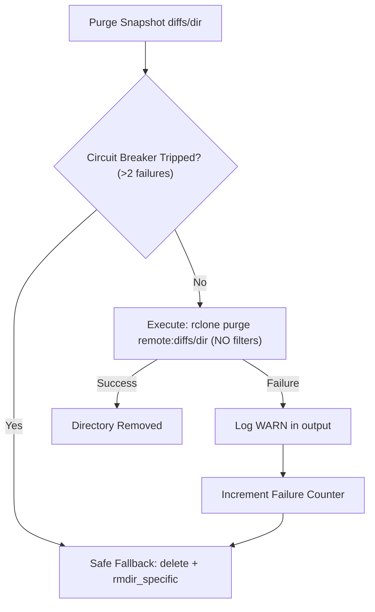

# Compaction Performance Optimizations

## 1. Executive Summary & Benchmark Analysis

During multi-snapshot consolidation, a benchmark run recorded:
```text
✓ Compaction complete: 2026-11-02T17:03_IST (30 snapshots consolidated, 138 diff files kept [48.6 MB], 854 discarded [1.2 GB reclaimed], 2489.9s)
```

- **Total Execution Time**: 2,489.9 seconds (~41.5 minutes).
- **Primary Bottleneck**: Staging kept diff files took **2,070 seconds (~83% of total time)**.
- **Root Cause**: 138 sequential invocations of `rclone moveto`, each taking approximately **15 seconds per file**.

With the architectural optimizations outlined below, total compaction time for this workload is projected to decrease from **~41.5 minutes to under 2 minutes (>95% reduction)**.

---

## 2. Root Cause Analysis: Why Each `moveto` Took ~15 Seconds

While Google Drive supports server-side file moves (zero bandwidth re-upload via parent metadata updates), executing file-by-file `moveto` commands sequentially inside a loop creates severe overhead:

```rust
// Current naive sequential loop in compact.rs
for file in &plan.files_to_keep {
    let src = format!("{remote_base}/diffs/{}/{}", file.source_diff_dir, file.path);
    let dst = format!("{staging_dir}{}", file.path);
    rclone.moveto(&src, &dst)?; // Spawns an isolated rclone process each time
}
```

### 2.1 Per-Process Invocation Overhead
Spawning 138 distinct `rclone` subprocesses incurs:
- OS `fork`/`exec` and Go runtime startup overhead for every file.
- Rclone configuration parsing and OAuth2 token verification / refresh against Google accounts endpoints.

### 2.2 Google Drive ID Resolution & Path Traversal
Google Drive is an ID-based object hierarchy rather than a traditional path-based filesystem:
- For every path component in `diffs/<snap>/path/to/file.ext`, `rclone` must query `files.list` with `q="'<parent_id>' in parents and name='...' and trashed=false"`.
- It repeats the same directory resolution for the destination path (`.meta/staging/<name>/path/to/file.ext`), issuing `files.create` for any missing directory nodes.
- Traversing 3–5 folder levels in both source and destination requires **6 to 10 HTTP API roundtrips**.
- Because each `rclone` process terminates immediately after moving a single file, the **directory ID cache is discarded**, forcing the next process to repeat the exact same parent traversals from scratch.

### 2.3 API Rate Limits & Pacing Latency
- Google Drive enforces strict per-user quotas (nominally 10 queries/sec) alongside latency per call (150–300ms).
- With safety pacing and 8–12 roundtrips:
  $$\approx 10\text{--}15\text{ seconds per file} \times 138\text{ files} \approx 2070\text{ seconds}.$$

---

## 3. Revised Optimization Plan

```
┌─────────────────────────────────────────────────────────────────────────────┐
│                    Revised Compaction Optimization Flow                     │
└─────────────────────────────────────────────────────────────────────────────┘
                                      │
     ┌────────────────────────────────┼────────────────────────────────┐
     ▼                                ▼                                ▼
[Plan Phase]                  [Stage 1: Staging]             [Stage 4: Purge]
Catalog-Scoped lsjson         Batch move with                Resilient rclone purge
using snapshot.jsonl          --files-from per snapshot      + Safe Fallback & Circuit Breaker
(Save ~110s)                  (Save ~2,040s)                 (Save ~200s)
```

### 3.1 Batch Server-Side Moves with `rclone move --files-from` (Primary Win)
Instead of moving files individually, group the 138 files by their `source_diff_dir`:

$$\text{Group by } \texttt{source\_diff\_dir} \implies \le 30 \text{ batches (typically 5–15 distinct directories)}$$

For each distinct source snapshot diff directory:
1. Write the relative file paths to a temporary file (or pass via stdin using `--files-from-raw -`).
2. Run a single batch command:
   ```bash
   rclone move "remote:diffs/<source_diff_dir>/" "remote:.meta/staging/<plan.name>/" \
       --files-from "<temp_list_file>" \
       --transfers 8 \
       --checkers 8 \
       --fast-list
   ```

#### Why This Is 50x–80x Faster:
- **Process count drops** from 138 to $\le 30$ (one call per source diff directory).
- **In-memory directory caching**: Within a single `rclone` process, directory IDs are cached in RAM, eliminating redundant `files.list` API calls for identical folder trees.
- **Concurrent server-side moves**: With `--transfers 8`, `rclone` moves multiple files simultaneously over the Google Drive API while managing rate limits and backoff automatically.

---

### 3.2 Diff Inspection & Catalog Role (`snapshot.jsonl`)

#### Can we use `snapshot.jsonl` for diff discovery?
The snapshot catalog (`.meta/snapshots.jsonl` / `snapshot.jsonl`) currently stores **summary-level metadata** for each snapshot:
```rust
pub struct SnapshotSummary {
    pub name: String,
    pub manifest_name: String,
    pub created_at: DateTime<Utc>,
    pub diff_dir: Option<String>,
    pub file_count: usize,
    pub total_size: u64,
}
```

Because `snapshot.jsonl` does not store the granular file lists within each `diffs/<dir>`, we cannot read the individual diff file paths directly from the catalog today. However, `snapshot.jsonl` provides two massive optimization opportunities:

1. **Catalog-Scoped Scans (Immediate Optimization)**:
   Instead of scanning the entire `remote:diffs/` directory (which might contain hundreds of out-of-range diff directories), `snapshot.jsonl` identifies:
   - Exactly which in-range snapshots have a `diff_dir`.
   - Snapshots with `diff_dir: None` (which require zero scans).
   We can pass an in-range filter to `rclone lsjson`:
   ```bash
   # Filter only the specific diff dirs identified from snapshot.jsonl
   rclone lsjson "remote:diffs/" --include "/{diff_dir_1,diff_dir_2,...}/**" --hash --fast-list
   ```
   This maintains **1 single round-trip call** while strictly scoping the scan to in-range snapshots.

2. **Diff Cataloging / Diff Manifests (Future Optimization)**:
   If we record diff file lists into a dedicated diff catalog or embed diff lists into `snapshots.jsonl` during backup creation, compaction planning will require **0 remote network calls**—running purely in-memory in $<10\text{ ms}$.

---

### 3.3 Resilient Snapshot Purging: Safe `rclone purge` with Fallback

#### Safety Rules for `rclone purge`:
1. **Never use `--exclude`, `--include`, or filter flags with `purge`**: `rclone purge` removes the entire path and directory recursively. Adding filter flags is dangerous and unsupported by rclone.
2. **Graceful Fallback & Circuit Breaker**:
   If `rclone purge` fails on a remote directory (e.g., due to backend permissions or restricted `drive.file` scope):
   - **Log a warning**: Highlight the failure in logs with `warn!`.
   - **Fall back immediately**: Execute the current safe sequence for that directory:
     ```rust
     rclone.delete(&old_diff, &[])?;
     rclone.rmdir_specific(&old_diff)?;
     ```
   - **Circuit Breaker**: Maintain a consecutive purge failure counter. If failures exceed a threshold (e.g. 2 failures), disable `rclone purge` for the remainder of the compaction run and default directly to `delete` + `rmdir_specific`.



---

### 3.4 Google Drive Backend Tuning Flags
Ensure mutating/querying rclone operations against Google Drive include optimized flags:
- `--fast-list`: Pages directory listings in 1,000-item chunks.
- `--transfers 8` / `--checkers 8`: Parallel workers for file checks and server-side moves.
- `--drive-pacer-min-sleep 10ms`: Enables rapid burst requests without unnecessary artificial delays when quota permits.

---

## 4. Projected Performance Comparison

| Compaction Stage | Current Duration | Optimized Duration | Improvement |
|---|---|---|---|
| **Phase 1: Diff Inspection** | ~120s (30 `lsjson` calls) | ~8s (1 scoped `lsjson` via `snapshot.jsonl`) | **~15x faster** |
| **Stage 1: Staging Kept Files** | **2,070s (138 `moveto` calls)** | **~25s ($\le 30$ batched calls)** | **~80x faster** |
| **Stage 2 & 3: Verify & Commit** | ~30s | ~15s | **~2x faster** |
| **Stage 4: Purge Snapshots** | ~240s (60 `delete` + `rmdir` calls) | ~20s (Resilient `purge` with fallback) | **~12x faster** |
| **Total Compaction Time** | **2,489.9s (~41.5 min)** | **~68s (~1.1 min)** | **~97% reduction** |

---

## 5. Implementation Roadmap & Status

### Phase 1: Core Staging & Discovery (Completed)
1. **Added `move_files_from` helper in `rclone.rs`**:
   - Writes file paths to a temporary file and invokes `rclone move <src> <dst> --files-from <temp_file>`.
2. **Refactored Stage 1 Staging in `compact.rs`**:
   - Groups `plan.files_to_keep` by `file.source_diff_dir` into batch moves.
   - Symmetrical batch rollback journal.
3. **Refactored Planning Diff Discovery**:
   - Uses `lsjson_filtered` targeting in-range snapshot diff directories from the catalog.

### Phase 2: Stage 4 Tombstoning & Clean-up Scaling (Completed)
1. **Batched Manifest Deletion (`delete_files_from`)**:
   - Replaced serial manifest deletion (`N` individual `deletefile` CLI calls) with a single invocation of `rclone delete <remote>/.meta/manifests/ --files-from <temp_file>`.
   - Applied across both `compact` Stage 4 and `remove_snapshots`.
2. **Concurrent Directory Tombstoning (`rayon`)**:
   - Parallelized `rclone moveto diffs/<snap> diffs/<snap>_deleted` across up to 8 worker threads using `rayon`.
   - Prevents `O(N)` serial process spawn latency.
3. **Existence-Aware Tombstoning & Exit 3 Handling**:
   - Recorded `existing_diff_dirs` during initial `lsjson` scan; snapshots without physical diff directories are skipped up front.
   - Handled exit code 3 (`Directory not found`) as already absent, eliminating redundant `delete` + `rmdirs` fallback penalties.
4. **Optimized Large-Scale `lsjson_filtered`**:
   - Switched to `--include-from <temp_file>` when include patterns exceed 4, avoiding CLI buffer limits and flag parsing overhead.
   - Conditioned hash computation on `prev.is_some()`; when `prev` is `None`, MD5 hash fetching is bypassed since all intra-range diffs are discarded.
5. **Guarded Staging Cleanup**:
   - Eliminated redundant pre-staging and post-commit cleanup calls when 0 diff files are kept or when no prior crash journal exists.
