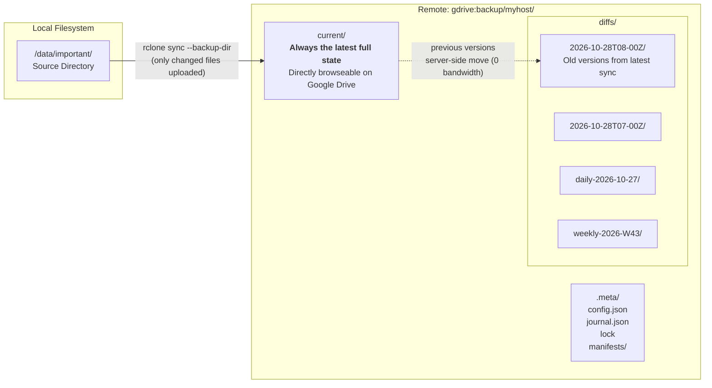
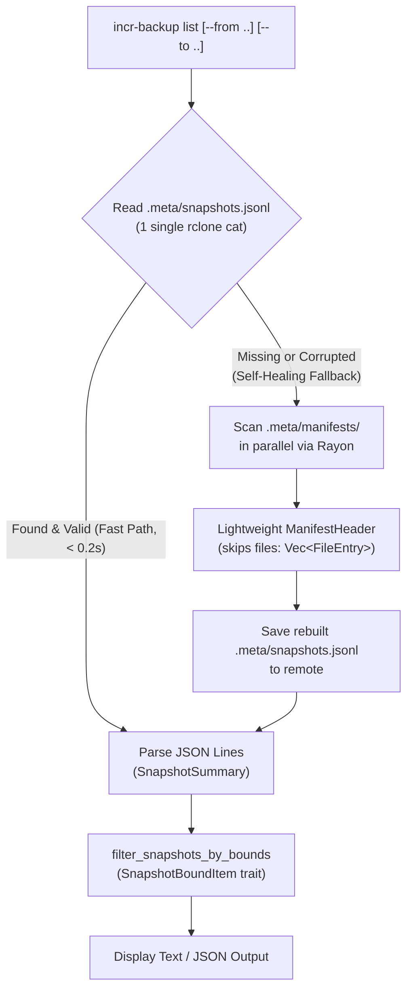
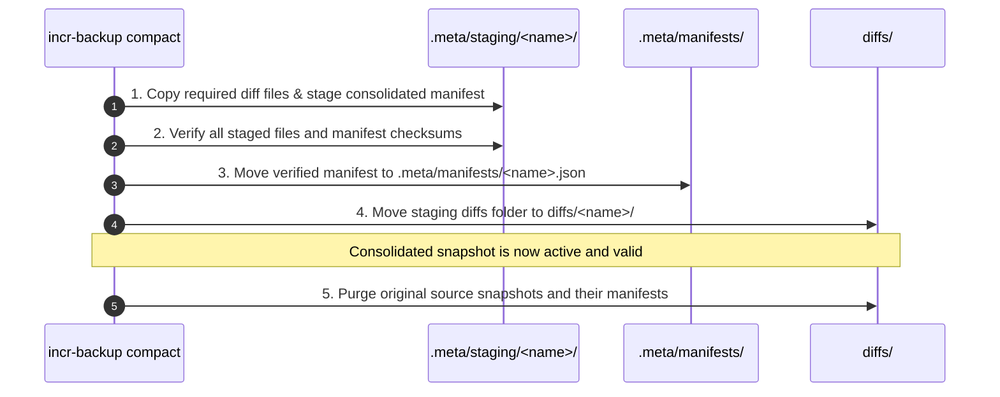
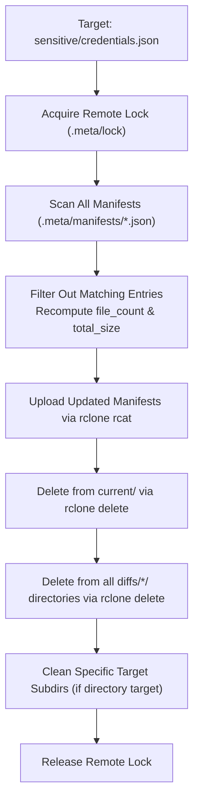
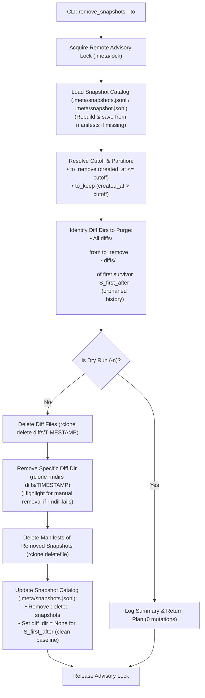

# incr-backup — Developer Guide & Walkthrough

> **Reverse-incremental snapshot backup orchestration tool for rclone cloud remotes (Google Drive, S3, etc.)**
> 
> *Written in Rust with zero-bandwidth server-side file movements, write-ahead journaling, and dynamic snapshot consolidation.*

---

## Table of Contents

1. [Architecture & How It Works](#1-architecture--how-it-works)
2. [Remote Directory Layout](#2-remote-directory-layout)
3. [Quick Start Tutorial](#3-quick-start-tutorial)
4. [Deep Dive: All Commands](#4-deep-dive-all-commands)
   - [init & init --adopt](#init--init---adopt)
   - [sync: Discrete Incremental Snapshots](#sync-discrete-incremental-snapshots)
     - [Supported Snapshot Names (Default vs. Custom)](#supported-snapshot-names-default-vs-custom)
     - [How Timestamps Are Identified for Custom Names](#how-timestamps-are-identified-for-custom-names)
   - [list & status: High-Performance Snapshot Discovery](#list--status)
     - [The Scale Problem: 1,000+ Snapshots](#the-scale-problem-1000-snapshots)
     - [Architectural Options & Trade-Off Analysis](#architectural-options--trade-off-analysis)
     - [Chosen Architecture: Hybrid Snapshot Catalog (Option 5)](#chosen-architecture-hybrid-snapshot-catalog-option-5)
     - [Summary of Implementation Changes](#summary-of-implementation-changes)
   - [diff between snapshots](#diff-between-snapshots)
   - [restore & location resolution](#restore--location-resolution)
   - [compact & Dynamic Snapshot Consolidation](#compact--dynamic-snapshot-consolidation)
   - [verify & space analysis](#verify--space-analysis)
   - [remove & snapshot history purging](#remove--snapshot-history-purging)
   - [remove_snapshots: Pruning Past Snapshots by Timestamp](#removesnapshots-pruning-past-snapshots-by-timestamp)
     - [Understanding CLI Output: "Deleted Snapshots" vs. "Purged Diff Directories"](#understanding-cli-output-deleted-snapshots-vs-purged-diff-directories)
   - [gc: Garbage Collection & Orphaned Diff Pruning](#gc-garbage-collection--orphaned-diff-pruning)
   - [config: synchronizing local & remote metadata](#config-synchronizing-local--remote-metadata)
5. [Crash Recovery: Write-Ahead Journal (WAL)](#5-crash-recovery-write-ahead-journal-wal)
6. [Advisory Locking & Concurrency](#6-advisory-locking--concurrency)
7. [Space Calculation & Deduplication Guarantee](#7-space-calculation--deduplication-guarantee)
8. [Automated Cron Setup](#8-automated-cron-setup)
9. [Rust Code Architecture for Java/Python Developers](#9-rust-code-architecture-for-javapython-developers)
10. [Testing Strategy & Remote Mocking](#10-testing-strategy--remote-mocking)
    - [Local Directory as Rclone Remote (Non-Live Tests)](#local-directory-as-rclone-remote-non-live-tests)
    - [Live Google Drive Tests vs. Non-Live Tests](#live-google-drive-tests-vs-non-live-tests)
    - [Dry-Run Subprocess Interception](#dry-run-subprocess-interception)
    - [In-Memory Storage Backends for Unit Testing](#in-memory-storage-backends-for-unit-testing)

---

## 1. Architecture & How It Works

Traditional cloud backup tools either upload full copies (wasting huge amounts of storage and bandwidth) or store files in opaque proprietary chunked formats (like Borg or Restic) that cannot be browsed directly on Google Drive.

`incr-backup` bridges this gap using a **reverse-incremental snapshot architecture**:



### The 4 Core Principles:

1. **`current/` is always a full mirror**: You can open Google Drive on your phone or web browser and browse/download files directly from `current/`. No special software is needed to access your latest files.
2. **Zero-bandwidth older versions**: When files change or are deleted locally, `rclone sync --backup-dir` performs a **server-side move** on Google Drive. Old versions are relocated from `current/` to a timestamped directory in `diffs/`. Zero bandwidth is used for the moved files.
3. **Point-in-Time Manifests**: Every snapshot has a JSON manifest in `.meta/manifests/` listing every single file that existed at that point in time, with relative path, size, MD5 hash, and modification time.
4. **Append-Only Snapshots & Decoupled Compaction**: Every sync creates an independent, immutable timestamped snapshot without slot limits or rotation overflows. Snapshots can be consolidated anytime via `compact` (e.g. hourly snapshots into a single daily snapshot) with zero data loss.

---

## 2. Remote Directory Layout

```text
gdrive:backup/myhost/
│
├── current/                             👈 BROWSE ON GOOGLE DRIVE (latest full mirror)
│   ├── documents/
│   │   ├── report.pdf
│   │   └── notes.txt
│   ├── photos/
│   │   └── vacation.jpg
│   └── code/
│       └── main.rs
│
├── diffs/                               👈 Old versions of changed/deleted files
│   ├── 2026-10-28T08-00Z/               👈 Changes from most recent sync (or +0530 in local mode)
│   │   └── documents/
│   │       └── report.pdf               (previous version before 8:00 AM edit)
│   ├── 2026-10-28T07-00Z/
│   ├── daily-2026-10-28/                👈 Compacted from intermediate runs
│   ├── weekly-2026-W43/                 👈 Compacted from 7 dailies
│   └── 2026-10-27T00-00Z/
│       └── photos/
│           └── deleted-photo.jpg        (deleted from source, safely preserved)
│
└── .meta/
    ├── config.json                      👈 Remote backup configuration & metadata
    ├── journal.json                     👈 Write-ahead log (only present during sync)
    ├── lock                             👈 Mutual exclusion lock (holds PID & host)
    ├── staging/                         👈 Safe staging during compaction (ephemeral)
    ├── snapshots.jsonl                  👈 Snapshot catalog index (O(1) high-speed listing)
    └── manifests/                       👈 Table of contents for each snapshot point
        ├── current.json                 (describes current state)
        ├── 2026-10-28T08-00Z.json       (describes snapshot at that time)
        ├── 2026-10-28T07-00Z.json
        ├── daily-2026-10-28.json        (manifest for compacted daily snapshot)
        └── weekly-2026-W43.json         (manifest for compacted weekly snapshot)
```

---

## 3. Quick Start Tutorial

### Step 1: Initialize the Backup

You can initialize using your `incr-backup.toml` configuration file:
```bash
incr-backup init
```

Or specify source, remote, and presets explicitly via command-line arguments:
```bash
# Basic initialization
incr-backup init --source /home/user/documents --remote gdrive:backups/myhost
```

Output:
```text
Initializing backup:
  Source:    /home/user/documents
  Remote:    gdrive:backups/myhost
Creating remote directory structure...
Scanning remote for initial manifest...
✓ Initialized gdrive:backups/myhost
  45,231 files indexed (200.0 GB)
  Ready for incremental backups.
```

### Step 2: Run a Sync

```bash
incr-backup sync
```

Output:
```text
Syncing /home/user/documents → gdrive:backups/myhost/current/
Generating manifest...
✓ Sync complete: 2026-10-28T08-00Z (45,235 files, 200.1 GB, 14.2s)
```

### Step 3: Check Status

```bash
incr-backup status
```

Output:
```text
Backup status for gdrive:backups/myhost

Source:     /home/user/documents
Remote:     gdrive:backups/myhost
Lock:       (none)
Current:    45,235 files, 200.1 GB
Diffs:      12 files, 4.2 MB
  2026-10-28T08-00Z: 12 files, 4.2 MB
```

### Step 4: Compare Snapshots

```bash
incr-backup diff 2026-10-28T08-00Z 2026-10-28T07-00Z
```

Output:
```text
Comparing: 2026-10-28T08-00Z ↔ 2026-10-28T07-00Z

Added (in 2026-10-28T08-00Z, not in 2026-10-28T07-00Z):
  + projects/notes.md                                  2.4 KB

Modified (same path, different content):
  ~ report.pdf                                         1.2 MB → 1.4 MB   md5: 8f4b1c → e29a7d

Summary: 1 added, 0 deleted, 1 modified
         New data: 2.4 KB | Removed: 0 B
```

### Step 5: Restore from Any Point in Time

```bash
# Restore specific file from an earlier sync to /tmp/restore
incr-backup restore 2026-10-28T07-00Z --to /tmp/restore --path report.pdf --verify
```

---

## 4. Deep Dive: All Commands

### `init` & `init --adopt`

`incr-backup init` sets up the remote backup directory layout (`current/`, `diffs/`, `.meta/`, and initial manifest).

> [!NOTE]
> `--source` and `--remote` are **optional** if defined in `incr-backup.toml` (or via `INCR_BACKUP_SOURCE` / `INCR_BACKUP_REMOTE` environment variables). If passed on the command line, `--source` and `--remote` override the configuration file.

`incr-backup init` inspects the remote state before taking action:

#### 1. Empty Remote:
Creates `current/`, `diffs/`, `.meta/`, and `.meta/manifests/` on the remote, then uploads `.meta/config.json` and initial manifest. If `--adopt` is provided on an empty remote, it is silently ignored.

#### 2. Already Initialized Remote (`current/`, `.meta/`, `diffs/` present):
Treated as a **pure NO-OP** (exit 0). Existing metadata is untouched and `--adopt` is ignored. If stray files/folders exist at root outside the backup triad, an informational notice is accompanied by a warning to manually delete or move them out.

#### 3. Non-Empty Remote Missing Structure (Without `--adopt`):
If the remote contains files/directories but lacks any of `current/`, `.meta/`, or `diffs/`, `incr-backup init` halts with an error (exit 1), prompting the user to re-run with `--adopt` to prevent leaving unmanaged files stranded at the remote root.

#### 4. Adopt Existing Remote (`--adopt`):
If you already ran plain `rclone sync` to a Google Drive directory (e.g. `gdrive:mybackup/` with 200 GB of files) or interrupted a previous adopt:
1. Emits `[WARN] Adopting existing remote contents into 'current/'...`
2. Creates `current/` directory if missing.
3. Performs an **instant server-side move** of all non-backup files into `current/` (`rclone move --exclude "current/**" --exclude ".meta/**" --exclude "diffs/**"`).
4. **Zero bytes of file data are uploaded**. 200 GB is organized in ~2-3 minutes.
5. Creates missing directories (`diffs/`, `.meta/`, `.meta/manifests/`).
6. Overwrites `.meta/config.json` with the new backup configuration.
7. Scans `current/` via `rclone lsjson` to build and upload the baseline manifest.

```bash
incr-backup init --source /data/important --remote gdrive:backup --adopt
```

---

### `sync`: Discrete Incremental Snapshots

Under **Dynamic Snapshot Consolidation**, every `sync` operation creates an append-only snapshot directory with its own manifest:

1. **No Slot Limits or Rotation Overflow**: You can sync as often as you like (e.g. every 10 minutes, hourly, or before risky software deployments). There are no slot limits or destructive rotation cascades during sync.
2. **Append-Only Immutability**: Previous snapshot manifests and diff directories are never modified or overwritten in-place during `sync`.

---

#### Supported Snapshot Names: Default vs. Custom

`incr-backup` supports two ways of naming snapshots:

##### 1. Automatic Timestamp Names (Default)
When `--name` is omitted, `sync` generates a filesystem-safe ISO-8601 timestamp name based on the configured timezone. All colons (`:`) are replaced with hyphens (`-`) for universal compatibility across Linux, macOS, Windows, Google Drive, S3, and FAT/NTFS filesystems:

- **`--timezone utc` (default)**: Appends `Z` (e.g., `2026-10-29T04-28Z`). Recommended for cloud backups and multi-machine environments.
- **`--timezone local` (or `--tz local`)**: Embeds the local numeric offset (e.g., `2026-10-29T09-58+0530`), matching your local wall-clock cron schedule.
- Can also be set globally in `incr-backup.toml` (`timezone = "local"` or `[snapshot] timezone = "local"`) or via the `INCR_BACKUP_TIMEZONE` environment variable.

```bash
# Default UTC timestamp snapshot (e.g. 2026-10-29T04-28Z)
incr-backup sync

# Local timezone timestamp snapshot (e.g. 2026-10-29T09-58+0530)
incr-backup sync --timezone local
```

##### 2. Custom Snapshot Names
You can assign an arbitrary, meaningful custom name to any snapshot using the `--name` option:

```bash
# Sync with custom name before a software deployment or OS upgrade
incr-backup sync --name pre-upgrade-v2
incr-backup sync --name release-v1.0

# Compaction requires a name for the consolidated snapshot
incr-backup compact --from 2026-10-28T00:00:00Z --to 2026-10-28T23:59:59Z --name daily-2026-10-28
```

##### Custom Name Validation Rules
To ensure safety on local and cloud filesystems, custom snapshot names must satisfy:
- Must not be empty.
- Must not contain path separators (`/` or `\`).
- Must not start with a dot (`.`).
- Must not overwrite or collide with an existing snapshot outside the compaction range.

---

#### How Timestamps Are Identified for Custom Names

If a snapshot has a custom name (e.g. `pre-upgrade-v2` or `daily-2026-10-28`), **how does the backup engine know when it was taken?**

1. **Manifest Metadata as the Source of Truth (`created_at`)**:
   Every snapshot — whether named automatically with a timestamp or given a custom name — has a companion JSON manifest uploaded to `.meta/manifests/<snapshot_name>.json`. Inside this manifest, the exact UTC creation timestamp is recorded in the `created_at` field:
   ```json
   {
     "snapshot_name": "pre-upgrade-v2",
     "created_at": "2026-10-29T04:28:15.123456789Z",
     "files": [
       { "path": "documents/report.pdf", "size": 1048576, "md5": "...", "mtime": "..." }
     ],
     "total_size": 1048576,
     "file_count": 1
   }
   ```
   *(For consolidated snapshots created by `compact`, the manifest inherits the `created_at` timestamp of the anchor snapshot — the newest snapshot within the compacted range).*

2. **Chronological Sorting & Range Operations**:
   The engine does **not** rely on parsing strings from snapshot directory names. When executing operations such as:
   - `list` (chronological display)
   - `restore` (identifying diff snapshots between the target point-in-time and `current/`)
   - `compact` (filtering snapshots within `--from` and `--to` timestamp ranges)
   - `verify` (validating snapshot sequence ordering)
   
   The engine calls `discover_all_snapshots`, reads each `.meta/manifests/<name>.json`, extracts `manifest.created_at`, and sorts all snapshots chronologically by that timestamp.

3. **Inspecting Timestamps of Custom Snapshots**:
   You can view the identified timestamp of any custom snapshot using:
   - **`incr-backup list`**:
     ```text
     Snapshots at gdrive:backups/myhost:

       pre-upgrade-v2 (42 files, 1.2 MB, 2026-10-29 09:58:15 +05:30)
       daily-2026-10-28 (150 files, 5.4 GB, 2026-10-28 20:00:00 +05:30)
     ```
   - **`incr-backup list --json`**:
     ```json
     {
       "name": "pre-upgrade-v2",
       "timestamp": "2026-10-29T04:28:15Z",
       "dir_name": "diffs/pre-upgrade-v2",
       "files": 42,
       "size": 1048576
     }
     ```
   - **Direct Remote Manifest Inspection**:
     ```bash
     rclone cat gdrive:backups/myhost/.meta/manifests/pre-upgrade-v2.json
     ```

---

### `list` & `status`

- `list`: Lists existing snapshot directories sorted chronologically, optionally filtered by timestamp or snapshot name bounds using `--from` / `--start` and `--to` / `--end`.
  ```bash
  incr-backup list
  incr-backup list --from 2026-10-01 --to 2026-10-15
  incr-backup list --json
  ```
- `status`: Displays remote configuration, lock status (including whether any lock is active or stale), and remote file/storage totals.

---

#### High-Performance Snapshot Discovery Architecture

##### The Scale Problem: 1,000+ Snapshots

In naive implementations, discovering snapshots requires scanning `.meta/manifests/` and checking each manifest. At smaller snapshot counts (10–20 snapshots), this appears fast. However, at scale (e.g. 1,000+ snapshots accumulating over months of hourly backups), this causes severe latency bottlenecks:

1. **$O(N)$ Serial Subprocesses & Round-Trips**:  
   Iterating over each manifest and running `rclone cat` sequentially for 1,000 snapshots means **1,000 independent process spawns and network round-trips**. Over cloud backends (Google Drive, S3, B2, SFTP), network latency and API throttling cause `list` to take **several minutes**; even on high-speed local NVMe SSDs, sequential subprocess calls take 30–60 seconds.
2. **Full File Tree Deserialization**:  
   Every `.meta/manifests/<name>.json` contains the entire file listing (`files: Vec<FileEntry>`). Deserializing 1,000 full manifests transfers hundreds of megabytes over the network and parses millions of JSON file records into heap memory, even though `list` only needs `name`, `created_at`, `diff_dir`, `file_count`, and `total_size`.
3. **Post-Fetch Filtering**:  
   When a user supplies `--from` and `--to` bounds, filtering happened in memory *after* reading every single manifest, wasting bandwidth and time downloading files that fall completely outside the query window.

##### Architectural Options & Trade-Off Analysis

To resolve this slowness, five candidate architectures were evaluated:

| Architectural Option | Remote Calls (1,000 snaps) | Latency | Bandwidth | Invalidation / Consistency | Backward Compatibility | Complexity |
| :--- | :--- | :--- | :--- | :--- | :--- | :--- |
| **Option 1: Centralized Append-Only Remote Index (`snapshots.jsonl`)** | **1 call** | **< 0.2s** | ~100 KB total | High consistency; needs write-path integration | High (requires fallback for existing repos) | Low–Medium |
| **Option 2: Local Client Metadata Cache (`~/.cache/...`)** | 1 call (after cold run) | < 0.4s | Local read | Cache invalidation needed on multi-machine setups | 100% Yes | Medium |
| **Option 3: Two-Phase Filtering (Name/Timestamp Pruning & Lazy Fetch)** | 1 + $K$ calls ($K$ = in-range snaps) | 0.5s – 2s | $K$ manifests | Unbounded `list` still slow; custom names need fetch | 100% Yes | Low |
| **Option 4: Batch Download + `ManifestHeader` Deserialization** | 1 batch sync | 1.5s – 3s | All manifests | Always downloads all manifests on cold runs | 100% Yes | Low |
| **Option 5: Hybrid Production Solution (Chosen)** | **1 call** | **< 0.2s** | **~100 KB** | Write-through with automatic self-healing fallback | **100% Yes** | **Medium** |

##### Chosen Architecture: Hybrid Snapshot Catalog (Option 5)

`incr-backup` adopted the **Hybrid Production Architecture**, combining the maximum speed of a remote index catalog with the resilience of self-healing fallback and selective JSON deserialization:



###### Key Design Components:

1. **Lightweight Remote Catalog (`.meta/snapshots.jsonl`)**:
   Stores summary headers in newline-delimited JSON (`.jsonl`). Each line represents a `SnapshotSummary`:
   ```json
   {"name":"2026-10-29T04-28Z","manifest_name":"2026-10-29T04-28Z.json","created_at":"2026-10-29T04:28:00Z","diff_dir":"2026-10-29T04-28Z","file_count":42,"total_size":1048576}
   ```
   For 1,000 snapshots, the entire catalog is ~120 KB and fetches in **one single round-trip**.

2. **Selective Deserialization via `ManifestHeader`**:
   [`manifest.rs`](src/manifest.rs) provides `ManifestHeader`, which deserializes only scalar summary fields (`snapshot_name`, `created_at`, `total_size`, `file_count`). Serde completely skips the `files` array, reducing CPU parsing overhead and memory allocations by ~98%.

3. **Multi-Threaded Rebuild via Rayon**:
   When rebuilding the catalog (cold repos or recovery), manifest parsing runs concurrently across available CPU cores using Rayon's `par_iter()`.

4. **Self-Healing Guarantees**:
   If `.meta/snapshots.jsonl` does not exist or becomes corrupted, the catalog transparently rebuilds itself from `.meta/manifests/` and saves the rebuilt index back to the remote, ensuring zero administrative intervention.

5. **Lifecycle Maintenance**:
   Mutating operations maintain catalog consistency:
   - `sync`: Appends/updates the new snapshot entry after manifest upload.
   - `compact`: Atomically deletes purged snapshot records and registers the consolidated snapshot entry.
   - `remove_snapshots`: Removes pruned snapshot entries and sets `diff_dir = None` for the newly promoted baseline snapshot.

6. **Bound Trait Abstraction (`SnapshotBoundItem`)**:
   [`changelog.rs`](src/changelog.rs) abstracts snapshot boundary resolution into `SnapshotBoundItem`, implemented for both `SnapshotSummary` and `SnapshotMeta`. Commands like `changelog` and `restore` read the lightweight catalog first, filter the target range, and only download full manifests for snapshots that are actually within the requested bounds.

###### Summary of Implementation Changes:

1. **Remote Snapshot Catalog (`.meta/snapshots.jsonl`)**:
   - Added [`crates/incr-backup/src/catalog.rs`](../crates/incr-backup/src/catalog.rs) with `SnapshotSummary` containing only metadata needed by listing and bounding: `name`, `manifest_name`, `created_at`, `diff_dir`, `file_count`, and `total_size`.
   - `list` reads `<remote>/.meta/snapshots.jsonl` in a single `rclone cat` network round-trip (< 100 KB total payload) rather than issuing sequential `cat` calls per snapshot.

2. **Self-Healing Fallback & Rebuild**:
   - If `.meta/snapshots.jsonl` is missing or corrupt (e.g. existing repositories), `catalog::load_snapshot_catalog` automatically falls back to `rebuild_snapshot_catalog`.
   - Uses a newly added `ManifestHeader` struct in [`crates/incr-backup/src/manifest.rs`](../crates/incr-backup/src/manifest.rs) that deserializes only the summary fields, skipping the large `files: Vec<FileEntry>` array (saving ~98% CPU/RAM).
   - Manifest reading during rebuild is parallelized across CPU cores via Rayon.
   - The rebuilt catalog is automatically saved to the remote for future runs.

3. **Lifecycle Synchronization**:
   - `sync` ([`crates/incr-backup/src/sync.rs`](../crates/incr-backup/src/sync.rs)): Appends or updates the newly created snapshot in the catalog after uploading the manifest.
   - `compact` ([`crates/incr-backup/src/compact.rs`](../crates/incr-backup/src/compact.rs)): Atomically replaces compacted source snapshot entries with the new consolidated snapshot entry.
   - `remove_snapshots` ([`crates/incr-backup/src/remove.rs`](../crates/incr-backup/src/remove.rs)): Removes pruned snapshot entries and sets `diff_dir = None` for the promoted baseline snapshot.

4. **Range Filtering & Trait Abstraction**:
   - Added `SnapshotBoundItem` trait to [`crates/incr-backup/src/changelog.rs`](../crates/incr-backup/src/changelog.rs) implemented for both `SnapshotSummary` and `SnapshotMeta`.
   - `filter_snapshots_by_bounds` works uniformly on lightweight summaries and full metadata.
   - `changelog` and `restore` now also load the lightweight catalog first and only fetch full manifests for snapshots within the requested range.

5. **Testing**:
   - Added unit tests for JSON lines catalog serialization and `ManifestHeader` selective parsing in `catalog.rs`.
   - Added integration test `test_list_catalog_fast_path_and_self_healing` in [`crates/incr-backup/tests/test_list.rs`](../crates/incr-backup/tests/test_list.rs).
   - All tests across the workspace pass.

---

### `diff` Between Snapshots

Compares any two snapshots entirely from their manifests. **Requires zero network file transfers** after the small JSON manifests are cached:

```bash
incr-backup diff 2026-10-28T08-00Z 2026-10-27T00-00Z
incr-backup diff snap2 snap1 --stat               # Count and byte totals only
incr-backup diff snap2 snap1 --json               # Machine-readable output
incr-backup diff snap2 snap1 --only-modified      # Filter for changed files only
```

---

### `restore` & Location Resolution

#### The Reverse-Incremental Challenge:
When file `report.pdf` changes at time $T_1$, its previous version $T_0$ is moved to `diffs/<snapshot_name>/`.
If another file `notes.txt` did not change between $T_0$ and now, it still lives in `current/notes.txt`.

#### The Resolution Algorithm:
To restore snapshot $S$:
1. Load target manifest `.meta/manifests/<snapshot>.json`.
2. Inspect all diff directories created between $S$ and now (ordered newest to oldest).
3. For each file in the target manifest:
   - If found in any diff directory between $S$ and now → download from `diffs/<snapshot_dir>/<file_path>`.
   - If not found in any diff directory → the file was never modified, so download directly from `current/<file_path>`.
4. Group resolved files by remote directory and download in batch with `rclone copy --files-from`.
5. Optionally verify MD5 checksums of all restored files against the manifest (`--verify`).

```bash
# Restore entire snapshot
incr-backup restore 2026-10-27T00-00Z --to /restore/full

# Restore consolidated snapshot
incr-backup restore daily-2026-10-28 --to /restore/day2 --verify

# Restore single file or subfolder
incr-backup restore 2026-10-27T00-00Z --to /restore/docs --path documents/taxes/

# Overwrite existing destination
incr-backup restore 2026-10-27T00-00Z --to /existing/dir --overwrite --verify
```

---

### `compact` & Dynamic Snapshot Consolidation

#### The Motivation:
In reverse-incremental backups, every `sync` creates an immutable, point-in-time snapshot. Over time, taking snapshots at arbitrary frequencies (e.g., hourly, every 15 minutes, or on code save) accumulates many intermediate diff directories.

The `compact` command combines multiple snapshots within a user-specified date range into a single named snapshot with **mathematically verifiable point-in-time recovery and zero data loss**.

```bash
incr-backup compact \
    --from 2026-10-28T00:00:00+05:30 \
    --to 2026-10-28T23:59:59+05:30 \
    --name daily-2026-10-28
```

#### Reverse-Incremental Diff Mechanics: Which Files to Keep vs. Discard?

Consider 3 files across 3 days:
* `report.docx`: Modified multiple times each day ($V_A \to V_B \to V_C \to V_D$).
* `budget.xlsx`: Modified once on Day 2 morning ($V_1 \to V_2$), then never again.
* `logo.png`: Never modified ($V_L$).

```text
Day 1 (Oct 27, 23:00): day-2026-10-27 (report=VA, budget=V1, logo=VL)
Day 2 (Oct 28):
  - 10:00: snap-10:00 (budget modified to V2 -> diffs/snap-10:00/ receives budget.xlsx V1)
  - 14:00: snap-14:00 (report modified to VB -> diffs/snap-14:00/ receives report.docx VA)
  - 20:00: snap-20:00 (report modified to VC -> diffs/snap-20:00/ receives report.docx VB)
Day 3 (Oct 29, 12:00): snap-12:00 (report modified to VD -> diffs/snap-12:00/ receives report.docx VC)
Now: current/ contains report.docx (VD), budget.xlsx (V2), logo.png (VL)
```

When compacting Day 2 `[snap-10:00, snap-14:00, snap-20:00]` into `daily-2026-10-28`:
1. **Manifest Selection**: The consolidated snapshot `daily-2026-10-28` adopts the **manifest of `snap-20:00`** (the anchor / newest snapshot in the range: $V_C, V_2, V_L$).
2. **Strict Earliest-Diff Rule**:
   - `budget.xlsx` ($V_1$ in `snap-10:00`): **KEEP**. Needed by Day 1 history! Moved to `diffs/daily-2026-10-28/budget.xlsx`.
   - `report.docx` ($V_A$ in `snap-14:00`): **KEEP**. Needed by Day 1 history! Moved to `diffs/daily-2026-10-28/report.docx`.
   - `report.docx` ($V_B$ in `snap-20:00`): **DISCARD**. Neither Day 1 ($V_A$) nor Day 2 anchor ($V_C$) needs intermediate edit $V_B$. Deleted to reclaim storage!
3. **Intra-Range Created/Deleted Files**: Any file created after Day 1 and deleted before Day 2 20:00 was purely scratch data; it is purged completely.
4. **Beginning of History**: If no snapshots exist prior to the range, all intra-range diffs are safely discarded because no older snapshots exist to reference them.

#### Two-Phase Safe Compaction Protocol:

To ensure network drops or crashes never cause data loss, source snapshots are purged **only after** the consolidated snapshot is fully verified and committed:



#### Timestamp Validation & Dry-Run Visibility:

* **Explicit Timezone Validation**: `--from` and `--to` require ISO-8601 timestamps whose offset strictly matches the configured backup timezone. If UTC is passed when `local` (+05:30) is configured, the CLI aborts with:
  `Error: Timezone offset in --from (+00:00) does not match configured backup timezone (+05:30).`
* **Dry-Run Modes**:
  ```bash
  # High-level summary:
  incr-backup compact --from <START> --to <END> --name <NAME> --dry-run --summary

  # Detailed file-by-file plan:
  incr-backup compact --from <START> --to <END> --name <NAME> --dry-run --full-list
  ```
* **Recursive Uniform Format**: A consolidated snapshot uses the exact same manifest format and directory layout as regular snapshots. You can compact hourly snapshots into daily snapshots, and later compact those daily snapshots into monthly snapshots.

---

### `verify` & Space Analysis

Verifies 12 integrity checks across 3 depth levels:

```bash
incr-backup verify                  # Quick structural checks (1-9)
incr-backup verify --space          # Quick checks + comprehensive remote space report
incr-backup verify --check-hashes   # Quick checks + remote MD5 verification (10-11)
incr-backup verify --deep           # Quick + hash + download & local md5 check (12)
```

Example output:
```text
Verifying backup at gdrive:backup/myhost/

  ✓ Config valid                           (.meta/config.json)
  ✓ Manifests exist                        (7 manifest files)
  ✓ Manifest: current                      (45,231 files, 200.0 GB)
  ✓ File count match                       (45,231 files)
  ✓ Total size match                       (200.0 GB)
  ✓ Snapshot ordering                      (timestamps checked)
  ✓ Manifest consistency                   (6 snapshots, 6 diff directories found)
  ✓ No stale lock                          (no lock file)
  ✓ Diff directories                       (6 diff directories found)
  ✓ Remote hashes match manifest           (45,231 files verified)

Space usage:
  current/     200.0 GB    (45,231 files)
  diffs/        18.4 GB    (5,260 files across 6 snapshots)
  .meta/        12.8 MB
  ─────────────────────────
  Total:       218.4 GB

All checks passed. ✓
```

---

### `remove` & Snapshot History Purging

#### The Challenge:
In a reverse-incremental backup system, simply deleting a file from your local source and running `sync` only moves that file into `diffs/<snapshot>/` to preserve historical versions. Older copies still remain preserved across snapshots!

If you accidentally backed up an API secret, private credentials, or need to comply with **GDPR "Right to be Forgotten"**, the data must be completely erased from **both the current mirror and every historical snapshot**.

#### The Purging Algorithm:
When you run `incr-backup remove <target>`:



1. **Locking**: Acquires advisory lock at `.meta/lock` to ensure no backup runs concurrently.
2. **Manifest Rewriting**:
   - Iterates through every manifest in `.meta/manifests/` (`current.json`, `<snapshot>.json`, etc.).
   - Removes matching `FileEntry` records (supports exact file paths, directory prefixes with/without slashes, and glob patterns).
   - Recalculates `file_count` and `total_size`.
   - Re-uploads updated manifests.
3. **Storage Purging**:
   - Executes pure file-level `rclone delete` with include filters across `current/` and all snapshot directories under `diffs/`.
   - Never runs broad `rmdirs --leave-root` across parent containers. If removing an entire named directory target (e.g. `sensitive/`), specifically attempts `rclone rmdirs` on that target subdirectory.
4. **Zero Residue & Verification Integrity**:
   - Because both manifests and storage are updated consistently, running `incr-backup verify` immediately afterwards passes all 12 integrity checks.

#### Examples:

```bash
# Purge a single leaked credential file from current and all historical snapshots
incr-backup remove sensitive/secrets.env

# Purge an entire directory tree across all snapshots
incr-backup remove documents/confidential/

# Purge matching glob patterns (e.g. all .key files)
incr-backup remove "*.key"

# Preview what would be removed without touching remote data
incr-backup remove heavy_build_dir/ --dry-run

# Output structured JSON result for automated pipelines
incr-backup remove customer_records/ --json
```

---

### `remove_snapshots`: Pruning Past Snapshots by Timestamp

#### Overview & Purpose:
While `remove` purges specific file paths across all historical snapshots, `remove_snapshots` (visible alias: `remove-snapshots`) drops **entire snapshot recovery points** from the remote repository up to and including a specified cutoff timestamp (`--to <timestamp>`):

```bash
incr-backup remove_snapshots --to <timestamp> [--force] [--json] [-n / --dry-run]
```

This is the reverse-incremental equivalent of retention policy pruning (e.g. `restic forget` or `git prune`), enabling automated or manual cleanup of older historical snapshots.

#### Supported Cutoff Formats (`--to`):
- **Exact Snapshot Name / Stem**: `--to 2026-10-28T08-00Z` or `--to snap-10:00` (resolves to that snapshot's exact creation time).
- **Date-Only**: `--to 2026-10-28` (treated as an end bound, matching up to `2026-10-28T23:59:59.999Z`).
- **ISO-8601 / RFC-3339**: `--to 2026-10-28T12:00:00+05:30` or `--to 2026-10-28T06:30:00Z`.

#### The Removal Pipeline:



1. **Advisory Lock Acquisition**: Acquires `.meta/lock` (with `--force` option to break stale locks if needed).
2. **Snapshot Discovery & Partitioning (Catalog-Accelerated)**: Reads snapshots from `.meta/snapshots.jsonl` (or fallback `.meta/snapshot.jsonl`) in a single network call. If the catalog does not exist or is corrupted, it automatically rebuilds the catalog from `.meta/manifests/` using fast header inspection, saves it to remote storage, and proceeds. Sorts snapshots chronologically and partitions them into:
   - `to_remove`: All snapshots whose `created_at <= cutoff_timestamp`.
   - `to_keep`: All snapshots whose `created_at > cutoff_timestamp`.
3. **Diff Directories Determination**:
   - Gathers all diff directories associated with `to_remove`.
   - If at least one snapshot is deleted and surviving snapshots exist, it **also purges the diff directory of the first surviving snapshot ($S_{first\_after}$)**.
4. **Targeted Delete & Directory Pruning**:
   - If `--dry-run` (`-n`) is active, logs all snapshots and diff directories that would be purged and exits without modifying remote storage.
   - Otherwise, executes `rclone delete` to remove files inside each target diff directory, attempts `rclone rmdirs remote:diffs/TIMESTAMP` specifically on that snapshot directory (highlighting for manual removal if it fails), and deletes the corresponding JSON manifests from `.meta/manifests/`. Never runs `rmdirs --leave-root` across parent `diffs/`.
5. **Snapshot Catalog Synchronization (`.meta/snapshots.jsonl`)**:
   - Immediately after deleting manifests, `remove_snapshots` calls `crate::catalog::remove_from_catalog(rclone, remote_base, &names_to_remove, &purged_diff_set)`.
   - **Removes Pruned Records**: Drops all deleted snapshots from the catalog index.
   - **Baseline Transition Guarantee**: Because $S_{first\_after}$ had its diff directory purged to become the new earliest baseline, the catalog sets its `diff_dir` to `None`, ensuring `snapshots.jsonl` accurately mirrors the remote filesystem.
   - **Instant Listing**: Subsequent `incr-backup list` commands immediately return the updated snapshot count in a single network round-trip (< 0.2s) without needing a catalog rebuild.

---

#### Evaluation: Does It Affect Restoring Snapshots Timestamped After `given_timestamp`?

**Verdict: No. Restoring any snapshot timestamped after `given_timestamp` is completely unaffected, retaining 100% data integrity and passing all `--verify` checksum checks.**

##### Why Surviving Snapshots Remain 100% Restorable:

1. **Discrete, Independent Manifests**:
   Every snapshot maintains its own discrete manifest in `.meta/manifests/<name>.json`. This manifest contains the full catalog of files, paths, sizes, and MD5 checksums at that snapshot point. Surviving snapshots do not inherit from or link to deleted manifests.
2. **Reverse-Incremental Data Flow**:
   - The remote mirror `current/` always holds the latest state of all files.
   - In reverse-incremental backups, when snapshot $S_k$ is created, only older files overwritten or deleted by $S_k$ are moved into `diffs/S_k`. That means diffs store versions looking **backwards** in time.
   - When restoring any surviving snapshot $S_{target} > T$:
     - If a file was modified in a later snapshot $S_{later} > S_{target}$, its $S_{target}$ version was preserved in `diffs/S_{later}`.
     - If a file was never modified after $S_{target}$, it resides in `current/`.
     - Location resolution **only searches forward** into diff directories created *after* $S_{target}$ (`snap.created_at > target_manifest.created_at`) and `current/`.
     - **It never reads or references diff directories or manifests created at or before $T$**.
3. **Baseline Transition for the First Surviving Snapshot ($S_{first\_after}$)**:
   - What was inside `diffs/S_{first_after}`? It stored files from the snapshot immediately preceding it ($S_{last\_deleted}$) that were changed when $S_{first\_after}$ was synced.
   - Because $S_{last\_deleted}$ and all prior snapshots are deleted, **no surviving snapshot ($S \ge S_{first\_after}$) ever needs those files**.
   - Purging `diffs/S_{first_after}` safely reclaims the disk/cloud space of the deleted history and cleanly promotes $S_{first\_after}$ to the new earliest baseline snapshot.

---

#### Understanding CLI Output: "Deleted Snapshots" vs. "Purged Diff Directories"

When executing `remove_snapshots`, you may observe output where a surviving snapshot's diff directory appears under `Purged diff directories:`:

```text
Removing snapshot(s) up to '2026-11-02T00-03+0530' at gdrive:backup/myhost:

Deleted snapshots:
  ✓ 2026-11-02T00-03+0530

Purged diff directories:
  ✓ diffs/2026-11-02T00-03+0530/
  ✓ diffs/2026-11-02T00-33+0530/

✓ Successfully deleted 1 snapshot(s). Remaining snapshots: 1.
```

##### 1. Why are diff directories purged during `remove_snapshots`?
In `incr-backup`, each snapshot consists of two distinct components on remote storage:
- **Metadata manifest** (`.meta/manifests/<name>.json`): The catalog of files, timestamps, and checksums representing that restorable snapshot.
- **Physical historical files** (`diffs/<name>/`): Old file versions moved out of `current/` by `rclone sync --backup-dir` whenever a sync modified or deleted existing files.

If `remove_snapshots` only deleted the `.meta/manifests/*.json` manifest files, all the historical files in `diffs/` would remain orphaned on remote storage forever, consuming storage quota and increasing cloud hosting costs. Purging diff directories ensures real cloud storage reclamation.

##### 2. Why was `diffs/2026-11-02T00-33+0530/` purged if snapshot `2026-11-02T00-33+0530` was NOT deleted?
**Crucial distinction:** The snapshot `2026-11-02T00-33+0530` itself was **NOT deleted**.
- Under `Deleted snapshots:`, only `2026-11-02T00-03+0530` is listed. Its manifest was deleted.
- Snapshot `2026-11-02T00-33+0530` retains its manifest (`.meta/manifests/2026-11-02T00-33+0530.json`), remains listed in `incr-backup list`, and is 100% restorable.
- Only its physical directory in `diffs/` (`diffs/2026-11-02T00-33+0530/`) was purged.

###### The Reverse-Incremental "Displaced Files" Principle:
In reverse-incremental backups with `rclone sync --backup-dir diffs/<snapshot>/`:
- `current/` always contains the latest, up-to-date state.
- When snapshot `S2 (00-33)` was created, `rclone sync` moved modified or deleted files out of `current/` into `diffs/00-33/`.
- **Those displaced files in `diffs/00-33/` actually represented the state of `S1 (00-03)` (the previous snapshot), NOT `S2 (00-33)`!**

| Snapshot | Created At | Files inside its `diffs/` folder belong to: |
| :--- | :--- | :--- |
| `S1 (00-03)` | Cutoff Target (Deleted) | Baseline snapshot (empty or pre-adopt files) |
| `S2 (00-33)` | First Survivor (Kept) | **`S1 (00-03)`** (files modified/deleted when S2 ran) |
| `S3 (01-03)` | Later Survivor (Kept) | **`S2 (00-33)`** (files modified/deleted when S3 ran) |

###### Baseline Promotion Mechanics:
1. When all snapshots prior to `00-33` were deleted, `00-33` became the **earliest remaining snapshot** (the new baseline).
2. The files in `diffs/00-33/` only existed to restore the deleted snapshot `00-03`.
3. To restore `00-33`, the restore algorithm checks `current/` and diff directories created **after** `00-33` (such as `diffs/01-03/`). It never checks its own `diffs/00-33/`.
4. Therefore, `diffs/00-33/` became obsolete orphaned history against deleted snapshots. Purging it reclaims space, and the snapshot catalog updates `diff_dir = None` for `00-33`, officially establishing it as a clean baseline.

---

#### Comparison: `remove_snapshots` vs. `compact`

| Feature / Trade-off | `remove_snapshots --to T` | `compact --from T1 --to T2` |
| :--- | :--- | :--- |
| **Primary Goal** | Drop historical snapshots prior to a cutoff (retention pruning). | Consolidate multiple fine-grained snapshots into one named snapshot (history preservation). |
| **Recovery Points** | **Permanently dropped**: All points at or before $T$ are gone forever. | **Consolidated**: Earlier points within range are rolled into a single anchor snapshot; pre-range restore remains intact. |
| **Pre-Range History** | Recovery prior to $T$ is impossible. | Preserved. Rollbacks before $T_1$ remain fully functional. |
| **Historical Diffs** | `diff` and `changelog` across the cutoff boundary are no longer possible (fails with `SnapshotNotFound`). | Preserves consolidated manifests for long-term diffing and changelog tracking. |
| **Bandwidth & Remote Operations** | Deletes remote files/directories directly via server-side delete. | Two-phase staged server-side copy, hash verification, commit, and delete. |

#### Examples:

```bash
# Delete all snapshots up to a specific ISO-8601 timestamp
incr-backup remove_snapshots --to 2026-10-28T12:00:00+05:30

# Delete all snapshots up to a named snapshot (inclusive)
incr-backup remove_snapshots --to snap2

# Delete all snapshots from a specific date (matches end of day)
incr-backup remove_snapshots --to 2026-10-27

# Dry-run preview of what would be removed
incr-backup remove_snapshots --to snap2 --dry-run

# Output structured JSON for cron scripts or automation
incr-backup remove_snapshots --to 2026-10-28 --json

# Break a stale lock if necessary
incr-backup remove_snapshots --to snap2 --force
```

---

### `gc`: Garbage Collection & Orphaned Diff Pruning

The `gc` command provides dedicated garbage collection for remote storage. Over time, physical directories in `diffs/` can become orphaned (e.g. if snapshot manifests were deleted before physical diff purging was introduced, if manifests were removed out-of-band, or if a sync/compaction was interrupted).

#### Architecture & Safety Rules:
1. **Authoritative Manifests**: Snapshot manifests in `.meta/manifests/*.json` serve as the single source of truth for active snapshots.
2. **Multi-Strategy Active Matching**: A diff directory is marked active (and retained) if it matches an active manifest's stem, `snapshot_name`, prefix (`stem__`), explicit `diff_dir` in `.meta/snapshots.jsonl`, or `restore::find_snapshot_diff_dir`.
3. **Orphan Identification & Pruning**: Any directory under `diffs/` without a corresponding active manifest is considered orphaned. Its files are deleted via `rclone.delete` and the specific directory is removed via `rclone rmdirs remote:diffs/TIMESTAMP` (highlighting for manual removal if rmdir fails). It never touches parent `diffs/` or active snapshots' empty diff directories.
4. **Catalog Self-Healing**: After purging orphaned diffs, any stale entries in `.meta/snapshots.jsonl` are automatically cleaned up.
5. **Dry-Run & JSON Support**: Fully supports `-n / --dry-run` to preview file counts and byte sizes that would be freed, as well as `--json` for automation.

#### Usage:
```bash
# Preview orphaned diff directories without modifying remote
incr-backup gc --orphaned-diffs --dry-run

# Purge orphaned diff directories and reclaim remote storage
incr-backup gc --orphaned-diffs

# Output structured JSON report
incr-backup gc --orphaned-diffs --json

# Break stale lock if another process died
incr-backup gc --orphaned-diffs --force
```

---

### `config`: Synchronizing Local & Remote Metadata

The remote stores a metadata record at `.meta/config.json`. Local configurations live in `incr-backup.toml` (or custom paths specified via `-c / --config`).

The `config` command allows bidirectional synchronization and diff inspection between local configuration and remote metadata:

#### 1. Inspect Differences (`config diff`):
Checks local source and exclude patterns against `.meta/config.json`:
```bash
incr-backup config diff
```
If values differ, it highlights the mismatch (e.g. `Exclude Patterns: (DIFFER)`).

#### 2. Push Local Config to Remote (`config push`):
Safely updates `.meta/config.json` while acquiring the advisory cloud lock:
```bash
# Push updated exclude patterns:
incr-backup config push

# Preview changes without modifying remote metadata:
incr-backup config push --dry-run

# Force-break a stale lock if held:
incr-backup config push --force
```

#### 3. Pull Remote Metadata to Local TOML (`config pull`):
Retrieves `.meta/config.json` and writes a formatted TOML configuration file:
```bash
# Pull into ./incr-backup.toml (safely aborts if file exists):
incr-backup config pull

# Specify custom destination:
incr-backup config pull --to ./my-host.toml

# Explicitly overwrite existing local file:
incr-backup config pull --overwrite
```

#### 4. Design Decision: Why No Silent Auto-Update?
`incr-backup` intentionally does **not** auto-update `.meta/config.json` on every sync:
- **Protects Transient Overrides**: Environment variables and one-off test config files (`-c test.toml`) remain transient without polluting shared remote metadata.
- **Multi-Host Safety**: Multiple machines backing up to the same namespace won't clobber each other's configurations.
- **Snapshot Safety**: Accidental local edits don't trigger silent, unintended remote changes.

---

## 5. Crash Recovery: Write-Ahead Journal (WAL)

Backup tools must be resilient against laptop sleep, network drops, and power cuts.

`incr-backup` maintains a Write-Ahead Log at `.meta/journal.json`:

```json
{
  "operation": "sync",
  "snapshot_name": "2026-10-28T08-00Z",
  "started_at": "2026-10-28T08:00:00Z",
  "backup_dir": "diffs/2026-10-28T08-00Z",
  "steps": [
    { "name": "acquire_lock",      "status": "Done" },
    { "name": "rclone_sync",       "status": "Running" },
    { "name": "generate_manifest", "status": "Pending" },
    { "name": "upload_manifest",   "status": "Pending" },
    { "name": "cleanup_journal",   "status": "Pending" },
    { "name": "release_lock",      "status": "Pending" }
  ]
}
```

### Crash Recovery Guarantee:
When `incr-backup` runs, it checks for an existing journal:
1. If found, it displays: `Found incomplete journal from 2026-10-28T08:00:00Z. Resuming interrupted operation.`
2. It detects the last step that was `Running` or `Pending`.
3. Every operation in the pipeline is **strictly idempotent**:
   - `rclone sync` skips files already uploaded (hash matching).
   - `rclone moveto` on already-moved directories is a no-op.
   - `rclone delete` on already-deleted files/directories is a no-op.
   - Manifest generation and upload overwrites cleanly.
4. Once all steps complete, `.meta/journal.json` is safely deleted.

---

## 6. Advisory Locking & Concurrency

To prevent two cron jobs or machines from running backups simultaneously:
- A lock file is created at `.meta/lock` containing:
  ```json
  {
    "holder": "work-laptop.local",
    "pid": 4821,
    "started_at": "2026-10-28T08:00:00Z",
    "timeout_minutes": 60
  }
  ```
- **Active Lock**: If another process attempts to sync while a fresh lock exists, it immediately exits with an informative error message.
- **Stale Lock Auto-Break**: If the lock is older than `timeout_minutes` (default: 60 min), `incr-backup` logs a warning that the previous holder crashed, automatically breaks the lock, and resumes.
- **Manual Override**: The `--force` flag breaks any existing lock unconditionally.

---

## 7. Space Calculation & Deduplication Guarantee

### Deduplication Guarantee:
Every unique version of a file exists in **exactly one location** on the remote:
- If unchanged → lives only in `current/`.
- If modified → old version lives only in `diffs/<snapshot>/`; latest version lives in `current/`.

### Worked Space Example (200 GB Source):
- Source size: 200 GB (45,000 files)
- Daily churn: ~2% = 4 GB/day (~0.5 GB/working hour)
- After 24 hourly syncs, you have 24 historical diffs.
- Running `incr-backup compact --from ... --to ... --name daily-YYYY-MM-DD` merges intermediate scratch revisions into a single snapshot, reclaiming superseded files while preserving earliest diffs with zero data loss.

---

## 8. Automated Cron Setup

Add these entries to your system `crontab` (`crontab -e`):

```cron
# Hourly sync: create an append-only snapshot every hour
0 * * * *   /usr/local/bin/incr-backup sync -c /etc/incr-backup/backup.toml >> /var/log/incr-backup.log 2>&1

# Daily Compaction: Every night at 2:30 AM, consolidate yesterday's hourly snapshots
30 2 * * *  /usr/local/bin/incr-backup compact --from "$(date -v-1d +\%Y-\%m-\%dT00:00:00\%z)" --to "$(date -v-1d +\%Y-\%m-\%dT23:59:59\%z)" --name "daily-$(date -v-1d +\%Y-\%m-\%d)" -c /etc/incr-backup/backup.toml >> /var/log/incr-backup.log 2>&1
```

> **Overlap Protection:** If the 2:30 AM compaction run is still operating when the 3:00 AM hourly sync fires, the 3:00 AM job detects the active advisory lock (`.meta/lock`), skips gracefully, and the 4:00 AM sync proceeds normally.

---

## 9. Rust Code Architecture for Java/Python Developers

For engineers familiar with Java/Python, this codebase follows these design mappings:

| Concept in Java / Python | Rust Implementation in `incr-backup` | Location |
|---|---|---|
| Checked Exceptions / `try-catch` | `Result<T, IncrError>` with `?` propagation | [`src/error.rs`](src/error.rs) |
| `@ConfigurationProperties` / `configparser` | TOML deserialization with `serde` | [`src/config.rs`](src/config.rs) |
| `ProcessBuilder` / `subprocess.Popen` | Subprocess command execution with stdout piping | [`src/rclone.rs`](src/rclone.rs) |
| `Files.walk().parallelStream().map(md5)` | `walkdir::WalkDir` + `rayon::par_iter()` parallel hashing | [`src/scanner.rs`](src/scanner.rs) |
| `FileLock` / `fcntl.flock` | JSON-based remote advisory lock manager | [`src/lock.rs`](src/lock.rs) |
| State Machine / Workflow Engine | Write-Ahead Journal with step status transitions | [`src/journal.rs`](src/journal.rs) |
| Dict diffing `set(a) ^ set(b)` | Manifest HashMap comparison (`diff_manifests`) | [`src/manifest.rs`](src/manifest.rs) |
| `git filter-repo` / History Purging | Purge files/dirs across manifests, current/, and diffs/ | [`src/remove.rs`](src/remove.rs) |
| `restic forget` / Snapshot Pruning | Prune historical snapshots on or before cutoff timestamp | [`src/remove.rs`](src/remove.rs) |
| Fast Index / Database Catalog | Append-only JSON Lines snapshot catalog (`snapshots.jsonl`) | [`src/catalog.rs`](src/catalog.rs) |
| Partial / Lazy Deserialization | `ManifestHeader` selective JSON parsing without file arrays | [`src/manifest.rs`](src/manifest.rs) |

---

## 10. Testing Strategy & Remote Mocking

How does `incr-backup` test cloud-native operations (like Google Drive server-side moves and directory manipulation) hermetically and fast without incurring API quotas or network latency?

### Local Directory as Rclone Remote (Non-Live Tests)

In non-live integration test suites (`test_restore.rs`, `test_sync.rs`, `test_compact.rs`, `test_journal_recovery.rs`, `test_init.rs`, `test_diff.rs`, `test_remove.rs`, `test_remove_snapshots.rs`, `test_locking.rs`, `test_verify.rs`):

1. **Sandboxed Local Workspaces (`TestEnv`)**:
   In `crates/incr-backup/tests/common/mod.rs`, the `TestEnv` struct provisions an isolated local workspace containing both a `source` and a `remote` directory using temporary directories:
   ```rust
   let workspace = TempWorkspace::new();
   let source_path = workspace.create_dir("source");
   let remote_path = workspace.create_dir("remote");
   ```
2. **Rclone's Built-in Local Backend**:
   When tests execute `incr-backup` CLI commands, they pass the local path to `--remote`:
   ```bash
   incr-backup sync --source /tmp/.../source --remote /tmp/.../remote
   ```
   Because `rclone` abstracts all storage targets under a common interface, any standard local directory path is automatically handled by `rclone`'s native **`local` backend**.
   All key rclone commands used by `incr-backup`—including `--backup-dir`, server-side moves, `sync`, `copy`, `rcat`, `cat`, `lsjson`, `lsf`, `lsd`, `delete`, and `rmdirs`—execute identically to a remote Google Drive destination, but run 100% locally with zero network calls and zero cloud credentials.
3. **Direct Local Filesystem Verification & Fault Injection**:
   Because the mocked "remote" is an actual directory on the local disk:
   - Tests can directly assert file system structures using Rust's `std::fs` (e.g., verifying `env.remote_path.join("current/doc.txt").exists()`).
   - Tests can simulate crashed processes, network cuts, or concurrent lock holders by directly writing interrupted `.meta/lock` or `.meta/journal.json` files before resuming.

### Live Google Drive Tests vs. Non-Live Tests

| Feature | Non-Live Tests (`TestEnv`) | Live Tests (`LiveGdriveTestEnv`) |
| :--- | :--- | :--- |
| **Test Suites** | `test_restore.rs`, `test_sync.rs`, `test_compact.rs`, `test_journal_recovery.rs`, etc. | `test_live_gdrive.rs` |
| **Target Remote** | Local directory path (e.g., `/tmp/.../remote`) | Actual Google Drive remote defined in `tests/incr-backup-testing.toml` |
| **Network & Quotas** | Zero network, hermetic, runs in milliseconds | Requires network and consumes Google Drive API requests |
| **Namespace Isolation**| Local `TempDir` automatically deleted on drop | Isolated timestamped cloud path (`live_{test_name}_{timestamp}_{pid}`) purged on `Drop` |
| **Execution Prerequisite** | None (always runs with `cargo test`) | Skipped automatically if `tests/incr-backup-testing.toml` is absent or remote probe fails |

### Dry-Run Subprocess Interception

For unit testing the `Rclone` subprocess wrapper in `crates/incr-backup/src/rclone.rs`:
- Tests configure `Rclone` with `dry_run = true`.
- The generic `SubprocessRunner` (`crates/common/src/subprocess.rs`) intercepts mutating commands (`sync`, `rcat`, `delete`, `rmdirs`) and short-circuits them to return `Ok(String::new())` without executing the `rclone` binary or mutating files on disk.

### In-Memory Storage Backends for Unit Testing

At the component level:
- Storage operations for advisory locking and write-ahead journaling implement traits (`LockBackend` in `common::lock` and `JournalBackend` in `common::journal`).
- While `RcloneLockBackend` and `RcloneJournalBackend` target rclone in production, unit tests use `InMemoryLockBackend`, `InMemoryJournalBackend`, and `test_commons::mocks::MockStorage`.
- These in-memory mocks manage state using thread-safe `Arc<Mutex<HashMap<String, String>>>` and provide failure-injection toggles (`set_fail_writes`, `set_fail_reads`) to test lock contention, recovery, and edge-case errors without spawning subprocesses.

