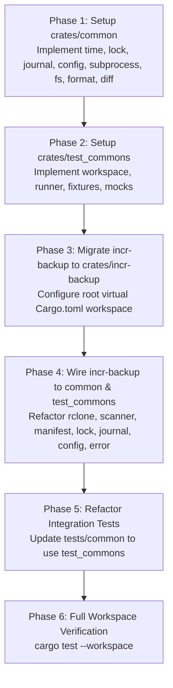

# Refactoring Implementation Plan: Multi-Crate Workspace Architecture

> File location: `docs/refactoring_implementation_plan.md`

## 1. Executive Summary & Architecture Directives

The workspace is structured into three dedicated crates:
1. **`crates/common`**: Project-agnostic, reusable production library (Time, Locking, WAL Journaling, Layered Config, Subprocess Runner, Filesystem Scanner/Hasher, Byte Size Formatter, Collection Diffing Engine).
2. **`crates/test_commons`**: Project-agnostic, reusable testing library containing test harnesses, infrastructure, sandboxes, mocks, and assertion utilities.
3. **`crates/incr-backup`**: Domain backup application and CLI crate depending on `common` and `test_commons`.

---

## 2. Workspace Layout & Crates Structure

```text
shabeer_incr_backup/
├── Cargo.toml                    <-- Virtual Workspace root
├── Cargo.lock
├── docs/                         <-- Design & architecture documentation
│   └── refactoring_implementation_plan.md
└── crates/
    ├── common/                   <-- REUSABLE PRODUCTION CRATE
    │   ├── Cargo.toml
    │   └── src/
    │       ├── lib.rs
    │       ├── time.rs           <-- Timezone, formatting, timestamps, clock
    │       ├── lock.rs           <-- LockBackend, GenericLockManager, LockInfo, InMemoryLockBackend
    │       ├── journal.rs        <-- JournalBackend, GenericJournalManager, StepStatus, JournalRecord
    │       ├── config.rs         <-- LayeredConfig trait, TOML loader, env var extractors
    │       ├── subprocess.rs     <-- Generic SubprocessRunner, stdin piping, dry-run, output capture
    │       ├── fs.rs             <-- Parallel directory scanning, chunked file hashing, glob matching
    │       ├── format.rs         <-- Human-readable byte formatting (format_size)
    │       └── diff.rs           <-- Generic set/collection difference engine (diff_collections)
    │
    ├── test_commons/             <-- REUSABLE TEST INFRASTRUCTURE CRATE
    │   ├── Cargo.toml
    │   └── src/
    │       ├── lib.rs
    │       ├── workspace.rs      <-- TempWorkspace filesystem sandbox & directory management
    │       ├── runner.rs         <-- Subprocess CLI runner, env sanitization, output assertions
    │       ├── fixtures.rs       <-- Sample directory trees, binary/text file generators
    │       └── mocks.rs          <-- MockLockBackend, MockJournalBackend
    │
    └── incr-backup/              <-- BACKUP-SPECIFIC APPLICATION CRATE
        ├── Cargo.toml            <-- depends on common, dev-depends on test_commons
        ├── src/
        │   ├── main.rs           <-- CLI entrypoint
        │   ├── lib.rs            <-- Library root & re-exports
        │   ├── rclone.rs         <-- Wraps common::subprocess::SubprocessRunner
        │   ├── scanner.rs        <-- Wraps common::fs::scan_directory with FileEntry mapping
        │   ├── manifest.rs       <-- Snapshot manifest CRUD, diffs via common::diff & format_size
        │   ├── lock.rs           <-- RcloneLockBackend + LockManager alias
        │   ├── journal.rs        <-- RcloneJournalBackend + Sync steps + JournalManager alias
        │   ├── config.rs         <-- IncrBackupConfig + RemoteConfig + CLI overrides
        │   ├── snapshot.rs       <-- Snapshot naming & parsing (uses common::time)
        │   ├── sync.rs           <-- Sync orchestration pipeline
        │   ├── restore.rs        <-- Restore logic & path resolution
        │   ├── compact.rs        <-- Snapshot compaction & rules
        │   ├── diff.rs           <-- CLI diff output formatting
        │   ├── verify.rs         <-- Integrity verification (12 checks)
        │   ├── remove.rs         <-- Purge files across snapshots
        │   └── error.rs          <-- IncrError (implements From for all common error enums)
        └── tests/                <-- Integration test suites (reusing test_commons)
            ├── common/           <-- TestEnv (wraps TempWorkspace) & LiveGdriveTestEnv
            ├── test_init.rs
            ├── test_sync.rs
            ├── test_journal_recovery.rs
            ├── test_locking.rs
            ├── test_restore.rs
            ├── test_compact.rs
            ├── test_remove.rs
            ├── test_diff.rs
            ├── test_verify.rs
            ├── test_config.rs
            ├── test_live_gdrive.rs
            └── incr-backup-testing.toml
```

---

## 3. Detailed Component Breakdown

### 3.1. Reusable Generic Modules (`crates/common`)

| Module | Core Types & Functions | Description | Isolated Error |
| :--- | :--- | :--- | :--- |
| **`time`** | `Timezone`, `format_datetime`, `format_rfc3339`, `format_log_timestamp`, `get/set_configured_timezone` | Timezone abstraction, RFC 3339 / display / log formatters, global timezone state | `TimeError` |
| **`lock`** | `trait LockBackend`, `GenericLockManager<B>`, `LockInfo`, `InMemoryLockBackend`, `is_stale`, `get_hostname` | Advisory lock coordination, staleness checking, force break, in-memory & remote backends | `LockError` |
| **`journal`** | `trait JournalBackend`, `GenericJournalManager<B, J>`, `StepStatus`, `JournalStep<T>`, `JournalRecord`, `SimpleJournal` | Write-Ahead Log state machine, crash recovery resume point detection, atomic updates | `JournalError` |
| **`config`** | `trait LayeredConfig`, `load_toml_file`, `find_config_file`, `read_env_var`, `read_env_var_parsed` | 3-tier cascade resolution (Base file $\to$ Env vars $\to$ CLI args $\to$ Validation) | `ConfigError` |
| **`subprocess`** | `SubprocessRunner`, `run`, `run_piped_stdin` | Configurable subprocess executor with argument handling, extra flags, dry-run simulation, and stdin streaming | `SubprocessError` |
| **`fs`** | `scan_directory`, `hash_file`, `glob_match`, `matches_any_exclude`, `GenericScanResult<T>` | Parallel directory scanning (rayon + walkdir), chunked MD5 hashing (64 KB buffer), wildcard matching | `ScanError` |
| **`format`** | `format_size(bytes: u64) -> String` | Converts byte count into human-readable strings (B, KB, MB, GB, TB) | — |
| **`diff`** | `diff_collections`, `DiffResult<T>` | Keyed set/collection difference engine (added, modified, deleted, unchanged) | — |

---

### 3.2. Reusable Test Infrastructure (`crates/test_commons`)

| Module | Core Types & Functions | Description |
| :--- | :--- | :--- |
| **`workspace`** | `TempWorkspace` | Isolated temporary directory sandbox with methods to create subdirs, write/read text and binary files, delete files, and check existence |
| **`runner`** | `CommandRunner` | Subprocess test runner with automatic environment sanitization (`RUSTC_WRAPPER=""`), flag passing, and assertion helpers |
| **`fixtures`** | `generate_test_files`, `TestFileTree` | Generates sample nested directory structures and dummy binary/text payloads |
| **`mocks`** | `MockLockBackend`, `MockJournalBackend` | Controllable mock storage backends for testing concurrency, lock contention, and WAL recovery without real I/O |

---

### 3.3. Backup Domain Layer (`crates/incr-backup`)

- **`rclone.rs`**: Wraps `common::subprocess::SubprocessRunner` to execute rclone commands (`sync`, `copy`, `rcat`, `cat`, `delete_file`, `delete`, `size`, `lsjson`, `lsd`, `lsf`, `mkdir`).
- **`scanner.rs`**: Delegates directory traversal and hashing to `common::fs::scan_directory`, mapping output into backup `FileEntry` records.
- **`manifest.rs`**: Delegates collection diffing to `common::diff::diff_collections` and byte formatting to `common::format::format_size`.
- **`lock.rs`**: Implements `LockBackend` as `RcloneLockBackend` targeting `{remote_base}/.meta/lock`, wrapping `GenericLockManager`.
- **`journal.rs`**: Implements `JournalBackend` as `RcloneJournalBackend` targeting `{remote_base}/.meta/journal.json`, defining the 6 standard sync steps.
- **`config.rs`**: Implements `LayeredConfig` for `Config`, handling `INCR_BACKUP_*` environment variables and CLI overrides.
- **`tests/common/`**: Re-exports `test_commons::TempWorkspace`, with `TestEnv` providing dedicated `source/` and `remote/` directories.

---

### 3.4. Error Composition

`incr-backup` remains decoupled from the internal error types of `common` by implementing `From`:
```rust
impl From<common::time::TimeError> for IncrError { ... }
impl From<common::lock::LockError> for IncrError { ... }
impl From<common::journal::JournalError> for IncrError { ... }
impl From<common::config::ConfigError> for IncrError { ... }
impl From<common::subprocess::SubprocessError> for IncrError { ... }
impl From<common::fs::ScanError> for IncrError { ... }
```

---

## 4. Phased Implementation Plan



### Safety & Backwards Compatibility Rules:
1. All 82 unit tests and 10 integration test suites run against the workspace build.
2. CLI commands, flags, and error messages remain 100% backwards-compatible.
3. Zero regressions.
