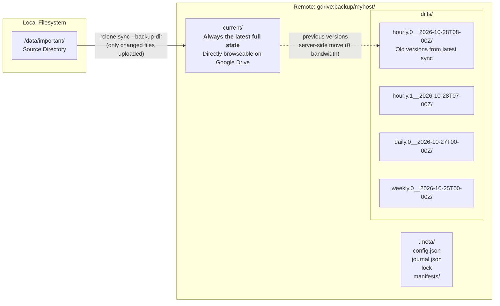
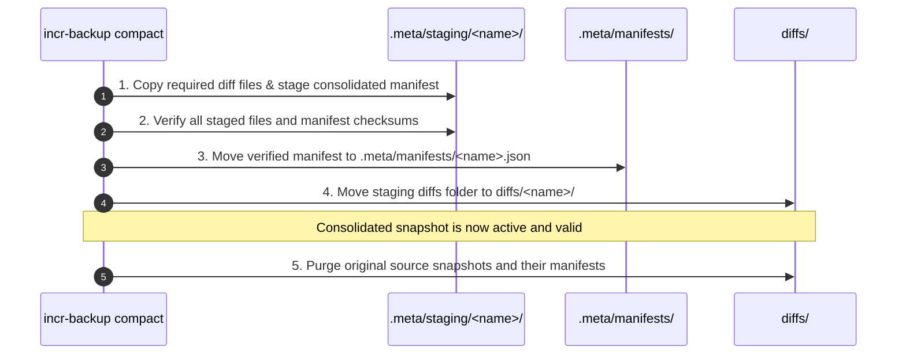
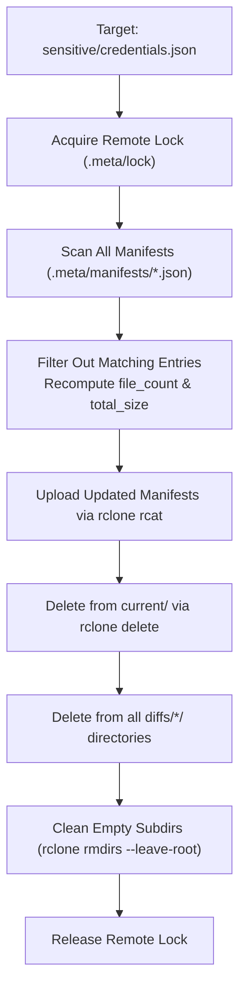

# incr-backup — Comprehensive Walkthrough

> **Reverse-incremental snapshot backup orchestration tool for rclone cloud remotes (Google Drive, S3, etc.)**
> 
> *Written in Rust with zero-bandwidth server-side file movements, write-ahead journaling, and rsnapshot-style retention.*

---

## Table of Contents

1. [Architecture & How It Works](#1-architecture--how-it-works)
2. [Remote Directory Layout](#2-remote-directory-layout)
3. [Quick Start Tutorial](#3-quick-start-tutorial)
4. [Deep Dive: All Commands](#4-deep-dive-all-commands)
   - [init & init --adopt](#init--init---adopt)
   - [sync & Cascade Rotation](#sync--cascade-rotation)
   - [list & status](#list--status)
   - [diff between snapshots](#diff-between-snapshots)
   - [restore & location resolution](#restore--location-resolution)
   - [compact & Dynamic Snapshot Consolidation](#compact--dynamic-snapshot-consolidation)
   - [verify & space analysis](#verify--space-analysis)
   - [remove & snapshot history purging](#remove--snapshot-history-purging)
   - [config: synchronizing local & remote metadata](#config-synchronizing-local--remote-metadata)
5. [Crash Recovery: Write-Ahead Journal (WAL)](#5-crash-recovery-write-ahead-journal-wal)
6. [Advisory Locking & Concurrency](#6-advisory-locking--concurrency)
7. [Space Calculation & Deduplication Guarantee](#7-space-calculation--deduplication-guarantee)
8. [Automated Cron Setup](#8-automated-cron-setup)
9. [Rust Code Architecture for Java/Python Developers](#9-rust-code-architecture-for-javapython-developers)

---

## 1. Architecture & How It Works

Traditional cloud backup tools either upload full copies (wasting huge amounts of storage and bandwidth) or store files in opaque proprietary chunked formats (like Borg or Restic) that cannot be browsed directly on Google Drive.

`incr-backup` bridges this gap using a **reverse-incremental snapshot architecture**:



### The 4 Core Principles:

1. **`current/` is always a full mirror**: You can open Google Drive on your phone or web browser and browse/download files directly from `current/`. No special software is needed to access your latest files.
2. **Zero-bandwidth older versions**: When files change or are deleted locally, `rclone sync --backup-dir` performs a **server-side move** on Google Drive. Old versions are relocated from `current/` to a timestamped directory in `diffs/`. Zero bandwidth is used for the moved files.
3. **Point-in-Time Manifests**: Every snapshot has a JSON manifest in `.meta/manifests/` listing every single file that existed at that point in time, with relative path, size, MD5 hash, and modification time.
4. **rsnapshot Rotation**: Snapshots rotate through tiers (`hourly` → `daily` → `weekly` → `monthly`). Promotions between tiers (e.g., `hourly.5` → `daily.0`) are instant server-side folder renames.

---

## 2. Remote Directory Layout

```text
gdrive:backup/myhost/
│
├── current/                             👈 BROWSE ON GOOGLE DRIVE (latest full mirror)
│   ├── documents/
│   │   ├── report.pdf
│   │   └── notes.txt
│   ├── photos/
│   │   └── vacation.jpg
│   └── code/
│       └── main.rs
│
├── diffs/                               👈 Old versions of changed/deleted files
│   ├── hourly.0__2026-10-28T08-00Z/     👈 Changes from most recent sync (or +0530 in local mode)
│   │   └── documents/
│   │       └── report.pdf               (previous version before 8:00 AM edit)
│   ├── hourly.1__2026-10-28T07-00Z/
│   ├── daily-2026-10-28/                👈 Compacted from Day 2 runs
│   ├── weekly-2026-W43/                 👈 Compacted from 7 dailies
│   ├── daily.0__2026-10-27T00-00Z/
│   │   └── photos/
│   │       └── deleted-photo.jpg        (deleted from source, safely preserved)
│   ├── weekly.0__2026-10-25T00-00Z/
│   └── monthly.0__2026-09-01T00-00Z/
│
└── .meta/
    ├── config.json                      👈 Remote backup configuration & retention
    ├── journal.json                     👈 Write-ahead log (only present during sync)
    ├── lock                             👈 Mutual exclusion lock (holds PID & host)
    ├── staging/                         👈 Safe staging during compaction (ephemeral)
    └── manifests/                       👈 Table of contents for each snapshot point
        ├── current.json                 (describes current state)
        ├── hourly.0.json                (describes snapshot at hourly.0)
        ├── hourly.1.json
        ├── daily-2026-10-28.json        (manifest for compacted daily snapshot)
        ├── weekly-2026-W43.json         (manifest for compacted weekly snapshot)
        └── daily.0.json
```

---

## 3. Quick Start Tutorial

### Step 1: Initialize the Backup

You can initialize using your `incr-backup.toml` configuration file:
```bash
incr-backup init
```

Or specify source, remote, and presets explicitly via command-line arguments:
```bash
# Basic initialization with default retention (6 hourly, 7 daily, 4 weekly, 6 monthly)
incr-backup init --source /home/user/documents --remote gdrive:backups/myhost
```

Output:
```text
Initializing backup:
  Source:    /home/user/documents
  Remote:    gdrive:backups/myhost
  Retention: 6h/7d/4w/6m (default preset)
Creating remote directory structure...
Scanning remote for initial manifest...
✓ Initialized gdrive:backups/myhost
  45,231 files indexed (200.0 GB)
  Ready for incremental backups.
```

### Step 2: Run an Hourly Sync

```bash
incr-backup sync --level hourly
```

Output:
```text
Syncing /home/user/documents → gdrive:backups/myhost/current/
Generating manifest...
✓ Sync complete: hourly.0__2026-10-28T08-00 (45,235 files, 200.1 GB, 14.2s)
```

### Step 3: Check Status

```bash
incr-backup status
```

Output:
```text
Backup status for gdrive:backups/myhost

Source:     /home/user/documents
Remote:     gdrive:backups/myhost
Retention:  6h / 7d / 4w / 6m (min interval: 30min)
Lock:       (none)
Current:    45,235 files, 200.1 GB
Diffs:      12 files, 4.2 MB
```

### Step 4: Compare Snapshots

```bash
incr-backup diff hourly.0 hourly.1
```

Output:
```text
Comparing: hourly.0 (2026-10-28T08:00) ↔ hourly.1 (2026-10-28T07:00)

Added (in hourly.0, not in hourly.1):
  + projects/notes.md                                  2.4 KB

Modified (same path, different content):
  ~ report.pdf                                         1.2 MB → 1.4 MB   md5: 8f4b1c → e29a7d

Summary: 1 added, 0 deleted, 1 modified
         New data: 2.4 KB | Removed: 0 B
```

### Step 5: Restore from Any Point in Time

```bash
# Restore specific file from 2 syncs ago to /tmp/restore
incr-backup restore hourly.1 --to /tmp/restore --path report.pdf --verify
```

---

## 4. Deep Dive: All Commands

### `init` & `init --adopt`

`incr-backup init` sets up the remote backup directory layout (`current/`, `diffs/`, `.meta/`, and initial manifest).

> [!NOTE]
> `--source` and `--remote` are **optional** if defined in `incr-backup.toml` (or via `INCR_BACKUP_SOURCE` / `INCR_BACKUP_REMOTE` environment variables). If passed on the command line, `--source` and `--remote` override the configuration file.

`incr-backup init` inspects the remote state before taking action:

#### 1. Empty Remote:
Creates `current/`, `diffs/`, `.meta/`, and `.meta/manifests/` on the remote, then uploads `.meta/config.json` and initial manifest. If `--adopt` is provided on an empty remote, it is silently ignored.

#### 2. Already Initialized Remote (`current/`, `.meta/`, `diffs/` present):
Treated as a **pure NO-OP** (exit 0). Existing metadata is untouched and `--adopt` is ignored. If stray files/folders exist at root outside the backup triad, an informational notice is accompanied by a warning to manually delete or move them out.

#### 3. Non-Empty Remote Missing Structure (Without `--adopt`):
If the remote contains files/directories but lacks any of `current/`, `.meta/`, or `diffs/`, `incr-backup init` halts with an error (exit 1), prompting the user to re-run with `--adopt` to prevent leaving unmanaged files stranded at the remote root.

#### 4. Adopt Existing Remote (`--adopt`):
If you already ran plain `rclone sync` to a Google Drive directory (e.g. `gdrive:mybackup/` with 200 GB of files) or interrupted a previous adopt:
1. Emits `[WARN] Adopting existing remote contents into 'current/'...`
2. Creates `current/` directory if missing.
3. Performs an **instant server-side move** of all non-backup files into `current/` (`rclone move --exclude "current/**" --exclude ".meta/**" --exclude "diffs/**"`).
4. **Zero bytes of file data are uploaded**. 200 GB is organized in ~2-3 minutes.
5. Creates missing directories (`diffs/`, `.meta/`, `.meta/manifests/`).
6. Overwrites `.meta/config.json` with the new backup configuration.
7. Scans `current/` via `rclone lsjson` to build and upload the baseline manifest.

```bash
incr-backup init --source /data/important --remote gdrive:backup --adopt
```

---

### `sync` & Cascade Rotation

The `sync` command takes a required `--level <hourly|daily|weekly|monthly>`.

#### 1. What Each Level Does:
- `--level hourly`: Rotates hourly snapshots (`hourly.4` → `hourly.5`, etc.), runs `rclone sync --backup-dir diffs/hourly.0__<timestamp>`, generates manifest, and uploads to `.meta/manifests/hourly.0.json`.
- `--level daily`: Rotates daily snapshots (`daily.5` → `daily.6`), promotes oldest hourly snapshot to `daily.0`, then executes the hourly sync.
- `--level weekly`: Rotates weekly snapshots, promotes oldest daily to `weekly.0`, cascades to daily rotation, then executes the hourly sync.
- `--level monthly`: Rotates monthlies, promotes oldest weekly to `monthly.0`, cascades down to hourly sync.

#### 2. Multiple Runs per Hour (Update-in-Place):
If `hourly.0` was created less than `min_interval_minutes` (default: 30 minutes) ago:
- The tool **skips rotation**.
- It re-syncs into the existing `hourly.0` backup directory.
- This prevents rapid manual syncs or tight cron schedules from filling up all 6 hourly slots.
- To override this and force a rotation regardless of timing:
  ```bash
  incr-backup sync --level hourly --force-rotate
  ```

#### 3. Timezone in Snapshot Names:
Every snapshot name embeds an unambiguous, filesystem-safe timestamp (no colons `:`). You can control whether timestamps reflect UTC or local time:
- **`--timezone utc` (default)**: Appends `Z` (e.g. `hourly.0__2026-10-29T04-28Z`). Canonical for cloud and multi-machine environments.
- **`--timezone local` (or `--tz local`)**: Embeds the local numeric offset (e.g. `hourly.0__2026-10-29T09-58+0530`), matching your local wall-clock cron schedule.
- Can also be set via `INCR_BACKUP_TIMEZONE` or `timezone = "local"` (or `[snapshot] timezone = "local"`) in `incr-backup.toml`.

```bash
# Sync with local timezone snapshot naming
incr-backup sync --level hourly --timezone local
```

---

### `list` & `status`

- `list`: Lists all existing snapshot directories sorted chronologically by tier.
  ```bash
  incr-backup list
  incr-backup list --json
  ```
- `status`: Displays remote configuration, lock status (including whether any lock is active or stale), and remote file/storage totals.

---

### `diff` Between Snapshots

Compares any two snapshots entirely from their manifests. **Requires zero network file transfers** after the small JSON manifests are cached:

```bash
incr-backup diff hourly.0 daily.0
incr-backup diff hourly.0 daily.0 --stat          # Count and byte totals only
incr-backup diff hourly.0 daily.0 --json          # Machine-readable output
incr-backup diff hourly.0 daily.0 --only-modified # Filter for changed files only
```

---

### `restore` & Location Resolution

#### The Reverse-Incremental Challenge:
When file `report.pdf` changes at time $T_1$, its previous version $T_0$ is moved to `diffs/hourly.0__.../`.
If another file `notes.txt` did not change between $T_0$ and now, it still lives in `current/notes.txt`.

#### The Resolution Algorithm:
To restore snapshot $S$:
1. Load target manifest `.meta/manifests/<snapshot>.json`.
2. Inspect all diff directories created between $S$ and now (ordered newest to oldest).
3. For each file in the target manifest:
   - If found in any diff directory between $S$ and now → download from `diffs/<snapshot_dir>/<file_path>`.
   - If not found in any diff directory → the file was never modified, so download directly from `current/<file_path>`.
4. Group resolved files by remote directory and download in batch with `rclone copy --files-from`.
5. Optionally verify MD5 checksums of all restored files against the manifest (`--verify`).

```bash
# Restore entire snapshot
incr-backup restore daily.0 --to /restore/full

# Restore consolidated snapshot
incr-backup restore daily-2026-10-28 --to /restore/day2 --verify

# Restore single file or subfolder
incr-backup restore daily.0 --to /restore/docs --path documents/taxes/

# Overwrite existing destination
incr-backup restore daily.0 --to /existing/dir --overwrite --verify
```

---

### `compact` & Dynamic Snapshot Consolidation

#### The Motivation:
In reverse-incremental backups, every `sync` creates an immutable, point-in-time snapshot. Over time, taking snapshots at arbitrary frequencies (e.g., hourly, every 15 minutes, or on code save) accumulates many intermediate diff directories.

The `compact` command combines multiple snapshots within a user-specified date range into a single named snapshot with **mathematically verifiable point-in-time recovery and zero data loss**.

```bash
incr-backup compact \
    --from 2026-10-28T00:00:00+05:30 \
    --to 2026-10-28T23:59:59+05:30 \
    --name daily-2026-10-28
```

#### Reverse-Incremental Diff Mechanics: Which Files to Keep vs. Discard?

Consider 3 files across 3 days:
* `report.docx`: Modified multiple times each day ($V_A \to V_B \to V_C \to V_D$).
* `budget.xlsx`: Modified once on Day 2 morning ($V_1 \to V_2$), then never again.
* `logo.png`: Never modified ($V_L$).

```text
Day 1 (Oct 27, 23:00): day-2026-10-27 (report=VA, budget=V1, logo=VL)
Day 2 (Oct 28):
  - 10:00: snap-10:00 (budget modified to V2 -> diffs/snap-10:00/ receives budget.xlsx V1)
  - 14:00: snap-14:00 (report modified to VB -> diffs/snap-14:00/ receives report.docx VA)
  - 20:00: snap-20:00 (report modified to VC -> diffs/snap-20:00/ receives report.docx VB)
Day 3 (Oct 29, 12:00): snap-12:00 (report modified to VD -> diffs/snap-12:00/ receives report.docx VC)
Now: current/ contains report.docx (VD), budget.xlsx (V2), logo.png (VL)
```

When compacting Day 2 `[snap-10:00, snap-14:00, snap-20:00]` into `daily-2026-10-28`:
1. **Manifest Selection**: The consolidated snapshot `daily-2026-10-28` adopts the **manifest of `snap-20:00`** (the anchor / newest snapshot in the range: $V_C, V_2, V_L$).
2. **Strict Earliest-Diff Rule**:
   - `budget.xlsx` ($V_1$ in `snap-10:00`): **KEEP**. Needed by Day 1 history! Moved to `diffs/daily-2026-10-28/budget.xlsx`.
   - `report.docx` ($V_A$ in `snap-14:00`): **KEEP**. Needed by Day 1 history! Moved to `diffs/daily-2026-10-28/report.docx`.
   - `report.docx` ($V_B$ in `snap-20:00`): **DISCARD**. Neither Day 1 ($V_A$) nor Day 2 anchor ($V_C$) needs intermediate edit $V_B$. Deleted to reclaim storage!
3. **Intra-Range Created/Deleted Files**: Any file created after Day 1 and deleted before Day 2 20:00 was purely scratch data; it is purged completely.
4. **Beginning of History**: If no snapshots exist prior to the range, all intra-range diffs are safely discarded because no older snapshots exist to reference them.

#### Two-Phase Safe Compaction Protocol:

To ensure network drops or crashes never cause data loss, source snapshots are purged **only after** the consolidated snapshot is fully verified and committed:



#### Timestamp Validation & Dry-Run Visibility:

* **Explicit Timezone Validation**: `--from` and `--to` require ISO-8601 timestamps whose offset strictly matches the configured backup timezone. If UTC is passed when `local` (+05:30) is configured, the CLI aborts with:
  `Error: Timezone offset in --from (+00:00) does not match configured backup timezone (+05:30).`
* **Dry-Run Modes**:
  ```bash
  # High-level summary:
  incr-backup compact --from <START> --to <END> --name <NAME> --dry-run --summary

  # Detailed file-by-file plan:
  incr-backup compact --from <START> --to <END> --name <NAME> --dry-run --full-list
  ```
* **Recursive Uniform Format**: A consolidated snapshot uses the exact same manifest format and directory layout as regular snapshots. You can compact hourly snapshots into daily snapshots, and later compact those daily snapshots into monthly snapshots.

---

### `verify` & Space Analysis

Verifies 12 integrity checks across 3 depth levels:

```bash
incr-backup verify                  # Quick structural checks (1-9)
incr-backup verify --space          # Quick checks + comprehensive remote space report
incr-backup verify --check-hashes   # Quick checks + remote MD5 verification (10-11)
incr-backup verify --deep           # Quick + hash + download & local md5 check (12)
```

Example output:
```text
Verifying backup at gdrive:backup/myhost/

  ✓ Config valid                           (.meta/config.json)
  ✓ Manifests exist                        (7 manifest files)
  ✓ Manifest: current                      (45,231 files, 200.0 GB)
  ✓ File count match                       (45,231 files)
  ✓ Total size match                       (200.0 GB)
  ✓ Snapshot ordering                      (timestamps checked)
  ✓ Retention compliance                   (h:6 d:7 w:4 m:6)
  ✓ No stale lock                          (no lock file)
  ✓ Diff directories                       (6 diff directories found)
  ✓ Remote hashes match manifest           (45,231 files verified)

Space usage:
  current/     200.0 GB    (45,231 files)
  diffs/        18.4 GB    (5,260 files across 6 snapshots)
  .meta/        12.8 MB
  ─────────────────────────
  Total:       218.4 GB

All checks passed. ✓
```

---

### `remove` & Snapshot History Purging

#### The Challenge:
In a reverse-incremental backup system, simply deleting a file from your local source and running `sync` only moves that file into `diffs/hourly.0__.../` to preserve historical versions. Older copies still remain preserved across snapshots!

If you accidentally backed up an API secret, private credentials, or need to comply with **GDPR "Right to be Forgotten"**, the data must be completely erased from **both the current mirror and every historical snapshot**.

#### The Purging Algorithm:
When you run `incr-backup remove <target>`:



1. **Locking**: Acquires advisory lock at `.meta/lock` to ensure no backup runs concurrently.
2. **Manifest Rewriting**:
   - Iterates through every manifest in `.meta/manifests/` (`current.json`, `hourly.*.json`, `daily.*.json`, etc.).
   - Removes matching `FileEntry` records (supports exact file paths, directory prefixes with/without slashes, and glob patterns).
   - Recalculates `file_count` and `total_size`.
   - Re-uploads updated manifests.
3. **Storage Purging**:
   - Executes `rclone delete` with include filters across `current/` and all snapshot directories under `diffs/`.
   - Runs `rclone rmdirs --leave-root` to clean up any empty directory structures left behind.
4. **Zero Residue & Verification Integrity**:
   - Because both manifests and storage are updated consistently, running `incr-backup verify` immediately afterwards passes all 12 integrity checks.

#### Examples:

```bash
# Purge a single leaked credential file from current and all historical snapshots
incr-backup remove sensitive/secrets.env

# Purge an entire directory tree across all snapshots
incr-backup remove documents/confidential/

# Purge matching glob patterns (e.g. all .key files)
incr-backup remove "*.key"

# Preview what would be removed without touching remote data
incr-backup remove heavy_build_dir/ --dry-run

# Output structured JSON result for automated pipelines
incr-backup remove customer_records/ --json
```

---

### `config`: Synchronizing Local & Remote Metadata

The remote stores a metadata record at `.meta/config.json`. Local configurations live in `incr-backup.toml` (or custom paths specified via `-c / --config`).

The `config` command allows bidirectional synchronization and diff inspection between local configuration and remote metadata:

#### 1. Inspect Differences (`config diff`):
Checks local source, retention, and exclude patterns against `.meta/config.json`:
```bash
incr-backup config diff
```
If values differ, it highlights the mismatch (e.g. `Retention: (DIFFER)`).

#### 2. Push Local Config to Remote (`config push`):
Safely updates `.meta/config.json` while acquiring the advisory cloud lock:
```bash
# Push updated retention or exclude patterns:
incr-backup config push

# Preview changes without modifying remote metadata:
incr-backup config push --dry-run

# Force-break a stale lock if held:
incr-backup config push --force
```

#### 3. Pull Remote Metadata to Local TOML (`config pull`):
Retrieves `.meta/config.json` and writes a formatted TOML configuration file:
```bash
# Pull into ./incr-backup.toml (safely aborts if file exists):
incr-backup config pull

# Specify custom destination:
incr-backup config pull --to ./my-host.toml

# Explicitly overwrite existing local file:
incr-backup config pull --overwrite
```

#### 4. Design Decision: Why No Silent Auto-Update?
`incr-backup` intentionally does **not** auto-update `.meta/config.json` on every sync:
- **Protects Transient Overrides**: Environment variables (e.g., `INCR_BACKUP_HOURLY=12`) and one-off test config files (`-c test.toml`) remain transient without polluting shared remote metadata.
- **Multi-Host Safety**: Multiple machines backing up to the same namespace won't clobber each other's configurations.
- **Snapshot Safety**: Accidental local edits don't trigger silent, irreversible remote snapshot prunes.
- **Visibility**: Both `status` and `verify` (Check 1) display warning notices (`⚠`) whenever local and remote policies diverge.

#### 5. When Does Cleanup Happen (Moving from Aggressive to Minimal)?
When shifting from `aggressive` (12h/14d/8w/12m) to `minimal` (3h/3d/2w/3m):
- Cleanup is **passive** and happens **only on rotation during `sync --level <tier>`**.
- Each tier cleans up its own oldest snapshot when its rotation limit is reached.
- Untouched tiers are unaffected until their specific sync level fires (e.g., `daily` snapshots are only pruned when `sync --level daily` runs).

---

## 5. Crash Recovery: Write-Ahead Journal (WAL)

Backup tools must be resilient against laptop sleep, network drops, and power cuts.

`incr-backup` maintains a Write-Ahead Log at `.meta/journal.json`:

```json
{
  "operation": "sync",
  "level": "hourly",
  "started_at": "2026-10-28T08:00:00Z",
  "backup_dir": "diffs/hourly.0__2026-10-28T08-00",
  "steps": [
    { "name": "acquire_lock",      "status": "Done" },
    { "name": "rotate_snapshots",  "status": "Done" },
    { "name": "delete_oldest",     "status": "Done" },
    { "name": "rclone_sync",       "status": "Running" },
    { "name": "generate_manifest", "status": "Pending" },
    { "name": "upload_manifest",   "status": "Pending" },
    { "name": "cleanup_journal",   "status": "Pending" },
    { "name": "release_lock",      "status": "Pending" }
  ]
}
```

### Crash Recovery Guarantee:
When `incr-backup` runs, it checks for an existing journal:
1. If found, it displays: `Found incomplete journal from 2026-10-28T08:00:00Z. Resuming interrupted operation.`
2. It detects the last step that was `Running` or `Pending`.
3. Every operation in the pipeline is **strictly idempotent**:
   - `rclone sync` skips files already uploaded (hash matching).
   - `rclone moveto` on already-moved directories is a no-op.
   - `rclone purge` on already-deleted directories is a no-op.
   - Manifest generation and upload overwrites cleanly.
4. Once all steps complete, `.meta/journal.json` is safely deleted.

---

## 6. Advisory Locking & Concurrency

To prevent two cron jobs or machines from running backups simultaneously:
- A lock file is created at `.meta/lock` containing:
  ```json
  {
    "holder": "work-laptop.local",
    "pid": 4821,
    "started_at": "2026-10-28T08:00:00Z",
    "timeout_minutes": 60
  }
  ```
- **Active Lock**: If another process attempts to sync while a fresh lock exists, it immediately exits with an informative error message.
- **Stale Lock Auto-Break**: If the lock is older than `timeout_minutes` (default: 60 min), `incr-backup` logs a warning that the previous holder crashed, automatically breaks the lock, and resumes.
- **Manual Override**: The `--force` flag breaks any existing lock unconditionally.

---

## 7. Space Calculation & Deduplication Guarantee

### Deduplication Guarantee:
Every unique version of a file exists in **exactly one location** on the remote:
- If unchanged → lives only in `current/`.
- If modified → old version lives only in `diffs/<snapshot>/`; latest version lives in `current/`.

### Worked Space Example (200 GB Source):
- Source size: 200 GB (45,000 files)
- Daily churn: ~2% = 4 GB/day (~0.5 GB/working hour)
- Retention: 6 hourly, 7 daily, 4 weekly, 6 monthly = 23 total slots

$$
\text{Total Remote Storage} = S_{\text{source}} + N_{\text{slots}} \times \overline{\Delta}_{\text{per sync}}
$$

$$
\text{Total Remote Storage} = 200\text{ GB} + 23 \times 0.5\text{ GB} = \mathbf{211.5\text{ GB}}\quad (\mathbf{1.06}\times\text{ of source})
$$

*(Compared to naive full copies which would require 23 × 200 GB = 4,600 GB.)*

---

## 8. Automated Cron Setup

Add these entries to your system `crontab` (`crontab -e`):

```cron
# Hourly sync (at minute 0 of every hour)
0 * * * *   /usr/local/bin/incr-backup sync --level hourly -c /etc/incr-backup/backup.toml >> /var/log/incr-backup.log 2>&1

# Daily sync (at 2:30 AM every day)
30 2 * * *  /usr/local/bin/incr-backup sync --level daily  -c /etc/incr-backup/backup.toml >> /var/log/incr-backup.log 2>&1

# Weekly sync (at 3:30 AM every Sunday)
30 3 * * 0  /usr/local/bin/incr-backup sync --level weekly -c /etc/incr-backup/backup.toml >> /var/log/incr-backup.log 2>&1

# Monthly sync (at 4:30 AM on the 1st of every month)
30 4 1 * *  /usr/local/bin/incr-backup sync --level monthly -c /etc/incr-backup/backup.toml >> /var/log/incr-backup.log 2>&1
```

> **Overlap Protection:** If the 2:30 AM daily run is still transferring large files when the 3:00 AM hourly fires, the 3:00 AM job detects the active lock, skips gracefully, and the 4:00 AM hourly proceeds normally.

---

## 9. Rust Code Architecture for Java/Python Developers

For engineers familiar with Java/Python, this codebase follows these design mappings:

| Concept in Java / Python | Rust Implementation in `incr-backup` | Location |
|---|---|---|
| Checked Exceptions / `try-catch` | `Result<T, IncrError>` with `?` propagation | [`src/error.rs`](src/error.rs) |
| `@ConfigurationProperties` / `configparser` | TOML deserialization with `serde` | [`src/config.rs`](src/config.rs) |
| `ProcessBuilder` / `subprocess.Popen` | Subprocess command execution with stdout piping | [`src/rclone.rs`](src/rclone.rs) |
| `Files.walk().parallelStream().map(md5)` | `walkdir::WalkDir` + `rayon::par_iter()` parallel hashing | [`src/scanner.rs`](src/scanner.rs) |
| `FileLock` / `fcntl.flock` | JSON-based remote advisory lock manager | [`src/lock.rs`](src/lock.rs) |
| State Machine / Workflow Engine | Write-Ahead Journal with step status transitions | [`src/journal.rs`](src/journal.rs) |
| Dict diffing `set(a) ^ set(b)` | Manifest HashMap comparison (`diff_manifests`) | [`src/manifest.rs`](src/manifest.rs) |
| `git filter-repo` / History Purging | Purge files/dirs across manifests, current/, and diffs/ | [`src/remove.rs`](src/remove.rs) |

